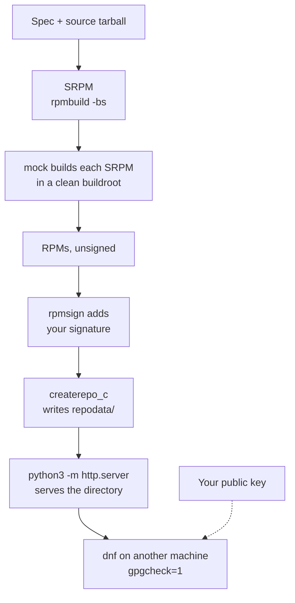
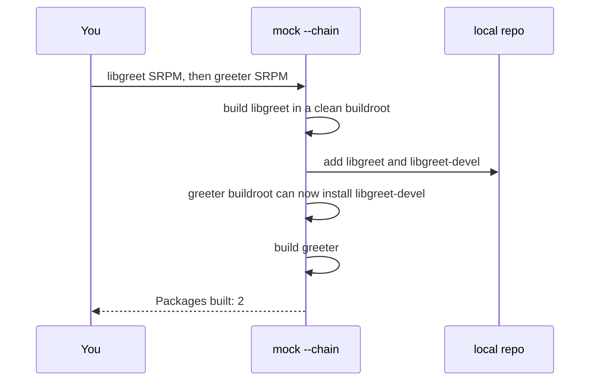
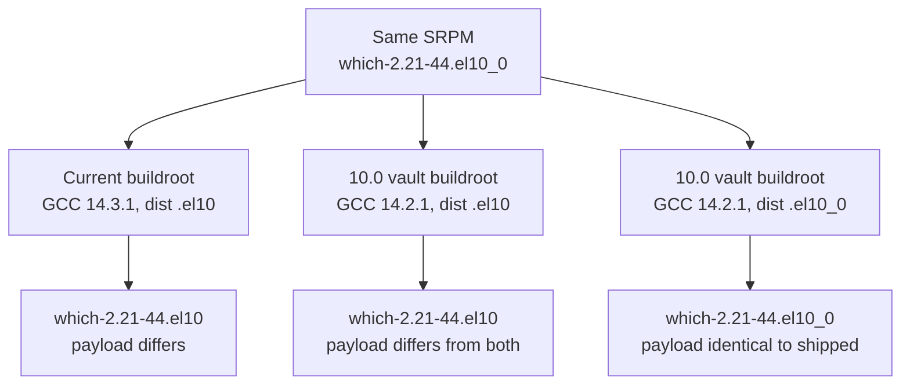

# 49 · Build your own packages and repository

<ul class="module-meta">
  <li>⏱ ~3 hours</li>
  <li>4 labs</li>
  <li>Builds on: 22 · Building RPM packages, 41 · Anatomy of a package, 47 · Trust I: signatures and keys</li>
  <li>Environment: Tier B</li>
  <li>Verified: Rocky 10.2, 2026-11-06</li>
</ul>

Rebuild Rocky's `which` source package on a Rocky 10.2 machine and you get `which-2.21-44.el10`. Rocky ships `which-2.21-44.el10_0`. Same source, a different name, and a binary 8 bytes smaller (x86_64, 2026-11-06). Point mock at Rocky's 10.0 vault, add one `--define`, and the payload digest equals the shipped one. Leave the define out and it does not.

Rocky does its building and signing at the Build and Sign stages, with a build system and a key you cannot touch. Here is yours, small: two packages where one needs the other, a signing key you generate in two seconds, a repository on a plain web server, and a second machine that refuses to trust you until you hand it your key. Then you use the loop to prove one thing about Rocky's own `which`.

<div class="pipeline-strip" data-here="build sign publish" role="group" aria-label="Rocky build pipeline, six stages" markdown>

1. Source
2. Build
3. Sign
4. Compose
5. Publish
6. Install

</div>

*You are here: Build, Sign and Publish (stages 2, 3 and 5 of 6), done by you at small scale. Before: Source. After: Compose is not part of this module (see [module 46](46-pipeline-compose-to-your-server.md)).*

!!! abstract "What you'll learn"
    - Set up mock on Rocky 10 (EPEL, the `mock` group, bootstrap, nspawn or chroot) and avoid the container volume pitfall.
    - Build two packages in order, where the second has a `BuildRequires` on the first, with a local repository between the builds.
    - Generate a signing key, sign RPMs with `rpmsign` and `%_gpg_name`, and read the five lines of `rpm -Kv`.
    - Turn a directory of RPMs into a repository with `createrepo_c` and serve it with `python3 -m http.server`.
    - Predict what a consumer with `gpgcheck=1` does when the key is missing, when `gpgkey=` is set, and when nobody is at the keyboard.
    - Rebuild Rocky's `which` so the payload digest matches the shipped package, and explain why it needs both a pinned buildroot and a dist define.
    - Explain the NVR collapse: why a rebuild can carry the wrong name and what that does to version comparison.

## The big picture

This module adds what [module 22](22-building-rpms.md) did not show: a build that depends on another build, what a consumer does with your signature, and a rebuild you can check against Rocky's own bytes.

!!! note "Remember from 22"
    A spec plus a source tarball becomes an SRPM, and `mock --rebuild` turns it into RPMs inside a clean buildroot. `rpmsign --addsign` adds a signature, `createrepo_c` writes the metadata, and a client with `gpgcheck=1` verifies. Module 22 also warned that a rebuilt package gets a different NVR. Here you measure by how much.

### Your own pipeline in one sentence

> **A repository is metadata plus signed files, and trust lives in the consumer's keyring.**

The repository is a directory. The signature is a few bytes inside each RPM. Whether a machine believes the signature depends only on which public keys it has imported. Think of a sealed parcel on a shelf with a catalogue: the seal proves who sealed it, and the person collecting decides whose seals they accept. The analogy breaks at the catalogue, which can be stale or forged too, and in your repository (as in Rocky's stock repo files) nothing checks it.



The diagram reads top to bottom. Sources become an SRPM, mock builds RPMs from it, you sign them, `createrepo_c` describes them, a web server hands them out, and the consumer's dnf checks each one. The dotted line is the part people forget: your public key reaches the consumer by a separate route, and that route is the whole trust story.

Rocky has the same shape with different machinery. The table says which of your steps matches which of Rocky's, and what you can check from outside.

| Your step | Rocky's version | What you can check publicly |
|-----------|-----------------|-----------------------------|
| `mock` in a clean buildroot | Builders run mock under Koji ([module 50](50-build-your-own-koji.md)) | `BUILDHOST` and `PACKAGER` in any RPM header |
| `rpmsign` with your key | A signing step after the build, with a Rocky key | `%{RSAHEADER:pgpsig}`: key ID and signing time |
| `createrepo_c` and a web server | Repositories produced by composes, copied to mirrors | `repodata/repomd.xml` on any mirror |
| Consumer with `gpgkey=` | `rocky-gpg-keys` ships Rocky's public key | `rpm -qa 'gpg-pubkey*'` |

How Rocky signs inside its build system is not public. The result is: you can read the key ID and the signing time from the package.

### The few things that solve most problems

| Situation | What to do | Where this module teaches it |
|-----------|-----------|------------------------------|
| mock says `No matching package to install: 'myorg-libgreet-devel'` for your own package | Build the dependency first and build both with `mock --chain --localrepo` | Two packages, one dependency |
| `rpm -Kv` ends in `NOKEY` | The signature is there, the key is not in rpm's keyring: check the fingerprint, then import | The core skill |
| dnf says `Public key for ... is not installed` and `GPG check FAILED` | Give the repo a `gpgkey=` line; never set `gpgcheck=0` | A consumer that checks |
| dnf stops at `Is this ok [y/N]` in a script | Add `-y`, and read the fingerprint it prints | A consumer that checks |
| Your rebuild has a different NVR from the shipped package | Pin the buildroot and pass `--define 'dist .el10_0'` | Proving the loop works |
| `/dev/null: Permission denied` while building in a container | Do not put `/var/lib/mock` on a podman named volume | Setting up mock |

To pick one, read the first words of the error. A message from mock about a missing package is a build order problem. A message from dnf or rpm about a key is a trust problem. A message about a different name or size after a rebuild is an input problem.

### Words you'll see

| Word | Plain meaning |
|------|---------------|
| **buildroot** | The clean directory tree mock builds in, holding only the declared build dependencies |
| **chain build** | `mock --chain`: build several SRPMs in the order given, each one able to use the earlier results |
| **local repo** | A directory mock keeps up to date with each build's output, so the next buildroot can install from it |
| **repodata** | The directory of metadata files (`repomd.xml` and friends) that makes a folder of RPMs a repository |
| **signing key** | A GPG key pair: the private half signs, the public half lets others check |
| **keyring** | The set of public keys rpm trusts, stored as `gpg-pubkey` entries in the rpm database |
| **NOKEY** | A signature that has not been checked because its key is not in the keyring |
| **NVR** | Name, version, release: `which-2.21-44.el10_0` |
| **dist tag** | The `.el10_0` part of the release, set by the `%dist` macro |
| **PAYLOADDIGEST** | A digest of the files inside the RPM, the right test for "same content" |

## The core skill: reading a package's verdict

Before you build anything, learn to read what a machine says about a package. `rpm -Kv` prints one line about the signature and four about digests. dnf wraps the same facts in its own words.

```console
$ rpm -Kv which-2.21-44.el10_0.x86_64.rpm
which-2.21-44.el10_0.x86_64.rpm:
    Header V4 RSA/SHA256 Signature, key ID 6fedfc85: OK
    Header SHA256 digest: OK
    Header SHA1 digest: OK
    Payload SHA256 digest: OK
    MD5 digest: OK
```

Rocky 10.2 x86_64, 2026-11-06. This is the shipped `which` on a machine that has Rocky's key. Five lines, all `OK`.

Use this template on any package:

1. **Is there a signature line?** No line means the package is unsigned. A line means someone signed it.
2. **How does the signature line end?** `OK`: the signature verifies against a key in this machine's keyring. `NOKEY`: the signature exists, but this machine has no key to check it with. `BAD`: the check ran and failed, which is what a changed header looks like ([module 47](47-trust-signatures-and-keys.md) tampers with a package to show it).
3. **Do the four digest lines say OK?** They prove the bytes are intact. They do not prove who made them.
4. **Which key ID is it?** `rpm -Kv` shows the short form (`6fedfc85`). The long form (`5b106c736fedfc85`) shows in `%{RSAHEADER:pgpsig}`. Same key, two lengths.

Two packages, two verdicts. Predict each before you open the answer.

```console
$ rpm -Kv myorg-greeter-1.0-1.el10.x86_64.rpm
myorg-greeter-1.0-1.el10.x86_64.rpm:
    Header SHA256 digest: OK
    Header SHA1 digest: OK
    Payload SHA256 digest: OK
    MD5 digest: OK
```

Rocky 10.2 x86_64, 2026-11-06. A package built in this module, before signing.

??? success "Answer: unsigned, intact"
    There is no signature line, so nobody has signed it. The digests are fine, so the file is intact. `rpm -K` on it prints `digests OK`, with no word `signatures`, which is the short way to see the same thing.

```console
$ rpm -Kv myorg-greeter-1.0-1.el10.x86_64.rpm
myorg-greeter-1.0-1.el10.x86_64.rpm:
    Header V4 RSA/SHA256 Signature, key ID 80045a5b: NOKEY
    Header SHA256 digest: OK
    Header SHA1 digest: OK
    Payload SHA256 digest: OK
    MD5 digest: OK
```

Rocky 10.2 x86_64, 2026-11-06. The same package right after `rpmsign --addsign`, on the machine that signed it.

??? success "Answer: signed, but this machine does not know the key"
    NOKEY is not a failure of the package. It says "I cannot check this". The key lives in a GPG keyring on the build host, and rpm's own keyring is a different place, so even the machine that signed the package shows NOKEY until you import the public key into rpm.

<div class="quiz" data-answer="2" markdown>

`rpm -Kv` shows `Header V4 RSA/SHA256 Signature, key ID 80045a5b: NOKEY` and four `OK` digest lines. What do you know?

- The package was tampered with
- The package is signed and intact, and this machine has no key to check the signature
- The package is unsigned

Right: NOKEY means a signature is present and unchecked. The digests prove the bytes are intact. Nothing here says the signer is who you think.

</div>

## Setting up mock on Rocky 10

Mock is not in Rocky's own repositories on Rocky 10.2. It comes from **EPEL** (Extra Packages for Enterprise Linux), so you enable that first. These are the steps the labs use.

```console
$ sudo dnf install -y epel-release
$ sudo dnf config-manager --set-enabled crb
$ sudo dnf install -y mock rpmdevtools rpm-build rpm-sign createrepo_c gnupg2 podman
$ sudo usermod -aG mock $USER
```

Then log out and back in, so your session picks up the `mock` group (`su - builder` also gives a fresh session if you made a dedicated user).

<!-- ev: FACTBASE-A O21; labs/final 02-packages README | observed | Rocky 10.2 x86_64 VM, 2026-11-06 -->
!!! freshness "As of 2026-11-06 on Rocky 10.2"
    mock 6.9-1.el10_2, createrepo_c 1.1.2-4.el10 and rpm-sign 4.19.1.1-23.el10 were the versions on the test machine, with mock from EPEL. Mock moves with EPEL updates. The mechanism (a clean buildroot per build, configs in `/etc/mock`) is stable.

    **Re-check:** `rpm -q mock createrepo_c rpm-sign`

Mock reads one config per target, and Rocky ships them.

```console
$ ls /etc/mock/rocky-*.cfg | xargs -n1 basename
rocky-10-aarch64.cfg rocky-10-ppc64le.cfg rocky-10-riscv64.cfg rocky-10-s390x.cfg rocky-10-x86_64.cfg rocky-8-aarch64.cfg rocky-8-x86_64.cfg rocky-9-aarch64.cfg rocky-9-ppc64le.cfg rocky-9-s390x.cfg rocky-9-x86_64.cfg
```

Rocky 10.2 x86_64, mock 6.9, 2026-11-06. These configs build against Rocky's published repositories. They are not Rocky's internal build tags, so a mock build is a reconstruction of Rocky's environment, not a copy of it.

### Bootstrap, and nspawn or chroot

Mock 6.9 turns **bootstrap** on by default. Each config gets two chroots: a small bootstrap one that runs dnf, and the real buildroot it creates. The Rocky 10 template names the container image for it.

```console
$ grep bootstrap_image /etc/mock/templates/rocky-10.tpl
config_opts['bootstrap_image'] = 'quay.io/rockylinux/rockylinux:10'
```

Rocky 10.2 x86_64, 2026-11-06. On the VM, mock's own log shows the bootstrap directory (`/var/lib/mock/rocky-10-x86_64-bootstrap/root`), so the two-chroot layout is visible even when you never asked for it. In a container, podman inside mock pulls that image.

Mock also chooses how to isolate the chroot. On a machine that booted with systemd it uses **nspawn**, a lightweight container from systemd. In a container that did not boot systemd, nspawn cannot work, so mock falls back to a plain chroot without telling you.

<!-- ev: FACTBASE-B C21; labs V1 1.4; labs V4 item 6 | observed | Rocky 10.2 x86_64 VM and aarch64 container, 2026-11-06 -->
!!! evidence "Observed: nspawn on a VM, silent chroot in a container"
    **Seen on:** Rocky 10.2 x86_64 VM (nspawn, SELinux enforcing, no AVC denials found) and a Rocky 10 aarch64 privileged container (chroot), 2026-11-06.

    ```text
    VM root.log:        Executing command: ['/usr/bin/systemd-nspawn', '-q', '-M', ...
    container, forced:  Failed to open bus: No such file or directory
    container, default: Guessed host environment type: unknown   (build ran in a chroot)
    ```

    **Check it yourself:** build once and run `grep -c systemd-nspawn RESULTDIR/root.log`, where `RESULTDIR` is the directory you gave to `--resultdir`. A number above zero means nspawn; zero means chroot.

Your builds work either way. When you debug, check which of the two you got.

### Worked story: `/dev/null: Permission denied`

**Symptom.** You build in a container, and `%build` dies with `/dev/null: Permission denied`, followed by an autoconf message that has nothing to do with it: `./configure: This script requires a shell more modern than all the shells that I found on your system`.

**Evidence and reasoning.** The first error is the real one: mock creates device nodes such as `/dev/null` inside its chroot, and the autoconf message is what configure says when its first shell test fails. The test machine had `/var/lib/mock` on a podman named volume. Podman mounts named volumes with `nosuid,nodev`, and a `nodev` filesystem cannot hold a usable device node.

**Fix.** Do not mount a volume at `/var/lib/mock`. The container's own overlay filesystem is fine. On the lab machine, `mount -o remount,dev /var/lib/mock` also worked, and everything after it built first try.

**Check.** The same build succeeds with no `/dev/null` error.

??? question "Running the labs in a container instead of a VM"
    The chain, signing and repository labs ran in a privileged rootful Rocky 10 container on aarch64 (2026-11), where a warm chain build took 14.6 s. On x86_64 the labs ran on a VM. The exact `which` reproduction ran only on the x86_64 VM, and the aarch64 pinned result is unverified, so in a container that lab becomes a read-along of the captured output below. Do not mount a volume on `/var/lib/mock`, and expect a chroot.

## Two packages, one dependency

Module 22 built one package. Real distributions are graphs: a library and a program that needs it. Rocky's builders solve that with tags and a scheduler ([module 50](50-build-your-own-koji.md)). On one machine you solve it with a chain.

The lab uses two tiny C packages. `myorg-libgreet` builds a shared library `libgreet.so.1` with a `-devel` subpackage holding the header. `myorg-greeter` is a program that links against it. The one line that creates the dependency is in the greeter spec.

```text
BuildRequires:  gcc make myorg-libgreet-devel
```

That line asks the buildroot to contain `myorg-libgreet-devel`. Mock builds the buildroot from Rocky's repositories, and your package is in none of them.

**Symptom.** You build the greeter SRPM alone.

```console
$ mock -r rocky-10-x86_64 --rebuild ~/rpmbuild/SRPMS/myorg-greeter-1.0-1.el10.src.rpm --resultdir=$L/fail
ERROR: Exception(.../myorg-greeter-1.0-1.el10.src.rpm) Config(rocky-10-x86_64) 0 minutes 5 seconds
ERROR: Command failed: 
No matching package to install: 'myorg-libgreet-devel'
Not all dependencies satisfied
Error: Some packages could not be found.
```

Rocky 10.2 x86_64, 2026-11-06. It failed after 6.9 s, before compiling anything.

**Reasoning.** Two things are true. The spec is correct, because the greeter really does need the header. And the clean buildroot is correct, because it only knows Rocky's repositories. Neither is a bug. The missing piece is a repository that contains the library, and it has to exist before the greeter builds.

**Fix.** Give mock both SRPMs, library first, and let it keep a local repository between them.

```console
$ mock -r rocky-10-x86_64 --chain --localrepo=$L/repo \
    ~/rpmbuild/SRPMS/myorg-libgreet-1.0-1.el10.src.rpm ~/rpmbuild/SRPMS/myorg-greeter-1.0-1.el10.src.rpm
INFO: Success building myorg-libgreet-1.0-1.el10.src.rpm
INFO: Success building myorg-greeter-1.0-1.el10.src.rpm
INFO: Packages built: 2
```

Rocky 10.2 x86_64, 2026-11-06. The whole chain took 33 s with the buildroot already cached from an earlier build.



The diagram shows the order doing the work. After each successful build, mock adds the results to the local repo. The next buildroot is allowed to install from it, so the greeter's `BuildRequires` is satisfied by a package you built a minute ago.

**Check.** Nine RPM files appear under `$L/repo`: two SRPMs, two main packages, a debuginfo and a debugsource package for each, and the `-devel` package.

??? question "The same thing by hand, with a repository between the builds"
    A chain is two builds and a repository. You can do each part yourself: build the library into `m1`, run `createrepo_c m1`, then build the greeter with `mock --addrepo=file://$PWD/m1 --resultdir=$PWD/m2`. That manual route worked on the aarch64 container, where mock uses a chroot. It is not tested under nspawn on the x86_64 VM, which is why the labs use `--chain`.

## Signing your packages

Signing is a separate step after the build. You will see that on your own machine in seconds, and on Rocky's packages as a gap of hours or more.

You need a key pair and one macro. The lab generates a key with no passphrase and keeps it in a throwaway `GNUPGHOME`, so your real keyring is untouched.

```console
$ export GNUPGHOME=$L/gnupg; mkdir -p -m 700 $GNUPGHOME
$ gpg --batch --pinentry-mode loopback --passphrase "" --quick-generate-key "MyOrg Lab Signing <signing@lab.example>" rsa4096 sign never
gpg: directory '.../gnupg/openpgp-revocs.d' created
gpg: revocation certificate stored as '.../gnupg/openpgp-revocs.d/36D6A28353A6E493A3557F5613BFFD4B80045A5B.rev'
$ gpg --armor --export "MyOrg Lab Signing" > $L/RPM-GPG-KEY-myorg-lab
$ echo '%_gpg_name MyOrg Lab Signing <signing@lab.example>' >> ~/.rpmmacros
```

Rocky 10.2 x86_64, 2026-11-06, gnupg2 2.4.5. Key generation took 1.9 s. Paths are trimmed with an ellipsis.

!!! warning "A key with no passphrase is for labs only"
    Anyone who gets this private key can sign packages that your consumers will install as root. A real signing key lives on a separate host or a hardware token, with a passphrase. The lab key sits in a directory you delete at the end.

`%_gpg_name` tells `rpmsign` which key to use, found by name in whatever `GNUPGHOME` points at. Then signing is one command on every RPM, including the SRPMs and debug packages (harmless).

```console
$ rpmsign --addsign *.rpm
myorg-libgreet-debuginfo-1.0-1.el10.x86_64.rpm:
myorg-libgreet-debugsource-1.0-1.el10.x86_64.rpm:
myorg-libgreet-devel-1.0-1.el10.x86_64.rpm:
```

Rocky 10.2 x86_64, 2026-11-06, last three of nine files shown. Signing nine files took 0.45 s. The result is the NOKEY line you saw in the core skill: the signature is present, and rpm does not know the key.

### Signing time is not build time

Your build and your signature are seconds apart because you are one person on one machine. Rocky's are not. Ask the shipped `bash` for both times.

<!-- ev: FACTBASE-A O24; FACTBASE-C O-07; ssh spot check | observed | Rocky 10.2 x86_64 VM, 2026-11-06 -->
!!! evidence "Observed: bash was signed months after it was built"
    **Seen on:** Rocky 10.2 x86_64, 2026-11-06.

    ```console
    $ rpm -q --qf '%{NAME} %{BUILDTIME:date} sig=%{RSAHEADER:pgpsig}\n' bash
    bash Thu 31 Oct 2024 05:16:11 AM UTC sig=RSA/SHA256, Wed 21 May 2025 01:19:52 PM UTC, Key ID 5b106c736fedfc85
    ```

    **Check it yourself:** run the command on any Rocky 10 system. The two dates differ because signing is a separate step.

The gap shows that signing is not part of compiling. Our reading is that the signature date records when someone vouched for the package, not when it was made. Who signs, on which machine, and how the key is guarded is not public.

<div class="quiz" data-answer="2" markdown>

You rebuild a Rocky package in mock. What will `rpm -q --qf '%{RSAHEADER:pgpsig}\n'` print for your result?

- The same Rocky key ID, because the source is identical
- `(none)`, because nothing has signed your build
- Your hostname, because you built it

Right: mock does not sign. On the test machine the pinned rebuild of `which` printed `(none)`, while the shipped package printed Rocky's signature line.

</div>

## What a repository is

A directory of RPMs becomes a repository when `createrepo_c` writes a `repodata/` directory next to them. The metadata lists every package, its dependencies and its files, so dnf can decide what to download without opening any RPM.

```console
$ createrepo_c .
Temporary output repo path: ./.repodata/
Pool started (with 5 workers)
Pool finished
$ ls repodata
6463bf1c...-other.xml.zst
f310849e...-primary.xml.zst
f6aa0f1b...-filelists.xml.zst
repomd.xml
```

Rocky 10.2 x86_64, 2026-11-06, createrepo_c 1.1.2, hash prefixes shortened. It took 0.04 s for nine files. `repomd.xml` is the index: it names the other three files, and the hashes in their file names change whenever their content does.

There is no signature on `repomd.xml` in your repository. Rocky publishes a detached signature next to its `repomd.xml`, but its stock repo files do not set `repo_gpgcheck`, so dnf does not check it ([module 47](47-trust-signatures-and-keys.md) tests this). Your repository is in the same position: the packages are signed, the catalogue is not.

### Serving it

The tested way to serve the directory is Python's built-in web server. It needs no configuration, which suits a lab, and it is not how you would run a repository for real.

```console
$ cd $L/web && (python3 -m http.server 8080 --bind 0.0.0.0 > $L/http.log 2>&1 & echo $! > $L/http.pid)
$ curl -sI http://127.0.0.1:8080/myorg/10/x86_64/repodata/repomd.xml | head -1
HTTP/1.0 200 OK
```

Rocky 10.2 x86_64, 2026-11-06. `--bind 0.0.0.0` listens on every interface of the lab machine. The directory holds only public RPMs and a public key, and you stop the server at the end of the lab.

!!! pitfall "Serving with httpd, SELinux and firewalld was not tested"
    Module 22's lab publishes with `httpd`. This module's evidence does not cover that route: the labs used `python3 -m http.server` only, so nothing here says how httpd, an SELinux label or a firewall rule behaves for a repository.

## A consumer that checks

Now the part that matters. The consumer is a second environment: a rootful podman container running `quay.io/rockylinux/rockylinux:10`, which reaches the host at `10.88.0.1`, the default address of podman's bridge. You add a repo file and install. Three runs show three behaviours.

The order inside one `dnf install` explains every message below. dnf downloads the metadata, works out that `myorg-greeter` needs `libgreet.so.1` (rpm's dependency generator added that requirement when it scanned the binary, see [module 41](41-anatomy-of-a-package.md)), and downloads both RPMs. Only then does it check signatures. If a key is missing it either stops or, when the repo file has `gpgkey=`, fetches the key and asks. After the key is in, the transaction runs.

### Run A: no `gpgkey=`, `gpgcheck=1`

```ini title="/etc/yum.repos.d/myorg-lab.repo (in the container)"
[myorg-lab]
name=MyOrg lab
baseurl=http://10.88.0.1:8080/myorg/10/$basearch/
enabled=1
gpgcheck=1
```

```console
# dnf -y install myorg-greeter
...
Total                                           1.9 MB/s |  20 kB     00:00     
Public key for myorg-greeter-1.0-1.el10.x86_64.rpm is not installed
Public key for myorg-libgreet-1.0-1.el10.x86_64.rpm is not installed
The downloaded packages were saved in cache until the next successful transaction.
You can remove cached packages by executing 'dnf clean packages'.
Error: GPG check FAILED
```

Rocky 10.2 x86_64 host, rockylinux:10 container, 2026-11-06. Note the `-y`: it does not rescue this. With no `gpgkey=` line dnf has no key to offer, so there is no question to answer.

To look at the package without installing it, download a copy and ask rpm directly. The `--nogpgcheck` here only fetches a file to inspect, and nothing is installed from it.

```console
# dnf -y download myorg-greeter --destdir=/tmp/dl --nogpgcheck
# rpm -K /tmp/dl/myorg-greeter*.rpm
/tmp/dl/myorg-greeter-1.0-1.el10.x86_64.rpm: digests SIGNATURES NOT OK
# rpm -Kv /tmp/dl/myorg-greeter*.rpm | head -3
/tmp/dl/myorg-greeter-1.0-1.el10.x86_64.rpm:
    Header V4 RSA/SHA256 Signature, key ID 80045a5b: NOKEY
    Header SHA256 digest: OK
# rpm -q gpg-pubkey
gpg-pubkey-6fedfc85-682ae1a9
```

Same machines, same day. The capitals in `SIGNATURES NOT OK` mean "present but unverifiable": only Rocky's key is in the container's keyring. `dnf download` needs `dnf-plugins-core`, which the base container image lacks (`dnf -y install dnf-plugins-core` first).

<!-- ev: labs/final 02-packages c.log; FACTBASE-C O-52 | observed | Rocky 10.2 x86_64 VM with rockylinux:10 container, 2026-11-06 -->
!!! evidence "Observed: the NOKEY failure needs gpgkey= to be missing"
    **Seen on:** Rocky 10.2 x86_64 host with a `rockylinux:10` container, 2026-11-06.

    ```text
    repo without gpgkey=, gpgcheck=1  ->  Error: GPG check FAILED
    repo with gpgkey=, answered by -y ->  Key imported successfully, install completes
    ```

    **Check it yourself:** run the install against the same repo twice, first with no `gpgkey=` line and then with one. Only the first fails. If you see a different outcome, check that the repo file in the container really lacks the `gpgkey=` line.

### Runs B and C: `gpgkey=` present

You append one line to the repo file.

```ini
gpgkey=http://10.88.0.1:8080/myorg/RPM-GPG-KEY-myorg-lab
```

Without a terminal and without `-y`, dnf stops before it imports anything.

```console
# dnf install myorg-greeter </dev/null
...
Transaction Summary
================================================================================
Install  2 Packages

Total download size: 20 k
Installed size: 30 k
Is this ok [y/N]: Operation aborted.
```

Rocky 10.2 x86_64 host, rockylinux:10 container, 2026-11-06. Nothing was imported and nothing was installed. With `-y`, the key and the packages go in.

```console
# dnf -y install myorg-greeter
...
retrieving repo key for myorg-lab unencrypted from http://10.88.0.1:8080/myorg/RPM-GPG-KEY-myorg-lab
Importing GPG key 0x80045A5B:
 Userid     : "MyOrg Lab Signing <signing@lab.example>"
 Fingerprint: 36D6 A283 53A6 E493 A355 7F56 13BF FD4B 8004 5A5B
 From       : http://10.88.0.1:8080/myorg/RPM-GPG-KEY-myorg-lab
Key imported successfully
...
Installed:
  myorg-greeter-1.0-1.el10.x86_64        myorg-libgreet-1.0-1.el10.x86_64       
Complete!
# greeter
hello from libgreet 1.0
# rpm -q --qf '%{NAME} %{RSAHEADER:pgpsig}\n' myorg-greeter myorg-libgreet
myorg-greeter RSA/SHA256, Fri Nov  6 23:42:59 2026, Key ID 13bffd4b80045a5b
myorg-libgreet RSA/SHA256, Fri Nov  6 23:42:59 2026, Key ID 13bffd4b80045a5b
# rpm -qa gpg-pubkey --qf '%{NAME}-%{VERSION}-%{RELEASE} %{SUMMARY}\n'
gpg-pubkey-6fedfc85-682ae1a9 Release Engineering (Rocky Linux 10) <releng@rockylinux.org> public key
gpg-pubkey-80045a5b-6aee6601 MyOrg Lab Signing <signing@lab.example> public key
```

Rocky 10.2 x86_64 host, rockylinux:10 container, 2026-11-06. The container's keyring now holds two keys: Rocky's and yours. Note the two spellings of your key: `80045a5b` in `rpm -Kv` and in the `gpg-pubkey` name, `13bffd4b80045a5b` in the `RSAHEADER` query.

??? question "Why do some write-ups say 'Refusing to automatically import keys'?"
    The message exists, and you can reach it on x86_64 too. With standard input from `/dev/null` and no `-y`, dnf stops at the first prompt, `Is this ok [y/N]: Operation aborted.`, before it reaches the key prompt (the run above). If something answers that first prompt but nobody can answer the key prompt, dnf gets one step further and prints `Error: Refusing to automatically import keys when running unattended. Use "-y" to override.` A reviewer re-run on the x86_64 VM (2026-11-07) got exactly that from `printf 'y\n' | dnf install myorg-greeter` in the same container, and an earlier aarch64 test got it with a non-terminal. So the wording depends on where in the run dnf stops, not on the CPU. Either way the lesson is the same: unattended, dnf needs `-y`, and nothing is imported or installed without it.

The fingerprint dnf printed is the only protection in this lab. The key arrived over plain HTTP from the same server as the packages. If an attacker could change the packages, they could change the key file too, and dnf would show a different fingerprint that you would have to notice. Compare the printed fingerprint with the one you get from the build host, delivered by a different route.

```console
$ gpg --show-keys --with-fingerprint $L/RPM-GPG-KEY-myorg-lab
pub   rsa4096 2026-11-06 [SC]
      36D6 A283 53A6 E493 A355  7F56 13BF FD4B 8004 5A5B
uid                      MyOrg Lab Signing <signing@lab.example>
```

Rocky 10.2 x86_64, gnupg2 2.4.5, 2026-11-06. The same 40 hex digits, grouped differently. Rocky's stock repo files take another route: `gpgkey=` points at a file on disk, `/etc/pki/rpm-gpg/RPM-GPG-KEY-Rocky-10`, which the `rocky-gpg-keys` package installed.

<div class="layers" data-hint="Click a layer to see what a consumer checks, top to bottom." markdown>

<div class="layer" data-label="Repo file" data-tag="gpgcheck, gpgkey" markdown>

Decides whether dnf checks packages at all (`gpgcheck=1`) and where it may fetch a key (`gpgkey=`). In Run A there was no `gpgkey=` line.

</div>

<div class="layer" data-label="Repo metadata" data-tag="repomd.xml" markdown>

The catalogue. In your repository nothing signs it and nothing checks it, and Rocky's stock repo files do not set `repo_gpgcheck` either.

</div>

<div class="layer" data-label="Package signature" data-tag="RSA over header" markdown>

A key you trust vouched for this header. `NOKEY` means the key is not in the keyring.

</div>

<div class="layer" data-label="Header digests" data-tag="SHA256, SHA1" markdown>

The header was not changed after it was written. It carries the payload digest, and the signature covers it.

</div>

<div class="layer" data-label="Payload digest" data-tag="SHA256, MD5" markdown>

The files inside the RPM match what the signed header recorded.

</div>

</div>

The layers go from the policy a consumer sets, down to the bytes. A failure at any layer stops the install, but only the repo file layer is something you choose.

<div class="quiz" data-answer="1" markdown>

Your repo file has `gpgcheck=1` and a `gpgkey=` line. A script runs `dnf install myorg-greeter` with no terminal and no `-y`. What happens?

- dnf stops without importing the key or installing anything
- dnf imports the key because `gpgkey=` is set, then installs
- dnf installs without checking, because there is no terminal

Right: `gpgkey=` only says where to fetch the key. dnf still wants a yes before it trusts it, and unattended it does not get one.

</div>

!!! danger "Do not fix NOKEY with gpgcheck=0"
    `gpgcheck=0` turns the whole check into a formality for every package from that repo, not only the one that failed. The correct fix is always to supply the key and check its fingerprint. [Module 21](21-inside-rocky-linux.md) says the same about `--nogpgcheck`.

## Proving the loop works: an exact rebuild of `which`

You now have a loop: build in a clean root, sign, publish. The obvious question is whether the build step reproduces anything. Rocky's `which` is a good test: one small C program, one binary, no heavy dependencies, a cold mock build in about a minute.

Take the SRPM that Rocky ships and rebuild it three ways: as shipped, in a current buildroot, and in a pinned buildroot. Then compare.

**Symptom.** You run the obvious command.

```console
$ mock -r rocky-10-x86_64 --rebuild which-2.21-44.el10_0.src.rpm --resultdir=$W/results-current
```

The result is called `which-2.21-44.el10.x86_64.rpm`. The input said `el10_0`.

**Evidence.** Three RPMs, three columns. Lab 4 step 5 produces every row.

| Field | Shipped | Rebuilt, pinned | Rebuilt, current |
|-------|---------|-----------------|------------------|
| File name | `which-2.21-44.el10_0.x86_64.rpm` | `which-2.21-44.el10_0.x86_64.rpm` | `which-2.21-44.el10.x86_64.rpm` |
| PAYLOADDIGEST | `0895052a...` | `0895052a...` | `8aefadaa...` |
| `/usr/bin/which` size | 28464 | 28464 | 28456 |
| Build ID | `44a94a79...` | `44a94a79...` | `400e5750...` |
| Every payload file | n/a | identical to shipped | only `which` and its build-id link differ |
| BUILDHOST | a Rocky build host | your hostname | your hostname |
| Signature | Rocky's key | none | none |

Rocky 10.2 x86_64 VM, 2026-11-06, digests shortened to eight characters. `cmp` of the shipped and pinned `/usr/bin/which` printed nothing (byte identical). Against the current rebuild it printed `differ: byte 25`.

**Reasoning.** Two hidden inputs decide the result, and the current rebuild changed both.



The diagram shows one source and three environments. Only the third, which pins the buildroot and sets the dist tag, lands on the shipped bytes.

The first hidden input is the buildroot. The current one has a newer compiler (GCC 14.3.1-4 against the shipped 14.2.1-7), so the machine code in `.text` differs. The second is the dist tag. Mock re-evaluates `%dist` inside the buildroot, and the buildroot's `rocky-release` gives `.el10`. That string leaks into `.gnu_debuglink`, the name of the debug file recorded in the binary, which is shorter with `el10` than with `el10_0`, and that changes the build ID.

**Fix.** Pin the buildroot to Rocky's 10.0 **vault** (the archive of old minor releases under `/vault/rocky/`) and pass the dist tag. The mock config for that is short.

```python
include('/etc/mock/rocky-10-x86_64.cfg')

config_opts['root'] = 'rocky-10.0-vault-x86_64'
config_opts['description'] = 'Rocky Linux 10.0 (vault, pinned buildroot)'

config_opts['dnf.conf'] = """
[main]
...
gpgcheck=1
...
[baseos]
name=Rocky Linux 10.0 vault - BaseOS
baseurl=https://dl.rockylinux.org/vault/rocky/10.0/BaseOS/$basearch/os/
gpgkey=file:///usr/share/distribution-gpg-keys/rocky/RPM-GPG-KEY-Rocky-10
enabled=1
...
"""
```

The full file, with the `[appstream]` and `[crb]` sections, is in lab 4. It keeps `gpgcheck=1`, which worked without any change. Then:

```console
$ mock -r ~/mockcfg/rocky-10.0-vault-x86_64.cfg --define 'dist .el10_0' --rebuild which-2.21-44.el10_0.src.rpm --resultdir=$W/results-pinned
```

**Check.** Compare the digest that means "same content".

```console
$ for r in which-2.21-44.el10_0.x86_64.rpm results-pinned/which-2.21-44.el10_0.x86_64.rpm results-current/which-2.21-44.el10.x86_64.rpm; do rpm -qp --qf '%{NVRA} %{PAYLOADDIGEST}\n' $r; done
which-2.21-44.el10_0.x86_64 0895052a64e967f475b7f981ff8ba03efa7815fd2e3d1ff4a154a56e820fa4c7
which-2.21-44.el10_0.x86_64 0895052a64e967f475b7f981ff8ba03efa7815fd2e3d1ff4a154a56e820fa4c7
which-2.21-44.el10.x86_64 8aefadaa1ef70273997d0b7ceafddb877d2484b4da026b9b1b15a0063373f8d4
```

Rocky 10.2 x86_64 VM, 2026-11-06. The first two lines match. The third does not.

<!-- ev: labs/final 01-exact-which README and pinned-without-dist; labs V4 item 6 | observed | Rocky 10.2 x86_64 VM, 2026-11-06 -->
!!! evidence "Observed: the payload matches only with both inputs pinned"
    **Seen on:** Rocky 10.2 x86_64 VM, one package, 2026-11-06.

    ```text
    pinned buildroot + --define 'dist .el10_0'  ->  PAYLOADDIGEST equals the shipped package
    pinned buildroot, no define                 ->  which-2.21-44.el10, a different PAYLOADDIGEST
    current buildroot                           ->  which-2.21-44.el10, a different PAYLOADDIGEST
    ```

    **Check it yourself:** run the three builds from lab 4 and compare `%{PAYLOADDIGEST}`. Only the first row should equal the shipped package's. Pinned alone does not reproduce: the dist define changes the debuglink and so the build ID.

The part that always differs is the header, because it describes the build event: `BUILDHOST`, `BUILDTIME`, `SHA256HEADER` and the signature. That is why `PAYLOADDIGEST`, not the whole-file hash, is the "same content" test. In the lab the whole-file hashes of shipped and pinned differ.

<!-- ev: labs/final 01-exact-which README; labs V4 item 6 | observed | Rocky 10.2 x86_64 VM, 2026-11-06 -->
!!! freshness "As of 2026-11-06 on Rocky 10.2"
    The result holds for `which-2.21-44.el10_0` on x86_64, built in the final 10.0 vault set (GCC 14.2.1-7, glibc 2.39-46.el10_0.4), which is not the exact set of packages on Rocky's build day in August 2025. It changes if Rocky rebuilds `which`, if the vault tree changes, or on another architecture (the aarch64 pinned rebuild is unverified). The mechanism, that a reproduction needs controlled inputs, is stable.

    **Re-check:** `rpm -q --qf '%{PAYLOADDIGEST}\n' which` (your system's package, compare with a pinned rebuild of the same NVR)

### What this proves, and what it does not

It proves that Rocky's build and yours agree on the payload of one small package, on one architecture, on one date. It does not prove the same for `bash`, for the kernel or on aarch64, because nobody ran those. It does not say how Rocky assembled its own buildroot: you reconstructed an environment that gives the same bytes, which is not the same as knowing the original. And it says nothing about the signature, which you cannot reproduce: `rpm -Kv` on the shipped package prints five lines and on your pinned rebuild four.

Use it as a method. When two builds disagree, list the inputs (compiler, libc, flags, names, time), pin them one at a time, and compare `PAYLOADDIGEST` after each change. The negative result, pinned without the define, is as informative as the success.

### The NVR collapse

Look again at the current rebuild's name. The release field started as `44.el10_0` and came out as `44.el10`. That is the **NVR collapse**: the point-release marker disappeared, and with it the name's ability to tell builds apart.

Three consequences follow.

1. **The name stops identifying the build.** `which-2.21-44.el10` now names a build from a different buildroot with a different binary. The file name looks like a normal Rocky package and is not one.
2. **rpm's version comparison ranks the shipped one higher.** rpm compares release strings piece by piece and the longer `el10_0` wins. That is rpm's rule. What dnf would install from a repository that holds both also depends on repo priority and other settings, and we did not test it.
3. **Both can sit in one repository.** If you publish your `el10` rebuild next to the shipped `el10_0`, dnf sees two different packages with the same version and different releases.

```console
$ rpmdev-vercmp 0 2.21 44.el10 0 2.21 44.el10_0
0:2.21-44.el10 < 0:2.21-44.el10_0
```

Rocky 10.2 x86_64, rpmdevtools, 2026-11-06 (the command exits with status 12, which means the second argument is newer). So by rpm's comparison your rebuild is older than the shipped package. Our reading is that dnf would keep preferring the shipped one. We did not run that dnf test.

Which part of Rocky's build system sets `.el10_0`, and why a point-release build gets it while the buildroot's own macro says `.el10`, is not public. What you can show is that giving the define reproduces it.

??? version "Comparison lens: CentOS Stream, RHEL and AlmaLinux"
    The collapsed name is not unique to you. The same source version ships on CentOS Stream and RHEL as `which-2.21-44.el10`, and on Rocky and AlmaLinux as `which-2.21-44.el10_0`. Observed on 2026-11-06, x86_64, the `/usr/bin/which` files of Rocky, AlmaLinux and Stream (which matches RHEL) are three different files. Your current-buildroot rebuild shares the Stream and RHEL name and matches none of the three binaries. **Check it yourself:** `rpm -q which` and `sha256sum /usr/bin/which` on each system.

<div class="quiz" data-answer="3" markdown>

You rebuild a Rocky SRPM named `pkg-1.0-1.el10_0` in the stock `rocky-10-x86_64` config and publish the result next to the shipped package. What do you expect?

- The result is named `pkg-1.0-1.el10_0`, identical to the shipped one
- dnf chooses your rebuild because it is newer
- The result is named `pkg-1.0-1.el10`, which rpm sorts below the shipped release

Right: the dist tag is recomputed in the buildroot, and rpm's comparison of `el10` and `el10_0` puts the shorter one first. Only a package that keeps the same release string competes with the shipped one on equal terms.

</div>

## Putting it together: the loop for your own packages

Everything above is one loop, and two properties follow from the evidence. It is reproducible to the extent you control its inputs: the payload of `which` matched only with a pinned buildroot and dist tag. It is trustworthy to the extent the consumer controls its keys: your consumer refused until it had your key. Rocky's consumers have the same control, with one difference: their usual key file, from the `rocky-gpg-keys` package, is already on disk before dnf contacts a repository, while yours came over plain HTTP from the server that holds the packages.

<div class="terminal-sim" data-title="Read the verdict on a local Rocky 10 package" markdown>

<div class="task" data-expect="rpm -E '%{dist} %{?rhel} %{?rocky} %{?centos} %{?el10}'||rpm -E '%{dist} %{?rhel} %{?rocky} %{?centos} %{?el10}'" data-hint="Ask rpm to expand the dist macro and a few related ones with rpm -E." markdown>

**Step 1.** Ask rpm what dist tag a Rocky 10 buildroot produces by default.

```text
.el10 10 10 10 1
```

</div>

<div class="task" data-expect="rpm -q --qf '%{RSAHEADER:pgpsig}\n' bash||rpm -q bash --qf '%{RSAHEADER:pgpsig}\n'" data-hint="Use rpm -q with --qf and the RSAHEADER tag formatted as pgpsig, for bash." markdown>

**Step 2.** Print the signature of the installed `bash` on one line.

```text
RSA/SHA256, Wed 21 May 2025 01:19:52 PM UTC, Key ID 5b106c736fedfc85
```

</div>

<div class="task" data-expect="rpm -qa 'gpg-pubkey*' --qf '%{NAME}-%{VERSION}-%{RELEASE} %{SUMMARY}\n'||rpm -qa gpg-pubkey --qf '%{NAME}-%{VERSION}-%{RELEASE} %{SUMMARY}\n'" data-hint="Public keys are stored as packages named gpg-pubkey. Query all of them and print name, version, release and summary." markdown>

**Step 3.** List the public keys in rpm's keyring.

```text
gpg-pubkey-6fedfc85-682ae1a9 Release Engineering (Rocky Linux 10) <releng@rockylinux.org> public key
```

</div>

</div>

!!! unknown "What nobody outside the project can tell you"
    - How Rocky's build system signs packages: which machine, which key custody, which step triggers it, and why a package can be signed months after it was built. The public record shows the result (key ID and signing time in the header), not the mechanism. Not public.
    - Which part of Rocky's build system sets `.el10_0` on a point-release build, and how Rocky's own buildroot for `which` was assembled. The vault set reproduced one package on one architecture, which does not say how Rocky did it. Not public.
    - Whether the pinned rebuild reproduces `which` on aarch64, or any other package. Not tested.
    - What dnf prints for a package with no signature at all against `gpgcheck=1`, and how serving the repository with httpd, SELinux and firewalld behaves. Not tested.

## Labs

!!! tip "Lab kit"
    The package, signing and repository scripts are in kits 02 and 01 on the [lab kits](lab-kits.md) page.

!!! lab "Lab 1: Set up mock and build a two package chain"

    - **Tier** B: build tools
    - **Status** Tested
    - **Time** failing build 6.9 s, chain 33 s (measured); the whole scripted package lab, with an installroot step not used here, took about 10 minutes
    - **Hardware** tested on 4 vCPU, 15 GiB RAM; the lab notes judge 2 vCPU and 4 GiB enough (not separately tested); about 1.2 GB disk for mock caches
    - **Tested on** Rocky 10.2 x86_64 VM, 2026-11-06; steps 2 to 7 re-run exactly as written by an independent reviewer on 2026-11-07 (all outputs matched)

    **Goal:** Install mock, build `myorg-libgreet` and `myorg-greeter` as SRPMs, watch the greeter fail alone, then build both with `mock --chain`.

    **You'll need:** a Rocky 10 VM with systemd, sudo, outbound network. Use one shell for labs 1 to 3: later steps rely on `L` and `GNUPGHOME`.

    1. Install the tools and join the `mock` group, then log out and back in:

        ```bash
        sudo dnf install -y epel-release
        sudo dnf config-manager --set-enabled crb
        sudo dnf install -y mock rpmdevtools rpm-build rpm-sign createrepo_c gnupg2 podman
        sudo usermod -aG mock $USER
        ```

    2. After logging back in, confirm `mock` is in your groups and create the lab directory:

        ```bash
        id -nG | tr ' ' '\n' | grep -x mock
        L=$HOME/lab/49; mkdir -p $L/src/libgreet-1.0 $L/src/greeter-1.0; cd $L/src
        ```

    3. Write the sources. The Makefile recipes need real tab characters, so the script writes a marker (`TAB`) and replaces it:

        ```bash
        T=$(printf '\t')
        cat > libgreet-1.0/greet.h <<'EOF'
        #ifndef GREET_H
        #define GREET_H
        const char *greet_message(void);
        #endif
        EOF
        cat > libgreet-1.0/greet.c <<'EOF'
        #include "greet.h"
        const char *greet_message(void) { return "hello from libgreet 1.0"; }
        EOF
        sed "s/^TAB/$T/" > libgreet-1.0/Makefile <<'EOF'
        CC ?= gcc
        CFLAGS ?= -O2
        LIBDIR ?= /usr/lib64
        all: libgreet.so.1.0
        libgreet.so.1.0: greet.c greet.h
        TAB$(CC) $(CFLAGS) $(LDFLAGS) -fPIC -shared -Wl,-soname,libgreet.so.1 -o $@ greet.c
        install: all
        TABinstall -D -m 0755 libgreet.so.1.0 $(DESTDIR)$(LIBDIR)/libgreet.so.1.0
        TABln -s libgreet.so.1.0 $(DESTDIR)$(LIBDIR)/libgreet.so.1
        TABln -s libgreet.so.1 $(DESTDIR)$(LIBDIR)/libgreet.so
        TABinstall -D -m 0644 greet.h $(DESTDIR)/usr/include/greet.h
        EOF
        cat > greeter-1.0/greeter.c <<'EOF'
        #include <stdio.h>
        #include <greet.h>
        int main(void) { puts(greet_message()); return 0; }
        EOF
        sed "s/^TAB/$T/" > greeter-1.0/Makefile <<'EOF'
        CC ?= gcc
        CFLAGS ?= -O2
        all: greeter
        greeter: greeter.c
        TAB$(CC) $(CFLAGS) $(LDFLAGS) -o $@ greeter.c -lgreet
        install: all
        TABinstall -D -m 0755 greeter $(DESTDIR)/usr/bin/greeter
        EOF
        tar czf libgreet-1.0.tar.gz libgreet-1.0 && tar czf greeter-1.0.tar.gz greeter-1.0
        ```

    4. Write the two specs:

        ```bash
        cat > myorg-libgreet.spec <<'EOF'
        Name:           myorg-libgreet
        Version:        1.0
        Release:        1%{?dist}
        Summary:        Tiny greeting library for the packaging lab
        License:        MIT
        Source0:        libgreet-%{version}.tar.gz
        BuildRequires:  gcc make

        %description
        A one-function shared library used to practice building and signing RPMs.

        %package devel
        Summary:        Headers and link symlink for myorg-libgreet
        Requires:       %{name}%{?_isa} = %{version}-%{release}

        %description devel
        Development files for myorg-libgreet.

        %prep
        %autosetup -n libgreet-%{version}

        %build
        %make_build CFLAGS="%{optflags}" LDFLAGS="%{build_ldflags}"

        %install
        %make_install LIBDIR=%{_libdir}

        %files
        %{_libdir}/libgreet.so.1*

        %files devel
        %{_includedir}/greet.h
        %{_libdir}/libgreet.so

        %changelog
        * Fri Nov 06 2026 Lab Author <lab@example.com> - 1.0-1
        - Initial package
        EOF
        cat > myorg-greeter.spec <<'EOF'
        Name:           myorg-greeter
        Version:        1.0
        Release:        1%{?dist}
        Summary:        Tiny greeting command for the packaging lab
        License:        MIT
        Source0:        greeter-%{version}.tar.gz
        BuildRequires:  gcc make myorg-libgreet-devel

        %description
        Prints a greeting obtained from libgreet.

        %prep
        %autosetup -n greeter-%{version}

        %build
        %make_build CFLAGS="%{optflags}" LDFLAGS="%{build_ldflags}"

        %install
        %make_install

        %files
        %{_bindir}/greeter

        %changelog
        * Fri Nov 06 2026 Lab Author <lab@example.com> - 1.0-1
        - Initial package
        EOF
        ```

    5. Build the two SRPMs. They land in `~/rpmbuild/SRPMS` whatever `_srpmdir` says:

        ```bash
        for p in libgreet greeter; do
          rpmbuild -bs --define "_sourcedir $L/src" $L/src/myorg-$p.spec 2>&1 | tail -1
        done
        ```

    6. Build the greeter alone and watch it fail:

        ```bash
        mock -r rocky-10-x86_64 --rebuild ~/rpmbuild/SRPMS/myorg-greeter-1.0-1.el10.src.rpm --resultdir=$L/fail 2>&1 | grep -E "No matching|Not all dep|ERROR|Error" | head -5
        ```

    7. Build both as a chain, library first, then list the results:

        ```bash
        mock -r rocky-10-x86_64 --chain --localrepo=$L/repo \
          ~/rpmbuild/SRPMS/myorg-libgreet-1.0-1.el10.src.rpm ~/rpmbuild/SRPMS/myorg-greeter-1.0-1.el10.src.rpm 2>&1 | grep -E "Success building|Packages built|Results"
        find $L/repo -name '*.rpm' | sort
        ```

    **Check your work:** step 6 prints `No matching package to install: 'myorg-libgreet-devel'`. Step 7 prints `Success building` twice and `Packages built: 2`, and `find` lists nine RPM files. If step 7 fails on the greeter, check the order of the two SRPMs.

    ??? success "What just happened?"
        The greeter's buildroot comes from Rocky's repositories, which lack your library. In the chain, mock built the library first and kept its output in a local repo the next buildroot could install from.

    **Clean up:** keep `$L` for labs 2 and 3. At the very end: `mock -r rocky-10-x86_64 --scrub=all; rm -rf ~/lab/49 ~/rpmbuild`.

!!! lab "Lab 2: Sign the packages and make a repository"

    - **Tier** B: build tools
    - **Status** Tested
    - **Time** key generation 1.9 s, signing 0.45 s and `createrepo_c` 0.04 s (measured); a few minutes with typing
    - **Hardware** same as lab 1
    - **Tested on** Rocky 10.2 x86_64 VM, 2026-11-06; re-run exactly as written on 2026-11-07 (all outputs matched)

    **Goal:** Generate a signing key, sign all nine RPMs, build repository metadata and see the `NOKEY` line on the machine that signed.

    **You'll need:** lab 1 finished, in the same shell (`L` set).

    1. Generate a throwaway key in its own `GNUPGHOME`, export the public half and tell rpm which key to use:

        ```bash
        export GNUPGHOME=$L/gnupg; mkdir -p -m 700 $GNUPGHOME
        gpg --batch --pinentry-mode loopback --passphrase "" --quick-generate-key "MyOrg Lab Signing <signing@lab.example>" rsa4096 sign never 2>&1 | tail -2
        gpg --armor --export "MyOrg Lab Signing" > $L/RPM-GPG-KEY-myorg-lab
        gpg --show-keys --with-fingerprint $L/RPM-GPG-KEY-myorg-lab
        echo '%_gpg_name MyOrg Lab Signing <signing@lab.example>' >> ~/.rpmmacros
        ```

    2. Collect the RPMs in a web directory, with the key beside them:

        ```bash
        mkdir -p $L/web/myorg/10/x86_64
        cp $(find $L/repo -name '*.rpm') $L/web/myorg/10/x86_64/
        cp $L/RPM-GPG-KEY-myorg-lab $L/web/myorg/
        cd $L/web/myorg/10/x86_64
        ```

    3. Verify one package before signing, sign everything, verify again:

        ```bash
        rpm -Kv myorg-greeter-1.0-1.el10.x86_64.rpm | head -8
        rpmsign --addsign *.rpm 2>&1 | tail -3
        rpm -Kv myorg-greeter-1.0-1.el10.x86_64.rpm | head -8
        ```

    4. Build the metadata and look at it:

        ```bash
        createrepo_c . 2>&1 | tail -3
        ls
        ls repodata
        ```

    **Check your work:** the first `rpm -Kv` prints four digest lines and no signature line. The second prints five lines with `Header V4 RSA/SHA256 Signature, key ID ...: NOKEY` first, and the key ID is the last eight hex digits of the fingerprint step 1 printed. `ls repodata` shows `repomd.xml` and three files whose names start with a long hash. If the second `rpm -Kv` still shows four lines, `rpmsign` did not sign: check that `~/.rpmmacros` has the `%_gpg_name` line and that `GNUPGHOME` is set in this shell.

    ??? success "What just happened?"
        You added a signature to each RPM header and generated a catalogue. NOKEY on the signing machine is expected: rpm's keyring and your GPG keyring are different places, and the public key is not in rpm yet.

    **Clean up:** `rm -rf $L/web $L/gnupg`, and delete the `%_gpg_name` line from `~/.rpmmacros` (delete the file if it holds nothing else). Keep them until lab 3 is done.

!!! lab "Lab 3: Serve the repository and install from a second environment"

    - **Tier** B: build tools
    - **Status** Tested
    - **Time** not timed on its own; the whole scripted package lab took about 10 minutes (measured)
    - **Hardware** same as lab 1; podman needs root for the default bridge network
    - **Tested on** Rocky 10.2 x86_64 VM, 2026-11-06; re-run exactly as written on 2026-11-07 (all outputs matched)

    **Goal:** Serve the repository with Python's web server, install from a Rocky 10 container, and see the three behaviours: refusal, an aborted prompt, and success after the key is imported.

    **You'll need:** labs 1 and 2 finished, `sudo`, `podman`. The container reaches the host at `10.88.0.1`, the default rootful podman bridge address on the test VM. If yours differs, find it with `sudo podman network inspect podman` (untested).

    1. Start the server and check it:

        ```bash
        cd $L/web && (python3 -m http.server 8080 --bind 0.0.0.0 > $L/http.log 2>&1 & echo $! > $L/http.pid)
        sleep 1; curl -sI http://127.0.0.1:8080/myorg/10/x86_64/repodata/repomd.xml | head -1
        ```

    2. Start the consumer container:

        ```bash
        HOST=10.88.0.1
        sudo podman rm -f consumer >/dev/null 2>&1
        sudo podman run -d --name consumer quay.io/rockylinux/rockylinux:10 sleep 3600 >/dev/null
        ```

    3. Run A: a repo file with no `gpgkey=`. Expect a failure:

        ```bash
        sudo podman exec consumer bash -c "cat > /etc/yum.repos.d/myorg-lab.repo <<R
        [myorg-lab]
        name=MyOrg lab
        baseurl=http://$HOST:8080/myorg/10/\\\$basearch/
        enabled=1
        gpgcheck=1
        R
        dnf -y install myorg-greeter 2>&1 | tail -12
        "
        ```

    4. Look at a downloaded copy with rpm (nothing is installed from it):

        ```bash
        sudo podman exec consumer bash -c "dnf -y -q install dnf-plugins-core; dnf -y download myorg-greeter --destdir=/tmp/dl --nogpgcheck 2>&1 | tail -2; rpm -K /tmp/dl/myorg-greeter*.rpm; rpm -Kv /tmp/dl/myorg-greeter*.rpm | head -3; rpm -q gpg-pubkey"
        ```

    5. Run B: add `gpgkey=`, then try without a terminal and without `-y`:

        ```bash
        sudo podman exec consumer bash -c "echo 'gpgkey=http://$HOST:8080/myorg/RPM-GPG-KEY-myorg-lab' >> /etc/yum.repos.d/myorg-lab.repo; dnf install myorg-greeter </dev/null 2>&1 | tail -8"
        ```

    6. Run C: let dnf import the key and install, then inspect:

        ```bash
        sudo podman exec consumer bash -c "dnf -y install myorg-greeter 2>&1 | tail -25; greeter; rpm -q --qf '%{NAME} %{RSAHEADER:pgpsig}\n' myorg-greeter myorg-libgreet; rpm -qa gpg-pubkey --qf '%{NAME}-%{VERSION}-%{RELEASE} %{SUMMARY}\n'"
        ```

    7. Compare the fingerprint dnf printed in step 6 with the build host's copy:

        ```bash
        gpg --show-keys --with-fingerprint $L/RPM-GPG-KEY-myorg-lab
        ```

    **Check your work:** step 3 ends in `Error: GPG check FAILED`. Step 4 prints `digests SIGNATURES NOT OK` and a `NOKEY` line, and `rpm -q gpg-pubkey` lists only Rocky's key. Step 5 ends in `Is this ok [y/N]: Operation aborted.`. Step 6 prints `Key imported successfully`, then `hello from libgreet 1.0`, and `gpg-pubkey` lists two keys. The fingerprint in step 6 matches step 7 character for character. If step 3 installs instead of failing, the repo file contains a `gpgkey=` line or `gpgcheck=0`. If step 5 prints `Refusing to automatically import keys when running unattended` instead, something answered the first prompt but not the key prompt, which is the same lesson one step later.

    ??? success "What just happened?"
        The same repository gave three different results because the consumer's configuration changed: first no key source, then a key source nobody confirmed, then a confirmed import. Nothing about the packages changed between runs. Trust is a property of the consumer.

    **Clean up:** `kill $(cat $L/http.pid)`; `sudo podman rm -f consumer; sudo podman rmi quay.io/rockylinux/rockylinux:10`; then the clean-up lines from labs 1 and 2 (`rm -rf ~/lab/49 ~/rpmbuild`, the `%_gpg_name` line, and `mock -r rocky-10-x86_64 --scrub=all`).

!!! lab "Lab 4: Rebuild Rocky's which exactly"

    - **Tier** B: build tools
    - **Status** Tested partly
    - **Time** about 2 minutes of builds when cold (current buildroot 61 s, pinned 49 s, measured); a few minutes with typing
    - **Hardware** tested on 4 vCPU, 15 GiB RAM; the lab notes judge 2 vCPU and 4 GiB enough (not separately tested); about 0.5 GB under `/var/lib/mock` and 0.7 GB under `/var/cache/mock` after both builds
    - **Tested on** Rocky 10.2 x86_64 VM, 2026-11-06; step 7 result captured in the lab but its command line was not logged; step 4 re-run on 2026-11-07 (22 s with a warm cache) gave a payload digest equal to the shipped `0895052a...`

    **Goal:** Rebuild `which-2.21-44.el10_0` in the current buildroot and in a pinned 10.0 vault buildroot, and compare both with the shipped package.

    **You'll need:** a Rocky 10.2 x86_64 VM with systemd, the tools and `mock` group from lab 1, `dnf-plugins-core` (it provides `dnf download`; install it if the command is missing), and network access to `dl.rockylinux.org`. Not run in a container: read the captured output in this module instead.

    1. Create the pinned mock config:

        ```bash
        mkdir -p ~/mockcfg
        cat > ~/mockcfg/rocky-10.0-vault-x86_64.cfg <<'EOF'
        include('/etc/mock/rocky-10-x86_64.cfg')

        config_opts['root'] = 'rocky-10.0-vault-x86_64'
        config_opts['description'] = 'Rocky Linux 10.0 (vault, pinned buildroot)'

        config_opts['dnf.conf'] = """
        [main]
        keepcache=1
        debuglevel=2
        reposdir=/dev/null
        logfile=/var/log/yum.log
        retries=20
        obsoletes=1
        gpgcheck=1
        assumeyes=1
        syslog_ident=mock
        syslog_device=
        metadata_expire=0
        best=1
        install_weak_deps=0
        protected_packages=
        skip_if_unavailable=False
        module_platform_id=platform:el10
        user_agent={{ user_agent }}

        [baseos]
        name=Rocky Linux 10.0 vault - BaseOS
        baseurl=https://dl.rockylinux.org/vault/rocky/10.0/BaseOS/$basearch/os/
        gpgkey=file:///usr/share/distribution-gpg-keys/rocky/RPM-GPG-KEY-Rocky-10
        enabled=1

        [appstream]
        name=Rocky Linux 10.0 vault - AppStream
        baseurl=https://dl.rockylinux.org/vault/rocky/10.0/AppStream/$basearch/os/
        gpgkey=file:///usr/share/distribution-gpg-keys/rocky/RPM-GPG-KEY-Rocky-10
        enabled=1

        [crb]
        name=Rocky Linux 10.0 vault - CRB
        baseurl=https://dl.rockylinux.org/vault/rocky/10.0/CRB/$basearch/os/
        gpgkey=file:///usr/share/distribution-gpg-keys/rocky/RPM-GPG-KEY-Rocky-10
        enabled=1
        """
        EOF
        ```

    2. Fetch the shipped SRPM and RPM and check the SRPM's signature:

        ```bash
        W=$HOME/lab/49-which; mkdir -p $W && cd $W
        dnf download --source which --enablerepo=baseos-source --enablerepo=appstream-source
        dnf download which --arch x86_64
        rpm -K which-2.21-44.el10_0.src.rpm
        ```

    3. Run A, the current buildroot:

        ```bash
        time mock -r rocky-10-x86_64 --rebuild which-2.21-44.el10_0.src.rpm --resultdir=$W/results-current
        ```

    4. Run B, the pinned buildroot with the dist define:

        ```bash
        time mock -r ~/mockcfg/rocky-10.0-vault-x86_64.cfg --define 'dist .el10_0' --rebuild which-2.21-44.el10_0.src.rpm --resultdir=$W/results-pinned
        ```

    5. Extract the three payloads and compare their headers, files and build IDs:

        ```bash
        S=which-2.21-44.el10_0.x86_64.rpm
        P=results-pinned/which-2.21-44.el10_0.x86_64.rpm
        C=results-current/which-2.21-44.el10.x86_64.rpm
        rm -rf x; mkdir -p x/s x/p x/c
        (cd x/s && rpm2cpio ../../$S | cpio -idm 2>/dev/null)
        (cd x/p && rpm2cpio ../../$P | cpio -idm 2>/dev/null)
        (cd x/c && rpm2cpio ../../$C | cpio -idm 2>/dev/null)
        for f in $S $P $C; do echo "$f"; rpm -qp --qf '  PAYLOADDIGEST=%{PAYLOADDIGEST}\n  BUILDHOST=%{BUILDHOST}\n  SIZE=%{SIZE}\n' $f; done
        sha256sum x/s/usr/bin/which x/p/usr/bin/which x/c/usr/bin/which
        for d in s p c; do printf '%s ' $d; readelf -n x/$d/usr/bin/which | awk '/Build ID/{print $3}'; done
        cmp x/s/usr/bin/which x/p/usr/bin/which && echo "BINARY-IDENTICAL pinned"
        cmp x/s/usr/bin/which x/c/usr/bin/which | head -1
        ```

    6. Look at the signatures too:

        ```bash
        rpm -Kv $S $P
        ```

    7. Optional negative result: pin the buildroot but leave out the define, and compare the payload digest:

        ```bash
        mock -r ~/mockcfg/rocky-10.0-vault-x86_64.cfg --rebuild which-2.21-44.el10_0.src.rpm --resultdir=$W/results-pinned-nodist
        rpm -qp --qf '%{NVRA} %{PAYLOADDIGEST}\n' results-pinned-nodist/which-2.21-44.el10*.x86_64.rpm
        ```

    **Check your work:** the payload digest of the shipped and pinned RPMs is the same string (`0895052a...`), and the current rebuild's is different (`8aefadaa...`). `cmp` of the shipped and pinned `/usr/bin/which` prints nothing and `BINARY-IDENTICAL pinned` appears; against the current one it prints `differ: byte 25`. Sizes read 28464, 28464 and 28456. Step 6 shows five lines for the shipped package and four for yours (no signature line). In step 7 the name is `which-2.21-44.el10` and the digest starts `45203a0a`, different from both. `BUILDHOST` differs by design. If the pinned digest differs, check that the file in `results-pinned` ends `el10_0` (the define took effect), that the config's `baseurl` lines point at `vault/rocky/10.0`, and that you are on x86_64: aarch64 was not verified.

    ??? success "What just happened?"
        You gave one SRPM three build environments. Only the one with the old toolchain and the original dist string landed on the shipped bytes. Host, time and signature differ in every case, which is why the payload digest is the test.

    **Clean up:** `mock -r ~/mockcfg/rocky-10.0-vault-x86_64.cfg --scrub=all; mock -r rocky-10-x86_64 --scrub=all; rm -rf ~/lab/49-which ~/mockcfg`.

## Common pitfalls

!!! pitfall "Mounting a volume on /var/lib/mock in a container"
    **Symptom:** `/dev/null: Permission denied` in `%build`, then an autoconf message about shells. **Cause:** podman named volumes mount `nodev`, so mock's device nodes do not work. **Fix:** use the container's own filesystem, or remount with `dev`.

!!! pitfall "Running dnf unattended without -y"
    **Symptom:** a script stops at `Is this ok [y/N]: Operation aborted.` (or, if something answered that prompt, at `Refusing to automatically import keys when running unattended`) and installs nothing. **Cause:** nobody answered. **Fix:** add `-y`, and log the fingerprint dnf prints so a human can review it afterwards.

!!! pitfall "Pinning the buildroot but forgetting the dist define"
    **Symptom:** the rebuild is named `which-2.21-44.el10` and the payload digest differs from the shipped one, even though the buildroot is the vault. **Cause:** the dist tag is recomputed in the buildroot and ends up in the debuglink name and the build ID. **Fix:** pass `--define 'dist .el10_0'`.

## Cheat sheet

| Command | What it does |
|---------|--------------|
| `sudo dnf install epel-release` | Enable EPEL, where mock lives on Rocky 10 |
| `sudo usermod -aG mock $USER` | Allow your user to run mock (log in again) |
| `rpmbuild -bs --define "_sourcedir DIR" X.spec` | Make an SRPM from a spec and sources |
| `mock -r rocky-10-x86_64 --rebuild X.src.rpm` | Build in a clean buildroot |
| `mock -r CFG --chain --localrepo=DIR A.src.rpm B.src.rpm` | Build in order with a local repo between |
| `gpg --quick-generate-key "NAME <MAIL>" rsa4096 sign never` | Generate a lab signing key |
| `rpmsign --addsign *.rpm` | Sign every RPM in the directory |
| `rpm -Kv X.rpm` | Five lines: signature and four digests |
| `rpm -q --qf '%{RSAHEADER:pgpsig}\n' X` | One-line signature with date and key ID |
| `createrepo_c DIR` | Write `repodata/` for a directory of RPMs |
| `python3 -m http.server 8080 --bind 0.0.0.0` | Serve the current directory (tested path) |
| `rpm -qp --qf '%{PAYLOADDIGEST}\n' X.rpm` | Digest of the files, the "same content" test |

## Facts and freshness

Every dated fact in this module, in one place.

| Fact | Value (dated) | Re-check | Stale when |
|------|---------------|----------|------------|
| mock, createrepo_c, rpm-sign | 6.9-1.el10_2, 1.1.2-4.el10, 4.19.1.1-23.el10 (2026-11-06) | `rpm -q mock createrepo_c rpm-sign` | EPEL or 10.3 updates |
| `bash` build and signing times | 2024-10-31 and 2025-05-21 (2026-11-06) | `rpm -q --qf '%{BUILDTIME:date}\n' bash` | `bash` is rebuilt |
| Shipped `which` payload digest | `0895052a...` for `which-2.21-44.el10_0` (2026-11-06) | `rpm -q --qf '%{PAYLOADDIGEST}\n' which` | `which` is rebuilt |
| Vault buildroot used | Rocky 10.0 final set, GCC 14.2.1-7 (2026-11-06) | `curl -sI https://dl.rockylinux.org/vault/rocky/10.0/BaseOS/x86_64/os/` | vault layout change |

## Flashcards

<div class="flashcards" markdown>

<div class="card" markdown>

What does `NOKEY` mean in `rpm -Kv`?

The package has a signature, and this machine has no matching public key to check it. It is not a failure of the package, and it says nothing about who to trust.

</div>

<div class="card" markdown>

Which two inputs did the exact `which` rebuild need?

A buildroot pinned to Rocky's 10.0 vault, and `--define 'dist .el10_0'`. Either one alone gives a different payload digest.

</div>

<div class="card" markdown>

Why is `PAYLOADDIGEST` the "same content" test?

It covers only the files in the package. `BUILDHOST`, `BUILDTIME`, `SHA256HEADER` and the signature always differ between builds.

</div>

<div class="card" markdown>

Which repo setting makes the NOKEY failure disappear safely?

A `gpgkey=` line in the repo file (and confirming the fingerprint dnf prints). Not `gpgcheck=0`.

</div>

<div class="card" markdown>

What does dnf need to import a key with nobody at the keyboard?

`-y`. Without it, dnf stops at a confirmation prompt and imports and installs nothing.

</div>

<div class="card" markdown>

What is the NVR collapse?

A rebuild's release loses the point-release marker (`el10_0` becomes `el10`), so the name no longer identifies the build, and rpm sorts it below the shipped package.

</div>

</div>

## Recap

!!! recap "Key takeaways"
    - A repository is metadata plus signed files, and trust lives in the consumer's keyring.
    - On Rocky 10 mock comes from EPEL, bootstrap is on by default, and nspawn is used on a VM while a container silently falls back to a chroot.
    - `mock --chain --localrepo` builds in order and keeps a local repo between builds, which is how a package that needs another can be built.
    - `rpmsign` with `%_gpg_name` signs; the result shows as NOKEY until the consumer imports the public key. Signing is a separate step from building, by seconds on your machine and by months for Rocky's `bash`.
    - A consumer without `gpgkey=` refuses, one with it needs `-y` unattended, and the fingerprint dnf prints is your check when the key travels over HTTP.
    - A rebuild of Rocky's `which` matches the shipped payload only with a pinned buildroot and `--define 'dist .el10_0'`; one package, one architecture, one date.
    - The NVR collapse means a rebuild can look like a Rocky package and sort below the real one.

## Add to your dossier

!!! example "Dossier entry"
    Add a section headed `## 49 · myorg-which` to `~/dossier/which.md`. Paste the output of each command below under it. On a container-only setup, use the captured values in lab 4 and say so in your entry.

    1. `rpm -qp --qf '%{NVRA} %{PAYLOADDIGEST}\n'` on the shipped `which` RPM, on your pinned rebuild and on your current rebuild.
    2. `rpm -Kv` on the shipped RPM and on your pinned rebuild (five lines against four).
    3. Optional, not run on `which` in our tests: sign your pinned rebuild with `rpmsign --addsign`, add it to the lab repository with `createrepo_c --update`, and note the `%{RSAHEADER:pgpsig}` line, which shows your key where Rocky's was.
    4. One sentence in your own words: which two inputs made the payload match, and what in the shipped package can you never reproduce?

    **A good entry proves:** you can reproduce the content of one Rocky package, and you can name the part (the signature) that reproduction never gives you.

## Go deeper

- [[man:mock(1)]] [[man:rpmsign(8)]] [[man:createrepo_c(8)]] [[man:rpm(8)]]
- [Mock documentation](https://rpm-software-management.github.io/mock/) and its [bootstrap feature page](https://rpm-software-management.github.io/mock/Feature-bootstrap)
- [createrepo_c on GitHub](https://github.com/rpm-software-management/createrepo_c)
- Where Rocky does this: Build and Sign are covered by [module 45](45-pipeline-source-to-build.md), [module 47](47-trust-signatures-and-keys.md) and [module 50](50-build-your-own-koji.md). In module 50, a Koji-built `which` lands on the same payload digest as your current-buildroot rebuild, not on the shipped one.

**Next:** [50 · Build your own Koji](50-build-your-own-koji.md)

*Verified on Rocky 10.2, 2026-11-06. Re-verify trigger: 10.3 GA.*
