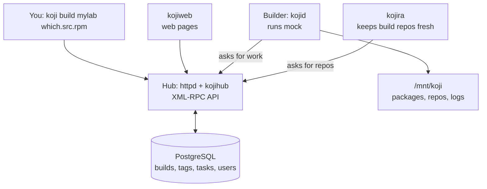
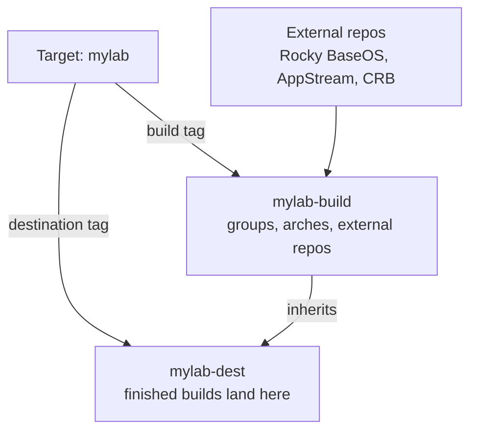
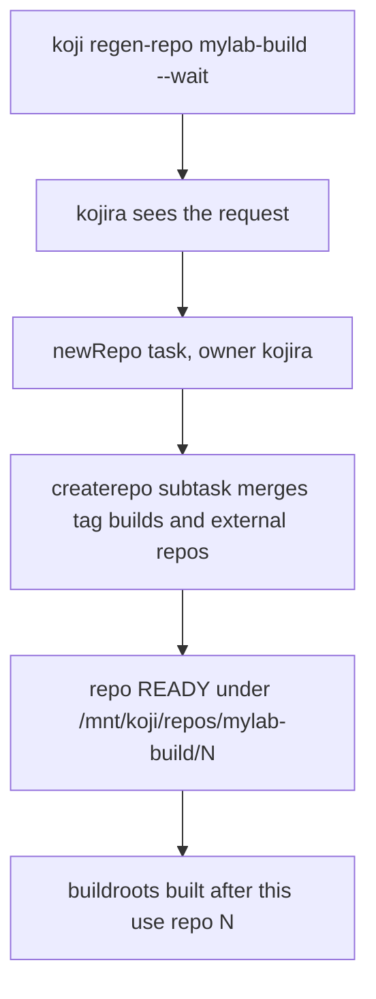

# 50 · Build your own build system (single-host Koji)

<ul class="module-meta">
  <li>⏱ ~3.5 hours</li>
  <li>5 labs</li>
  <li>Builds on: 22 · Building RPMs, 49 · Build your own packages and repository, 07 · systemd and Services</li>
  <li>Environment: Tier C</li>
  <li>Verified: Rocky 10.2, 2026-11-06</li>
</ul>

Ask Rocky's public Koji hub what is tagged `dist-rocky10` and, on 2026-11-06, it answers with 8,110 builds that share two traits: the owner is one and the same import service account and the task id is empty. Those builds were imported, not compiled on that hub. You did not need a password to learn that, because a build system is mostly a database. Rocky does this work at hop 3 of its pipeline; here is yours, small: one VM, one builder, Rocky's public repositories as the seed, and `which` built inside it.

<div class="pipeline-strip" data-here="build" role="group" aria-label="Rocky build pipeline, six stages" markdown>

1. Source
2. Build
3. Sign
4. Compose
5. Publish
6. Install

</div>

*You are here: Build (stage 2 of 6). Before: Source. After: Sign.*

!!! abstract "What you'll learn"
    - Say what the hub, PostgreSQL, the builder, kojira and kojiweb each do, and which one to look at for a given symptom.
    - Stand up a single-host Koji on Rocky 10.2 with a private certificate authority and certificate login.
    - Define tags, a target and external repositories so an empty Koji can build its first package.
    - Submit a scratch build and a real build of `which`, then read the task tree, `root.log` and `build.log`.
    - Explain three things Koji does not do: keep your NVR, sign packages, and re-read a tag before its repo is regenerated.
    - Map each piece of your Koji to what Rocky's public hub shows: tags, targets, channels, imports.

## The big picture

In [module 22](22-building-rpms.md) you built packages with `mock` on one machine. A **build system** adds the parts mock does not have: a record of every build, a queue of jobs, several builders, and rules about what each build is allowed to see. **Koji** is the build system Rocky uses for its Rocky 10 builds since 2025-05-16.

!!! note "Remember from module 21"
    Koji hands each build to a builder, and the builder runs `mock` in a clean chroot. Rocky 10 content began in Peridot and Koji builds start on 2025-05-16; 9.7 and 9.8 are Koji builds too. The `Packager` and `Build Host` fields of an installed package tell you which system built it.

### Koji in one sentence

> **Koji is a database of builds and a scheduler that runs mock on builders; tags decide what each build sees.**

Every word of this module hangs off that sentence. The **hub** is the database front end. A **builder** takes a job from the scheduler and runs `mock`. A **tag** is a named set of builds with settings, and it is the only thing that decides which packages a buildroot can install and where a finished build lands.



The diagram shows that everything goes through the hub. You, the web interface, the builder and kojira all talk to the hub's API; only the hub talks to PostgreSQL; and the results of a build end up as files under `/mnt/koji`.

### The few things that solve most problems

| Situation | What to do | Where this module teaches it |
|-----------|-----------|------------------------------|
| A build is queued, running or failed and you want to know why | Read the task tree, then the log of the child task that failed | The core skill |
| A build cannot find a package | Check the build tag, its parents and its external repos, then regenerate the repo | Tags decide what a build sees |
| You changed a tag and the next build ignores it | `koji regen-repo mylab-build --wait`, then build again | The first buildroot |
| The `koji` client says authentication failed | Set `authtype = ssl`, use absolute paths, remove inline comments | Who may do what |
| The hub answers `ServerOffline: database outage` | Cap the httpd workers below PostgreSQL's connection limit | Worked story |
| A task sits in FREE and never starts | Check that kojid runs, trusts your CA, and that the host is enabled in the right channel | The decision tree |

Pick by symptom. Auth errors come before any request reaches the hub, outage errors come from the hub itself, a FREE task is a builder problem, and a failed task is a log problem.

### Words you'll see

| Word | Plain meaning |
|------|---------------|
| **hub** | The web service (httpd plus `kojihub`) that holds the API and talks to the database. |
| **builder** | A machine running **kojid**, the daemon that takes tasks and runs `mock`. |
| **kojira** | The daemon that notices stale build repos and asks for new ones. It ships in `koji-utils`. |
| **tag** | A named set of builds plus settings (parents, architectures, groups, external repos). |
| **build tag, destination tag** | The tag a buildroot is built from, and the tag a finished build is put into. |
| **target** | A name that pairs one build tag with one destination tag. You build "for a target". |
| **external repo** | A plain RPM repository on the internet that a tag treats as an extra source of packages. |
| **buildroot** | The clean chroot `mock` builds in. Koji assembles it from a generated repo. |
| **task** | One unit of work with an id and a state (`build`, `rebuildSRPM`, `buildArch`, `tagBuild`, `newRepo`). |
| **NVR** | Name-Version-Release, such as `which-2.21-44.el10`. |
| **channel** | A pool of builders that accepts certain kinds of tasks (`default`, `createrepo`). |

## The core skill: read a task tree

Almost everything you will do with a Koji is read what it recorded. The skill is to read the **task tree**: a build is one parent task with child tasks, and the child that failed holds the log you need.

How to read one:

1. List the tasks with `koji list-tasks --all --after=2000-01-01` (the `--after` is required).
2. A top-level task has no indent. Its children start with a `+`.
3. The name says the job: `newRepo` and `createrepo` make a build repo (owner `kojira`), `rebuildSRPM` rebuilds the source package, `buildArch` compiles for one architecture, `tagBuild` files the result in the destination tag.
4. The state says where it stands: `FREE` waits for a builder, `OPEN` runs, `CLOSED` finished, `FAILED` did not.
5. For the failed child, open `root.log` (the buildroot: what was installed and why dnf refused) or `build.log` (the `rpmbuild` output).

```console
$ koji list-tasks --all --after=2000-01-01
ID       Pri  Owner                State    Arch       Name
1        15   kojira               CLOSED   noarch     newRepo (mylab-build)
2        14   kojira               CLOSED   noarch      +createrepo (x86_64)
3        20   kojiadmin            CLOSED   noarch     build (mylab, which-2.21-44.el10_0.src.rpm)
4        19   kojiadmin            CLOSED   noarch      +rebuildSRPM (noarch)
5        19   kojiadmin            CLOSED   x86_64      +buildArch (which-2.21-44.el10.src.rpm, x86_64)
6        20   kojiadmin            CLOSED   noarch     build (mylab, which-2.21-44.el10_0.src.rpm)
7        19   kojiadmin            CLOSED   noarch      +rebuildSRPM (noarch)
8        19   kojiadmin            CLOSED   x86_64      +buildArch (which-2.21-44.el10.src.rpm, x86_64)
9        19   kojiadmin            CLOSED   noarch      +tagBuild (noarch)
10       20   kojiadmin            OPEN     noarch     build (mylab, hello-1.0-1.el10.src.rpm)
11       19   kojiadmin            CLOSED   noarch      +rebuildSRPM (noarch)
12       19   kojiadmin            CLOSED   noarch      +buildArch (hello-1.0-1.el10.src.rpm, noarch)
13       19   kojiadmin            CLOSED   noarch      +tagBuild (noarch)
```

Rocky 10.2 x86_64, Koji 1.35.3, 2026-11-06. Read it as four parent tasks (1, 3, 6 and 10), each followed by its children marked with a `+`. Tasks 3 and 6 are the same source package.

??? success "Answer: which task compiled `which`, and why does only task 6 have a tagBuild child?"
    Task 5 (and again task 8) is the `buildArch` child with the real architecture, `x86_64`. That is where `rpmbuild` ran. The `rebuildSRPM` child is `noarch` because it only repacks the source.

    Task 3 was a scratch build, so it stops after `buildArch`: nothing is tagged. Task 6 was a real build, so it has task 9, `tagBuild`, which put the build into `mylab-dest`. You can confirm with `koji list-tagged mylab-dest`.

Practice two: before `regen-repo` finished, `koji taginfo mylab-build` printed this.

```console
$ koji taginfo mylab-build
Tag: mylab-build [2]
Arches: x86_64
Groups: build, srpm-build
Tag options:
This tag is a buildroot for one or more targets
Current repo: no active repo
```

??? success "Answer: what does `no active repo` mean for a build submitted now?"
    The tag has no generated repo yet, so there is nothing for a buildroot to install from. A build submitted now waits for a repo, and `koji regen-repo mylab-build --wait` is what produces it. Note also the empty `Tag options:` line: the bootstrap setting had not been added at that point.

<div class="quiz" data-answer="2" markdown>

A `koji build` finished and `koji list-tagged mylab-dest` shows nothing new. The task tree has `rebuildSRPM` and `buildArch` but no `tagBuild`. What happened?

- The builder could not reach the hub
- It was a scratch build, so nothing is tagged
- The destination tag is full

Right: a scratch build runs the whole build and throws the result away. No `tagBuild` task means no build was filed in the destination tag.

</div>

## Five services, one database

A single-host Koji is five services on one machine. Each has one job, and knowing which job tells you where to look.

<div class="layers" data-hint="Click a layer to see what lives there." markdown>

<div class="layer" data-label="Client: koji and kojiweb" data-tag="you" markdown>

**What it does:** sends requests to the hub. The command line (`koji`) and the web pages (`kojiweb`, run inside httpd) are both clients of the same API.

The shipped `/etc/koji.conf` says `authtype = kerberos`, so a certificate setup must override it.

</div>

<div class="layer" data-label="Hub: httpd and kojihub" data-tag="API" markdown>

**What it does:** answers every API call, checks who you are, creates tasks and writes to the database. It runs inside httpd with `mod_wsgi`. Its config is `/etc/koji-hub/hub.conf` and `/etc/httpd/conf.d/kojihub.conf`.

Each hub thread keeps its own PostgreSQL connection (see the worked story).

</div>

<div class="layer" data-label="PostgreSQL" data-tag="state" markdown>

**What it does:** stores users, tags, builds, tasks and permissions. The schema ships in `/usr/share/koji/schema.sql`. In the lab it listens on a Unix socket only.

</div>

<div class="layer" data-label="Builders: kojid and mock" data-tag="work" markdown>

**What it does:** polls the hub for tasks, builds a buildroot with `mock`, runs `rpmbuild` inside it and uploads the results. Its config is `/etc/kojid/kojid.conf`. The lab sets `sleeptime=15`, so an idle builder asks for work every 15 seconds.

kojira is a separate daemon, `/etc/kojira/kojira.conf`. It does not build anything. It watches for tags whose repo is out of date and asks for a new one.

</div>

<div class="layer" data-label="Files: /mnt/koji" data-tag="disk" markdown>

**What it does:** holds the build output. `packages/` has finished builds and their logs, `repos/` has generated build repos, `work/` and `scratch/` hold task files.

</div>

</div>

The five bars read top to bottom as a request does: a client calls the hub, the hub reads and writes PostgreSQL, a builder collects the resulting task, and the output lands on disk.

The packages are `koji`, `koji-hub`, `koji-web`, `koji-builder` and `koji-utils` from EPEL 10, plus `httpd`, `mod_ssl`, `postgresql-server` and `python3-mod_wsgi` from Rocky. Lab 1 installs them.

<!-- ev: FACTBASE-C L-16; labs/final 03-koji README | official | EPEL 10 koji package, 2026-11-06 -->
!!! freshness "As of 2026-11-06 on Rocky 10.2"
    EPEL 10 ships `koji` 1.35.3-8.el10_2; upstream had released 1.36.1 on 2026-07-08. The lab ran with Koji 1.35.3 and mock 6.9. The mechanism in this module is stable across Koji 1.x; the exact flags and defaults can change with a new EPEL build. This changes at each EPEL update.

    **Re-check:** `dnf repoquery koji`

## Tags decide what a build sees

A build system must answer two questions for every build: which packages may the compiler environment contain, and where does the result go? Koji answers both with tags.

A **tag** is a name with a list of builds and some settings. It can have a **parent**: it then also sees the parent's builds. That is **inheritance**. In the lab you create two tags. `mylab-dest` is the destination, where finished builds land. `mylab-build` is the build tag, the one a buildroot is made from. It inherits `mylab-dest`, so anything already released is visible to the next build.

A **target** ties the two together: `mylab` means "build from `mylab-build`, put the result in `mylab-dest`". You always build for a target, never directly for a tag.

!!! analogy "Think of it like folders that include other folders"
    A tag is a folder of builds, and a child folder can include its parent by reference. Where it breaks: a folder is only storage, but a tag also carries settings (architectures, package groups, external repos, build options), and what a buildroot may install is computed from those settings.



The diagram shows one target pointing at two tags. The build tag inherits the destination tag, and the build tag alone also draws on the external repositories.

Here is what the lab's Koji prints for these objects.

```console
$ koji list-tag-inheritance mylab-build
     mylab-build (2)
....  └─mylab-dest (1)
$ koji list-targets
Name                           Buildroot                      Destination
---------------------------------------------------------------------------------------------
mylab                          mylab-build                    mylab-dest
$ koji list-external-repos --tag mylab-build
Pri External repo name        Mode       URL
--- ------------------------- ---------- ----------------------------------------
10  rocky10-baseos            koji       https://dl.rockylinux.org/pub/rocky/10/BaseOS/$arch/os/
20  rocky10-appstream         koji       https://dl.rockylinux.org/pub/rocky/10/AppStream/$arch/os/
30  rocky10-crb               koji       https://dl.rockylinux.org/pub/rocky/10/CRB/$arch/os/
```

Rocky 10.2 x86_64, 2026-11-06. The priorities (10, 20, 30) decide which external repo wins when two have the same package; the mode `koji` is the default way Koji merges external repos into the generated one.

Two more settings finish the build tag. A **group** is a named package list that Koji installs first into the buildroot: `build` for compiling and `srpm-build` for rebuilding the source package. The lab fills `build` with exactly the list in Rocky's `mock` template for Rocky 10. And `--arches x86_64` on `mylab-build` says which architectures this tag builds.

<!-- ev: FACTBASE-A O13; own anonymous query | observed | koji.rockylinux.org anonymous XML-RPC, 2026-11-06 -->
!!! evidence "Observed: Rocky's hub has the same shape"
    **Seen on:** the public Rocky Koji hub, queried anonymously, 2026-11-06 (Lab 5 prints this).

    ```text
    target dist-rocky10.2-build build tag dist-rocky10.2-build dest tag dist-rocky10.2
    dist-rocky10.2-build inherits ['dist-rocky10.2', 'dist-rocky10-build-tools']
    groups on the build tag: ['build', 'srpm-build', 'livemedia-build', 'kiwi-build']
    external repos on the build tag: []
    ```

    **Check it yourself:** run Lab 5. The build tag inherits the destination tag, plus one tag of build tools, exactly as `mylab-build` inherits `mylab-dest`. Rocky's build tag also uses the groups `build` and `srpm-build`. Its list of external repos is empty: Rocky's tag is fed by tags, and external repos were only your way to seed an empty hub.

<div class="quiz" data-answer="3" markdown>

You add a package to `mylab-dest` by finishing a build. Will the next build for target `mylab` be able to install it into its buildroot?

- No, buildroots never see earlier builds
- Yes, immediately, in the middle of a running build
- Yes, once a new repo for `mylab-build` is generated, because `mylab-build` inherits `mylab-dest`

Right: inheritance makes the build visible to the tag, but a buildroot installs from a generated repo, and a repo is a snapshot. That is the next section.

</div>

## The first buildroot: seeding an empty Koji

A new Koji has no packages at all, and a buildroot needs `bash`, `rpm-build` and a compiler. The lab's first buildroot installed 145 packages for the `build` group alone (2026-11-06 run). This looks like a chicken-and-egg problem: you need packages to build packages.

For a distribution that already exists, the answer is small. Point the build tag at the distribution's public repositories as **external repos**. Koji's `createrepo` task merges those repositories and the tag's own builds into one generated repo. The package files stay on `dl.rockylinux.org`; Koji keeps only the metadata. The buildroot's only dnf repo is that generated one.



The diagram shows that a repo is created by a task, owned by kojira, and only after it reaches READY can a build use it.

<!-- ev: labs/final 03-koji output; V2 item 11, 13 | observed | Rocky 10.2 x86_64 VM, 2026-11-06 -->
!!! evidence "Observed: the buildroot installs from one generated repo"
    **Seen on:** Rocky 10.2 x86_64, Koji 1.35.3, mock 6.9, 2026-11-06.

    ```console
    $ grep -E "use_bootstrap|chroot_setup_cmd" /mnt/koji/packages/which/2.21/44.el10/data/logs/x86_64/mock_config.log
    config_opts['chroot_setup_cmd'] = 'install @build'
    config_opts['use_bootstrap'] = False
    config_opts['use_bootstrap_image'] = False
    $ grep -E "Transaction Summary|Install +[0-9]+ Packages" /mnt/koji/packages/which/2.21/44.el10/data/logs/x86_64/root.log | head
    DEBUG util.py:537:  Transaction Summary
    DEBUG util.py:537:  Install  145 Packages
    DEBUG util.py:537:  Transaction Summary
    DEBUG util.py:537:  Install  13 Packages
    ```

    The same `mock_config.log` shows one repo for the buildroot, named `build`, with the base URL `https://koji.lab.example/kojifiles/repos/mylab-build/1/x86_64`.

    **Check it yourself:** run Lab 4. The first transaction installs the `build` group (145 packages). In the saved log the second installs `gcc`, `make`, `readline-devel` and their dependencies, which are the build dependencies of `which`.

Two details cost people hours.

First, **tag settings freeze when a repo is created.** The lab sets `koji edit-tag -x mock.use_bootstrap=False mylab-build`. The key is `mock.use_bootstrap`. A key named `mock.bootstrap` is accepted silently, stored, and does nothing. Mock 6.9 turns its bootstrap chroot on by default (its own `site-defaults.cfg` comments say so), so without the setting each buildroot would be two chroots; we did not run a Koji build without the setting to see it. And because the setting is read when a repo is created, a build bound to the older repo still uses bootstrap. After any tag edit, regenerate: `koji regen-repo mylab-build --wait`.

Second, `koji regen-repo` is a request, not a command. kojira's regen thread creates the `newRepo` task, and kojira checks external repos about once a minute. In the lab, the whole tag step took 151 seconds and most of it was the first repo.

??? question "What about the very first compiler, the one nothing built?"
    Seeding from a public repo only works because those packages already exist. Making the first compiler of a distribution from nothing is a separate problem (bootstrapping), and this module does not do it. For Rocky 10, I found no public description of how the first x86_64 and aarch64 buildroot was seeded (see the unknown box).

## Who may do what: a private CA and certificates

Koji does not use passwords. The lab uses **SSL client certificates**: you prove who you are by presenting a certificate signed by a CA the hub trusts, and the hub takes your Koji username from the certificate's common name (CN). The lab builds its own certificate authority with `openssl`, so the same machine is CA, hub, builder and user.

| Certificate | CN | Who uses it |
|-------------|----|-------------|
| CA | `koji.lab.example-CA` | Signs every other certificate |
| hub | `koji.lab.example` | httpd serves it; carries a subject alternative name (SAN) |
| web | `koji.lab.example`, `OU=kojiweb` | kojiweb; its exact DN goes in `ProxyDNs` |
| `kojiadmin` | `kojiadmin` | Your `koji` client; the admin user |
| `kojira` | `kojira` | The kojira daemon |
| builder | `koji.lab.example` | kojid; CN equals the host name given to `koji add-host` |

Modern TLS clients ignore the CN alone for a server name, so the lab gives the hub and web certificates a SAN.

Four rules in the lab came from failures and are worth remembering.

1. `/etc/koji.conf` ships `authtype = kerberos`. Your client config must say `authtype = ssl`.
2. Koji ini files do not accept an inline `#` comment. A trailing comment silently became part of the value and authentication failed with "no authentication methods available".
3. Use absolute paths in `cert=` and `serverca=`. A `~` did not work in testing.
4. Put the CA in the system trust store (`/etc/pki/ca-trust/source/anchors`, then `update-ca-trust`) and restart kojid. Mock and dnf fetch the buildroot repo over HTTPS from the hub, and kojid downloads files with its own HTTP library. A kojid that started before the CA was trusted keeps failing with "self-signed certificate in certificate chain" until it is restarted.

The first admin cannot log in to create itself, so the lab inserts the admin straight into the database: one row in `users` and one in `user_perms` with permission id 1, which is `admin`.

<div class="quiz" data-answer="1" markdown>

`koji moshimoshi` fails with "no authentication methods available", and your config has `cert = /root/.koji/kojiadmin.pem  # admin cert`. What do you change first?

- Remove the inline comment and keep the absolute path
- Switch the hub to Kerberos
- Regenerate the CA

Right: the text after `cert =` is read as part of the value, so the file name never matches. Koji ini files have no inline comments.

</div>

## One build, task by task

You submit a source package. The client uploads it, the hub creates a parent `build` task, and the work spreads into children, each picked up by a builder.

<div class="stepper" markdown>

<div class="step" data-title="Submit" markdown>

`koji build mylab ~/srpms/which-2.21-44.el10_0.src.rpm --nowait` uploads the SRPM into the hub's work area and creates the parent task. In a script (no terminal) `koji build` returns immediately anyway, so always add `--nowait` and follow with `koji watch-task N`.

```console
$ koji build mylab ~/srpms/which-2.21-44.el10_0.src.rpm --nowait
$ koji watch-task 6
Watching tasks (this may be safely interrupted)...
6 build (mylab, which-2.21-44.el10_0.src.rpm): free
6 build (mylab, which-2.21-44.el10_0.src.rpm): free -> open (koji.lab.example)
```

</div>

<div class="step" data-title="rebuildSRPM" markdown>

A builder creates a buildroot from the `srpm-build` group and rebuilds the source package. This is where `%dist` is evaluated again, inside the buildroot. That is why the NVR changes, as the next section shows.

</div>

<div class="step" data-title="buildArch" markdown>

For each architecture of the build tag, a builder installs the `build` group, installs the package's build dependencies and runs `rpmbuild` in a `systemd-nspawn` container. It uploads the RPMs and the logs. The compute took about 35 seconds. Most of the wall time is waiting for the next poll.

</div>

<div class="step" data-title="tagBuild" markdown>

A real build, and only a real build, ends with `tagBuild`: the hub files the build in the destination tag. A scratch build has no such task. After this the build is visible in `koji list-tagged mylab-dest`, and `watch-task` ends with `completed successfully`.

</div>

</div>

The stepper shows four stages: the parent is submitted, the SRPM is rebuilt, each architecture is built, and a real build is tagged. The result becomes visible to later buildroots only after kojira asks for the next repo, which is why dependent builds in a chain need `koji wait-repo` (described here, not run).

Each build also leaves files. For `which` they are:

```text
/mnt/koji/packages/which/2.21/44.el10/src/which-2.21-44.el10.src.rpm
/mnt/koji/packages/which/2.21/44.el10/x86_64/which-2.21-44.el10.x86_64.rpm
/mnt/koji/packages/which/2.21/44.el10/x86_64/which-debuginfo-2.21-44.el10.x86_64.rpm
/mnt/koji/packages/which/2.21/44.el10/x86_64/which-debugsource-2.21-44.el10.x86_64.rpm
/mnt/koji/packages/which/2.21/44.el10/data/logs/x86_64/{build,root,state,mock_output,mock_config}.log ...
```

A **scratch build** (`koji build --scratch`) never lands in a tag. It runs `build`, `rebuildSRPM` and `buildArch` and stops. A real build adds `tagBuild` and keeps the result in the destination tag. Use scratch builds for trying a change.

Task timing in the lab (Rocky 10.2 x86_64, 2026-11-06): the scratch build of `which` took 2 minutes 46 seconds, the real one 3 minutes 17 seconds, and the compute in `buildArch` about 35 seconds. The gap is scheduling latency: kojid polls every 15 seconds, the hub schedules, and a build waits for a ready repo.

<div class="terminal-sim" data-title="Read a finished build on the lab VM" data-prompt="[rocky@koji ~]$ " markdown>

<div class="task" data-expect="ls /mnt/koji/packages/which/2.21/44.el10/||ls /mnt/koji/packages/which/2.21/44.el10" data-hint="List the directory of the finished build under /mnt/koji/packages." markdown>

**Step 1.** List the directory of the finished build.

```text
/mnt/koji/packages/which/2.21/44.el10/:
data
src
x86_64
```

</div>

<div class="task" data-expect="tail -5 /mnt/koji/packages/which/2.21/44.el10/data/logs/x86_64/build.log" data-hint="Show the last five lines of build.log." markdown>

**Step 2.** Show the last five lines of `build.log`.

```text
Checking for unpackaged file(s): /usr/lib/rpm/check-files /builddir/build/BUILDROOT/which-2.21-44.el10.x86_64
Wrote: /builddir/build/RPMS/which-2.21-44.el10.x86_64.rpm
Wrote: /builddir/build/RPMS/which-debuginfo-2.21-44.el10.x86_64.rpm
Wrote: /builddir/build/RPMS/which-debugsource-2.21-44.el10.x86_64.rpm
Child return code was: 0
```

</div>

<div class="task" data-expect="rpm -qp --qf 'NVR=%{NVRA} buildhost=%{BUILDHOST} vendor=%{VENDOR} packager=%{PACKAGER} sig=%{RSAHEADER:pgpsig}\n' /mnt/koji/packages/which/2.21/44.el10/x86_64/which-2.21-44.el10.x86_64.rpm" data-match="rpm -qp .*pgpsig.* /mnt/koji/packages/which/2\.21/44\.el10/x86_64/which-2\.21-44\.el10\.x86_64\.rpm" data-hint="rpm -qp with a query format that prints %{BUILDHOST}, %{VENDOR}, %{PACKAGER} and %{RSAHEADER:pgpsig}, then the path of the built RPM." markdown>

**Step 3.** Query the built RPM for build host, vendor, packager and signature.

```text
NVR=which-2.21-44.el10.x86_64 buildhost=localhost.localdomain vendor=Koji packager=Koji sig=(none)
```

</div>

</div>

## Koji rebuilds, it does not copy

You gave Koji `which-2.21-44.el10_0.src.rpm`. It built and recorded `which-2.21-44.el10`. Koji does not keep the NVR you submitted. The `rebuildSRPM` task rebuilds the source package inside the buildroot, which evaluates `%dist` again there, and the build is recorded under the rebuilt package's NVR. The buildroot's `rocky-release` package supplies `%dist` as `.el10`, so `.el10_0` collapses.

<!-- ev: labs/final 03-koji output; V2 item 15 | observed | Rocky 10.2 x86_64 VM, 2026-11-06 -->
!!! evidence "Observed: the task keeps the input name, the build does not"
    **Seen on:** Rocky 10.2 x86_64, Koji 1.35.3, 2026-11-06.

    ```console
    $ koji buildinfo which-2.21-44.el10
    BUILD: which-2.21-44.el10 [1]
    State: COMPLETE
    Built by: kojiadmin
    Source: which-2.21-44.el10.src.rpm
    Volume: DEFAULT
    Task: 6 build (mylab, which-2.21-44.el10_0.src.rpm)
    Finished: Fri, 06 Nov 2026 23:56:23 UTC
    Tags: mylab-dest
    Extra: {'source': {'original_url': 'which-2.21-44.el10.src.rpm'}}
    ```

    **Check it yourself:** run Lab 3. The task line names the file you submitted (`el10_0`), while the build and the RPM files say `el10`.

Rocky's own builds do carry the minor in the release: the public hub has `openssl-3.5.8-2.el10_2`. How Rocky's buildroot produces that was not part of our lab, so a Koji you build from this module will not match Rocky's NVRs unless you also set a dist value (not tested here).

The result is also not byte-for-byte Rocky's `which`. The payload digest of your Koji build equals the one from a plain `mock` rebuild against the current repositories, and differs from the shipped package:

```console
$ rpm -qp --qf 'PAYLOADDIGEST=%{PAYLOADDIGEST}\n' /mnt/koji/packages/which/2.21/44.el10/x86_64/which-2.21-44.el10.x86_64.rpm
PAYLOADDIGEST=8aefadaa1ef70273997d0b7ceafddb877d2484b4da026b9b1b15a0063373f8d4
```

Rocky 10.2 x86_64, 2026-11-06. The shipped `which-2.21-44.el10_0` payload digest starts with `0895052a` ([module 45](45-pipeline-source-to-build.md) and [module 48](48-trust-secure-boot-and-reproducibility.md) cover exact reproduction, which needs the pinned 10.0 buildroot and a `dist` define). So a build system proves a build happened; it does not by itself make two builds identical.

## Koji does not sign

Open the RPM Koji built and look at the header. The signature is empty, the vendor and packager are `Koji`, and the build host is whatever name the builder had.

<!-- ev: labs/final 03-koji output; V2 item 17 | observed | Rocky 10.2 x86_64 VM, 2026-11-06 -->
!!! evidence "Observed: a Koji build is unsigned"
    **Seen on:** Rocky 10.2 x86_64, Koji 1.35.3, 2026-11-06.

    ```console
    $ rpm -qp --qf 'NVR=%{NVRA} buildhost=%{BUILDHOST} vendor=%{VENDOR} packager=%{PACKAGER} sig=%{RSAHEADER:pgpsig}\n' /mnt/koji/packages/which/2.21/44.el10/x86_64/which-2.21-44.el10.x86_64.rpm
    NVR=which-2.21-44.el10.x86_64 buildhost=localhost.localdomain vendor=Koji packager=Koji sig=(none)
    ```

    **Check it yourself:** run Lab 4. `sig=(none)` means the RPM header carries no signature. Signing is a separate step that this lab does not do.

Compare a Rocky package. On a stock Rocky 10.2 install, `rocky-release-10.2-1.1.el10` shows a build host on Rocky's builder network and the packager `Rocky Linux Build System <releng@rockylinux.org>`; packages in the Rocky repositories are signed. Our reading: those are settings of Rocky's builders and a later signing step, neither of which your lab has. How Rocky signs after Koji is not public. Module 47 covers what the signature proves; module 49 signs packages by hand.

## Rocky's Koji, and yours, small

Rocky's public hub answers read calls anonymously. That makes it the best exhibit for what you just built: the same objects, bigger.

| Piece | Your lab | Rocky's public hub (2026-11-06) | How to ask |
|-------|----------|-------------------------------|-----------|
| Destination tag | `mylab-dest` | `dist-rocky10.2`, which inherits `dist-rocky10.1` | `getInheritanceData` |
| Build tag | `mylab-build`, inherits `mylab-dest` | `dist-rocky10.2-build`, inherits `dist-rocky10.2` and `dist-rocky10-build-tools` | `getInheritanceData` |
| Target | `mylab` | `dist-rocky10.2-build` (build tag `dist-rocky10.2-build`, destination `dist-rocky10.2`) | `getBuildTarget` |
| Compose tag | none | `dist-rocky10.2-compose`: what the compose reads | `getTag` |
| Builders | 1 host, `x86_64`, channels `default` and `createrepo` | 40 hosts, 28 enabled, 5 arch groups, 15 channels | `listHosts`, `listChannels` |
| Who submits | you, from an uploaded SRPM | an automation account, from a git commit | `getBuild` |
| Seed | external repos on the build tag | none on the build tag | `getTagExternalRepos` |

In the compose row, the tag matters more than the tool: a compose reads the compose tag and assembles repositories from it ([module 46](46-pipeline-compose-to-your-server.md)).

<!-- ev: FACTBASE-A hop 6 and O13; releng issue 49 | official | Rocky releng issue tracker, 2026-11-06 -->
!!! freshness "As of 2026-11-06 on Rocky 10.2"
    Rocky 10 composes with Pungi against Koji tags (as of 2026-11), and a public issue in Rocky's releng tracker asks to replace Pungi. The tag idea is stable; the compose tool name is what may change. This changes at the next tooling decision.

    **Re-check:** `gh api repos/rocky-linux/releng/issues/49`

An ordinary Rocky build is submitted from git, not from an uploaded SRPM, and the build is owned by an automation account (we do not print its name):

```text
openssl-3.5.8-2.el10_2 801106 git+https://git.rockylinux.org/staging/rpms/openssl.git#5149800af6f3adb4b269c05e47a71a0ad843696d
```

That line (NVR, task id, source) comes from `getBuild`, queried 2026-11-06 (Lab 5). Building from a git URL needs an SCM setup that your lab does not have and we did not test.

The hub also holds builds that nobody compiled on it. In the hook's query, every build tagged `dist-rocky10` has `task_id` of `None` and the same import service account as owner, with creation times from 2025-05-13 to 2025-05-18. They were imported. The Secure Boot kernel builds also show no task. A `task_id` of `None` means "no task built this on this hub", not "something is wrong".

<!-- ev: COLD-OPEN-VERIFICATION Ep1; FACTBASE-A hop 3 | observed | koji.rockylinux.org anonymous XML-RPC, 2026-11-06 -->
!!! freshness "As of 2026-11-06 on Rocky 10.2"
    The hub listed 40 hosts, 28 of them enabled (x86_64 7, riscv64 7, s390x 6, aarch64 5, ppc64le 3), and 15 channels including `default`, `createrepo`, `image`, `livemedia`, `runroot` and `secureboot`. Tag `dist-rocky10` held 8,110 builds, all owned by the same import service account with no task. These numbers change when builders are added or retired and when tags are cleaned.

    **Re-check:** `python3 -I -c "import xmlrpc.client as x; s=x.ServerProxy('https://koji.rockylinux.org/kojihub',allow_none=True); print(len(s.listHosts()), len(s.listChannels()), len(s.listTagged('dist-rocky10',None,False,None,False)))"`

??? version "Comparison lens: Fedora and CentOS"
    Koji is not Rocky's invention. Module 21 notes that Fedora and CentOS use it. You can see their hubs' fingerprints on a Rocky 10 machine: `rpm -qa --qf '%{BUILDHOST}\n' | sort | uniq -c | sort -rn` on a Rocky 10.2 x86_64 VM (2026-11-06) listed a few packages with `fedoraproject.org` and `centos.org` build hosts, which are packages from EPEL and SIG repositories, not from Rocky's hub. **Check it yourself:** run the command and look at the tail of the list. For one architecture, Rocky has published a sentence about its compiler bootstrap: its [riscv64 announcement](https://rockylinux.org/news/rockylinux-support-for-riscv) says the compiler stack was bootstrapped from Fedora RISC-V. That covers riscv64 only.

!!! unknown "What nobody outside the project can tell you"
    - Which Koji version Rocky's hub runs. The API version call returns `1` and no release string; EPEL 10 has 1.35.3. Not public.
    - How Rocky's hub and builders are deployed today, and what the second hostname `kojidev` is for (it returns the same data). Not public.
    - How the first x86_64 and aarch64 Rocky 10 buildroot got its first compiler. I found no public description (searched 2026-11-06: rockylinux.org news, docs.rockylinux.org, the forum, git.resf.org issues, pungi-rocky history). The tag name `r10-bootstrap` appears in a 2023 pungi-rocky commit and is not on the hub today.
    - How RPMs built in Koji are signed for Rocky 10, and who approves it. The public record shows signature times and key IDs, not the mechanism. Not public.
    - Whether a certificate login to kojiweb, signing through `koji import-sig`, builds from a git URL, dependent builds with `koji wait-repo`, or builders on other architectures work in this setup. Not tested here.

## Worked story: the hub that went offline

**Symptom.** `kojid` stopped taking tasks. A `createrepo` task sat in FREE. Client calls failed with `ServerOffline: database outage`.

**Evidence.** The PostgreSQL log held one repeated line:

```text
FATAL:  remaining connection slots are reserved for roles with the SUPERUSER attribute
```

**Reasoning.** Two things are true at once. Each hub thread keeps its own connection to PostgreSQL, and PostgreSQL's default `max_connections` is 100. The stock `mpm_event` settings of httpd (the lab script's note: 3 children of 25 threads, up to 400 workers) allow far more workers than that. Under load the hub exhausted the database's connection slots and then reported a database outage, although PostgreSQL itself was healthy. A second explanation, a broken database, is ruled out by the log line: PostgreSQL was refusing new clients on purpose, not crashing.

**Fix.** Cap httpd so its worker count stays below the database limit. The lab's file:

```ini title="/etc/httpd/conf.d/zz-koji-mpm.conf"
MaxConnectionsPerChild 100
<IfModule mpm_event_module>
    StartServers 1
    ServerLimit 4
    ThreadsPerChild 10
    MaxRequestWorkers 40
</IfModule>
```

**Check.** After the file was in place, `kojid` took tasks, the `createrepo` task moved from FREE to open, and the whole scripted run finished. Raising `max_connections` instead is an alternative we did not test. This setting is not in the upstream Koji HOWTO that the lab started from.

<div class="decision" markdown>

<div class="node" data-id="start" markdown>

**Does `koji moshimoshi` print your name and "Authenticated via client certificate"?**

<button data-goto="auth">No</button> <button data-goto="hub">Yes</button>

</div>

<div class="node" data-id="auth" markdown>

You are not logged in. Check `authtype = ssl` in `~/.koji/config.d/lab.conf`, absolute paths in `cert=` and `serverca=`, no inline `#` comments, and that `serverca` is the CA that signed the hub certificate.

</div>

<div class="node" data-id="hub" markdown>

**Do other calls fail with `ServerOffline: database outage`, or is the web page an error?**

<button data-goto="outage">Outage</button> <button data-goto="web">Permission denied page</button> <button data-goto="tasks">Neither</button>

</div>

<div class="node" data-id="outage" markdown>

Look at the PostgreSQL log for `remaining connection slots are reserved`. Cap httpd's workers with `zz-koji-mpm.conf` and restart httpd.

</div>

<div class="node" data-id="web" markdown>

kojiweb runs inside httpd and must open a TCP connection to the hub, even on localhost. Run `sudo setsebool -P httpd_can_network_connect=1` and restart httpd.

</div>

<div class="node" data-id="tasks" markdown>

**What does the task do?**

<button data-goto="free">Sits in FREE</button> <button data-goto="failed">Fails</button> <button data-goto="stale">Builds against wrong or old packages</button>

</div>

<div class="node" data-id="free" markdown>

No builder took it. Check `systemctl status kojid`, that `koji list-hosts` shows `Y Y` (enabled, ready), that the host is in the channel the task needs, and that kojid was restarted after the CA went into the trust store.

</div>

<div class="node" data-id="failed" markdown>

Run `koji list-tasks --all --after=2000-01-01`, find the child that failed, and read its `root.log` (buildroot problems) or `build.log` (compile problems).

</div>

<div class="node" data-id="stale" markdown>

The build used an older repo. Tag settings and tag contents freeze when a repo is created. Run `koji regen-repo mylab-build --wait`, then build again.

</div>

</div>

<div class="quiz" data-answer="1" markdown>

You edited `mylab-build` with `koji edit-tag -x mock.use_bootstrap=False`, built again, and the buildroot still created a bootstrap chroot. Why?

- The build was bound to the repo created before the edit, so it needs a regenerated repo
- `mock.use_bootstrap` is not a valid key
- Mock ignores tag settings

Right: tag configuration freezes at repo creation. `koji regen-repo mylab-build --wait` creates a repo that carries the new setting.

</div>

## Labs

!!! tip "Lab kit"
    The single-host Koji lab is a set of numbered scripts plus `run-all.sh`, all in kit 03 on the [lab kits](lab-kits.md) page.

The labs split the tested scripted run into parts. Labs 1 to 3 build the system and run both builds, Lab 4 reads the evidence and tears it down, Lab 5 asks Rocky's public hub the same questions. The scripts run on one VM as one set: the full scripted run (steps 1 to 8) took 593 seconds on x86_64.

!!! lab "Lab 1: Stand up the hub and log in with a certificate"

    - **Tier** C: root VM
    - **Status** Tested
    - **Time** about 20 seconds scripted with a warm dnf cache (steps 1 to 4 of the 593 second run)
    - **Hardware** 4 vCPU, 8 GiB RAM recommended, 20 GB free disk (the test VM had 4 vCPU, 15 GiB RAM and 99 GB disk)
    - **Tested on** Rocky 10.2 x86_64 VM, 2026-11-06

    **Goal:** Install Koji, create a private CA, start PostgreSQL and the hub, and prove a certificate login with `koji moshimoshi`.

    **You'll need:** a throwaway Rocky 10.2 x86_64 VM, a sudo user, network to `dl.rockylinux.org` and EPEL, SELinux left enforcing. **The first script changes the VM's host name to `koji.lab.example` and edits `/etc/hosts`. Do not run this on a machine you care about.**

    1. Make a working directory and save each script below under the name shown:

        ```bash
        mkdir ~/koji-lab && cd ~/koji-lab
        ```

    2. Save as `01-base.sh` and run `sudo bash -s < 01-base.sh`. It sets the host name, adds EPEL and installs the packages.

        ```bash
        set -euxo pipefail
        KOJI_FQDN=koji.lab.example
        hostnamectl set-hostname $KOJI_FQDN
        grep -q "$KOJI_FQDN" /etc/hosts || echo "127.0.0.1 $KOJI_FQDN koji" >> /etc/hosts
        dnf install -y epel-release
        dnf install -y httpd mod_ssl postgresql-server python3-mod_wsgi \
          koji koji-hub koji-web koji-builder koji-utils mock createrepo_c rpm-build \
          policycoreutils-python-utils
        ```

    3. Save as `02-certs.sh` and run `sudo bash -s < 02-certs.sh`. It creates the CA and the certificates from the table above.

        ```bash
        set -euxo pipefail
        FQDN=${FQDN:-koji.lab.example}
        PKI=/etc/pki/koji
        mkdir -p $PKI && cd $PKI
        rm -rf $PKI/* ; mkdir -p $PKI/{certs,private,newcerts}
        touch index.txt; echo 01 > serial
        echo 'unique_subject = no' > index.txt.attr   # hub+web+builder may share a CN

        cat > ssl.cnf <<CNF
        HOME = $PKI
        RANDFILE = $PKI/.rand
        [ca]
        default_ca = ca_default
        [ca_default]
        dir = $PKI
        certs = \$dir/certs
        crl_dir = \$dir/crl
        database = \$dir/index.txt
        new_certs_dir = \$dir/newcerts
        certificate = \$dir/koji_ca_cert.crt
        private_key = \$dir/private/koji_ca_cert.key
        serial = \$dir/serial
        default_days = 3650
        default_md = sha256
        policy = policy_match
        copy_extensions = copy
        [policy_match]
        countryName = optional
        stateOrProvinceName = optional
        localityName = optional
        organizationName = optional
        organizationalUnitName = optional
        commonName = supplied
        [req]
        default_bits = 2048
        default_md = sha256
        distinguished_name = req_distinguished_name
        prompt = no
        [req_distinguished_name]
        C = US
        ST = Oregon
        L = Portland
        O = KojiLab
        CN = placeholder
        [v3_ca]
        basicConstraints = CA:true
        keyUsage = keyCertSign, cRLSign
        subjectKeyIdentifier = hash
        CNF
        mkdir -p newcerts

        openssl genrsa -out private/koji_ca_cert.key 2048
        openssl req -config ssl.cnf -new -x509 -subj "/C=US/ST=Oregon/L=Portland/O=KojiLab/CN=$FQDN-CA" \
          -days 3650 -key private/koji_ca_cert.key -out koji_ca_cert.crt -extensions v3_ca

        mkcert_server() {  # name cn [ou]
          local name=$1 cn=$2 ou=${3:+/OU=$3}
          openssl genrsa -out private/$name.key 2048
          openssl req -config ssl.cnf -new -nodes -subj "/C=US/ST=Oregon/L=Portland/O=KojiLab$ou/CN=$cn" \
            -key private/$name.key -out certs/$name.csr -addext "subjectAltName=DNS:$cn,DNS:koji"
          openssl ca -config ssl.cnf -batch -in certs/$name.csr -out certs/$name.crt -notext
        }
        mkcert_client() {  # name (= CN = koji username)
          local name=$1
          openssl genrsa -out private/$name.key 2048
          openssl req -config ssl.cnf -new -nodes -subj "/C=US/ST=Oregon/L=Portland/O=KojiLab/CN=$name" \
            -key private/$name.key -out certs/$name.csr
          openssl ca -config ssl.cnf -batch -in certs/$name.csr -out certs/$name.crt -notext
          cat certs/$name.crt private/$name.key > $name.pem      # PEM = cert + key, this is what koji clients use
        }
        mkcert_server kojihub $FQDN
        mkcert_server kojiweb $FQDN kojiweb   # distinct DN (OU=kojiweb): this exact DN goes in hub.conf ProxyDNs
        mkcert_client kojiadmin
        mkcert_client kojira
        mkcert_client $FQDN      # builder: CN = builder hostname = koji host name
        chmod 600 private/*.key *.pem
        chmod 644 koji_ca_cert.crt
        chown -R root:root $PKI

        install -m 600 -o root -g root $PKI/$FQDN.pem /etc/kojid/kojid.pem
        cp $PKI/koji_ca_cert.crt /etc/kojid/koji_ca_cert.crt
        install -m 600 $PKI/kojira.pem /etc/kojira/kojira.pem
        cp $PKI/koji_ca_cert.crt /etc/kojira/koji_ca_cert.crt
        openssl x509 -in certs/kojiweb.crt -noout -subject -nameopt RFC2253
        ```

    4. Save as `03-db-hub.sh` and run `sudo bash -s < 03-db-hub.sh`. It starts PostgreSQL, loads the schema, inserts the admin, writes the hub config, caps httpd and starts httpd.

        ```bash
        set -euxo pipefail
        FQDN=koji.lab.example
        PKI=/etc/pki/koji

        [ -f /var/lib/pgsql/data/PG_VERSION ] || postgresql-setup --initdb
        PGDATA=/var/lib/pgsql/data
        sed -i "s/^#\?listen_addresses.*/listen_addresses = ''/" $PGDATA/postgresql.conf
        cat > $PGDATA/pg_hba.conf <<HBA
        local   koji      koji                       trust
        local   all       postgres                   peer
        HBA
        systemctl enable --now postgresql
        id koji &>/dev/null || useradd -r -m -d /home/koji koji
        su - postgres -c "createuser --no-superuser --no-createrole --no-createdb koji"
        su - postgres -c "createdb -O koji koji"
        su - koji -c "psql koji koji < /usr/share/koji/schema.sql" > /tmp/schema-load.log 2>&1
        tail -3 /tmp/schema-load.log
        su - koji -c "psql -c \"insert into users (name, status, usertype) values ('kojiadmin', 0, 0);\""
        su - koji -c "psql -c \"insert into user_perms (user_id, perm_id, creator_id) select u.id, 1, u.id from users u where u.name='kojiadmin';\""
        su - koji -c "psql -c 'select * from users; select * from user_perms; select id,name from permissions;'"

        cat > /etc/koji-hub/hub.conf <<HUB
        [hub]
        DBName = koji
        DBUser = koji
        KojiDir = /mnt/koji
        DNUsernameComponent = CN
        ProxyDNs = CN=$FQDN,OU=kojiweb,O=KojiLab,L=Portland,ST=Oregon,C=US
        LoginCreatesUser = On
        KojiWebURL = https://$FQDN/koji
        NotifyOnSuccess = False
        HUB
        python3 - <<'PY'
        import re
        p='/etc/httpd/conf.d/kojihub.conf'; s=open(p).read()
        blk="""# <Location /kojihub/ssllogin>
        assert blk in s
        s=s.replace(blk, "\n".join(l[2:] for l in blk.splitlines()))
        open(p,'w').write(s)
        PY
        sed -i "s|^SSLCertificateFile .*|SSLCertificateFile $PKI/certs/kojihub.crt|; s|^SSLCertificateKeyFile .*|SSLCertificateKeyFile $PKI/private/kojihub.key|" /etc/httpd/conf.d/ssl.conf
        grep -q '^SSLCACertificateFile' /etc/httpd/conf.d/ssl.conf || \
          sed -i "/^SSLCertificateKeyFile/a SSLCACertificateFile $PKI/koji_ca_cert.crt" /etc/httpd/conf.d/ssl.conf
        grep -n "^SSLCert\|^SSLCA\|^SSLCertificateKey" /etc/httpd/conf.d/ssl.conf
        cat > /etc/httpd/conf.d/zz-koji-mpm.conf <<MPM
        MaxConnectionsPerChild 100
        <IfModule mpm_event_module>
            StartServers 1
            ServerLimit 4
            ThreadsPerChild 10
            MaxRequestWorkers 40
        </IfModule>
        MPM

        mkdir -p /mnt/koji/{packages,repos,work,scratch,repos-dist}
        chown -R apache:apache /mnt/koji
        setsebool -P allow_httpd_anon_write=1
        semanage fcontext -a -t public_content_rw_t "/mnt/koji(/.*)?"
        restorecon -r /mnt/koji
        systemctl enable --now httpd
        systemctl --no-pager status httpd | head -5
        ```

    5. Save as `04-client.sh` and run it as your normal user, not root: `bash -s < 04-client.sh`.

        ```bash
        set -euxo pipefail
        mkdir -p ~/.koji/config.d
        sudo install -m 600 -o $USER -g $(id -gn) /etc/pki/koji/kojiadmin.pem ~/.koji/kojiadmin.pem
        sudo install -m 644 -o $USER -g $(id -gn) /etc/pki/koji/koji_ca_cert.crt ~/.koji/serverca.crt
        # NOTE: /etc/koji.conf ships authtype=kerberos; the authtype=ssl line below is required. No inline comments in koji ini files.
        cat > ~/.koji/config.d/lab.conf <<CONF
        [koji]
        server = https://koji.lab.example/kojihub
        weburl = https://koji.lab.example/koji
        topurl = https://koji.lab.example/kojifiles
        topdir = /mnt/koji
        cert = $HOME/.koji/kojiadmin.pem
        serverca = $HOME/.koji/serverca.crt
        authtype = ssl
        CONF
        koji moshimoshi
        koji call getLoggedInUser
        koji hello
        ```

    **Check your work:** run `koji moshimoshi` and `koji call getLoggedInUser`. Expect a greeting to `kojiadmin` (the language changes each time), a line `You are using the hub at https://koji.lab.example/kojihub (Koji 1.35.3)`, a line `Authenticated via client certificate`, and a user record with `'name': 'kojiadmin'` and `'authtype': 2`. If you see `gssapi auth failed`, the client config lacks `authtype = ssl`. If you see `no authentication methods available`, look for an inline comment or a `~` in `cert=`.

    ??? success "What just happened?"
        You created a CA and six certificates, loaded Koji's schema into PostgreSQL, inserted the admin user and its `admin` permission by hand, pointed httpd at the hub certificate and capped its workers below PostgreSQL's connection limit. The client then proved who it is with its certificate; the hub took the CN `kojiadmin` as the username.

    **Clean up:** keep everything for Labs 2 to 4. This lab created the host name `koji.lab.example` and its `/etc/hosts` line, the `epel-release` and Koji packages, `/etc/pki/koji`, the `koji` system user, the `koji` PostgreSQL role and database, `/etc/koji-hub/hub.conf`, `/etc/httpd/conf.d/zz-koji-mpm.conf`, `/mnt/koji`, the SELinux boolean `allow_httpd_anon_write` and a file context for `/mnt/koji`, and `~/.koji`. Lab 4 holds the teardown commands.

!!! lab "Lab 2: Register the builder and define tags"

    - **Tier** C: root VM
    - **Status** Tested
    - **Time** about 3 minutes scripted (28 seconds for step 1, 151 seconds for step 2, which includes the first repo)
    - **Hardware** 4 vCPU, 8 GiB RAM recommended, 20 GB free disk (tested with 15 GiB RAM)
    - **Tested on** Rocky 10.2 x86_64 VM, 2026-11-06

    **Goal:** Start kojid, kojira and kojiweb, then create the tags, target and external repos and wait for the first build repo to be READY.

    **You'll need:** Lab 1 finished, in the same VM and directory.

    1. Save as `05-builder-kojira-web.sh` and run it as your normal user: `bash -s < 05-builder-kojira-web.sh`. It registers the builder for `x86_64`, trusts the CA system-wide, writes the three daemon configs and starts them.

        ```bash
        set -euxo pipefail
        FQDN=koji.lab.example
        PKI=/etc/pki/koji
        koji add-user kojira || true
        koji grant-permission repo kojira || true
        koji add-host $FQDN x86_64 || true
        koji add-host-to-channel $FQDN createrepo || true
        koji edit-host --capacity=4 $FQDN

        sudo cp $PKI/koji_ca_cert.crt /etc/pki/ca-trust/source/anchors/koji-lab-ca.crt
        sudo update-ca-trust

        sudo tee /etc/kojid/kojid.conf >/dev/null <<CONF
        [kojid]
        sleeptime=15
        maxjobs=3
        minspace=4096
        topdir=/mnt/koji
        workdir=/tmp/koji
        mockdir=/var/lib/mock
        mockuser=kojibuilder
        server=https://$FQDN/kojihub
        topurl=https://$FQDN/kojifiles
        use_createrepo_c=True
        cert=/etc/kojid/kojid.pem
        serverca=/etc/kojid/koji_ca_cert.crt
        CONF

        sudo tee /etc/kojira/kojira.conf >/dev/null <<CONF
        [kojira]
        server=https://$FQDN/kojihub
        topdir=/mnt/koji
        logfile=/var/log/kojira.log
        cert=/etc/kojira/kojira.pem
        serverca=/etc/kojira/koji_ca_cert.crt
        CONF

        sudo bash -c "cat $PKI/certs/kojiweb.crt $PKI/private/kojiweb.key > $PKI/kojiweb.pem; chown root:apache $PKI/kojiweb.pem; chmod 640 $PKI/kojiweb.pem"
        sudo tee /etc/kojiweb/web.conf >/dev/null <<CONF
        [web]
        SiteName = koji
        KojiHubURL = https://$FQDN/kojihub
        KojiFilesURL = https://$FQDN/kojifiles
        WebCert = $PKI/kojiweb.pem
        ClientCA = $PKI/koji_ca_cert.crt
        KojiHubCA = $PKI/koji_ca_cert.crt
        LoginTimeout = 72
        LibPath = /usr/share/koji-web/lib
        LiteralFooter = True
        CONF
        sudo setsebool -P httpd_can_network_connect=1   # kojiweb (inside httpd) must connect to the hub over TCP, even on localhost
        sudo systemctl restart httpd
        sudo systemctl enable --now kojid kojira
        sleep 20
        systemctl --no-pager status kojid kojira | grep -E "Active|●"
        koji list-hosts
        ```

    2. Save as `06-tags.sh` and run `bash -s < 06-tags.sh`. The last two lines set the bootstrap key and regenerate the repo, and the script waits for it.

        ```bash
        set -euxo pipefail
        koji add-tag mylab-dest
        koji add-tag --parent mylab-dest --arches x86_64 mylab-build
        koji add-target mylab mylab-build mylab-dest
        koji add-external-repo -t mylab-build -p 10 rocky10-baseos   'https://dl.rockylinux.org/pub/rocky/10/BaseOS/$arch/os/'
        koji add-external-repo -t mylab-build -p 20 rocky10-appstream 'https://dl.rockylinux.org/pub/rocky/10/AppStream/$arch/os/'
        koji add-external-repo -t mylab-build -p 30 rocky10-crb       'https://dl.rockylinux.org/pub/rocky/10/CRB/$arch/os/'
        koji add-group mylab-build build
        koji add-group mylab-build srpm-build
        koji add-group-pkg mylab-build build bash bzip2 coreutils cpio diffutils findutils gawk glibc-minimal-langpack grep gzip info patch redhat-rpm-config rocky-release rpm-build sed tar unzip util-linux which xz
        koji add-group-pkg mylab-build srpm-build bash gnupg2 rpm-build redhat-rpm-config shadow-utils
        koji add-pkg --owner kojiadmin mylab-dest which hello
        koji list-tag-inheritance mylab-build
        koji list-targets
        koji list-external-repos --tag mylab-build
        koji taginfo mylab-build
        # Optional: skip mock's bootstrap chroot (mock 6.x enables it by default). Tag config is frozen at repo creation, so regen after.
        koji edit-tag -x mock.use_bootstrap=False mylab-build
        koji regen-repo mylab-build --wait || true
        ```

    **Check your work:** run `koji list-hosts`, `koji taginfo mylab-build` and `tail -8 /var/log/kojira.log`. Expect `koji.lab.example Y   Y    0.0/4.0  x86_64` (enabled and ready, capacity 4; the load figure varies, `1.0/4.0` was seen too), `mock.use_bootstrap : False` under tag options, a line `Current repo: repo#1` with a timestamp, and in the kojira log `State changed for repo 1: INIT -> READY`. `Current repo: no active repo` means the repo is not finished: wait and run `koji regen-repo mylab-build --wait` again. If the host shows `N` or the task never starts, check `systemctl status kojid`.

    ??? success "What just happened?"
        You gave the hub a builder and a repo manager, then described the build environment as data. Nothing was compiled. The `newRepo` task merged the three Rocky repositories into one generated repo for `mylab-build`, and froze the `mock.use_bootstrap=False` setting into it. kojiweb is configured and httpd serves it, but this module does not log in to it with a browser certificate.

    **Clean up:** keep everything for Labs 3 and 4. This lab created the users and host registrations in the database, the three daemon configs, `/etc/pki/ca-trust/source/anchors/koji-lab-ca.crt`, the SELinux boolean `httpd_can_network_connect`, the services `kojid` and `kojira`, and the tags, target and repo under `/mnt/koji/repos`. Lab 4 holds the teardown.

!!! lab "Lab 3: Build which twice and hello once"

    - **Tier** C: root VM
    - **Status** Tested
    - **Time** about 6.5 minutes for the two `which` builds (394 seconds measured), about 4 minutes for the hello build (3 minutes 44 seconds measured in a separate run)
    - **Hardware** 4 vCPU, 8 GiB RAM recommended, 20 GB free disk (tested with 15 GiB RAM)
    - **Tested on** Rocky 10.2 x86_64 VM, 2026-11-06

    **Goal:** Run a scratch build and a real build of Rocky's `which` SRPM, build a tiny `hello` package too, and see the builds in the destination tag.

    **You'll need:** Labs 1 and 2 finished. Do not run a QEMU boot test on the same 4 vCPU VM while kojid builds; both slow down badly.

    1. Save as `07-hello-srpm.sh` and run `bash -s < 07-hello-srpm.sh`. It writes a shell-script package and builds its SRPM with `rpmbuild -bs`.

        ```bash
        set -euxo pipefail
        mkdir -p ~/rpmbuild/{SPECS,SOURCES}
        cat > ~/rpmbuild/SOURCES/hello.sh <<'S'
        #!/bin/sh
        echo "hello from a Koji-built package"
        S
        cat > ~/rpmbuild/SPECS/hello.spec <<'S'
        Name:       hello
        Version:    1.0
        Release:    1%{?dist}
        Summary:    Hello world for the Koji lab
        License:    MIT
        BuildArch:  noarch
        Source0:    hello.sh

        %description
        Tiny shell-script package used to prove the Koji pipeline works.

        %prep
        %build
        %install
        install -D -m 0755 %{SOURCE0} %{buildroot}%{_bindir}/hello-koji

        %files
        %{_bindir}/hello-koji
        S
        rpmbuild -bs --define "dist .el10" ~/rpmbuild/SPECS/hello.spec
        ls ~/rpmbuild/SRPMS
        ```

    2. Save as `08-build.sh` and run `bash -s < 08-build.sh`. It downloads Rocky's `which` SRPM, runs a scratch build, then a real build, and lists the result.

        ```bash
        set -euxo pipefail
        mkdir -p ~/srpms && cd ~/srpms
        curl -sO https://dl.rockylinux.org/pub/rocky/10/BaseOS/source/tree/Packages/w/which-2.21-44.el10_0.src.rpm
        # NOTE: `koji build` returns immediately when stdin is not a tty (as in scripts); follow with watch-task.
        T=$(koji build --scratch mylab ~/srpms/which-2.21-44.el10_0.src.rpm --nowait | awk '/Created task/{print $3}')
        koji watch-task $T
        T=$(koji build mylab ~/srpms/which-2.21-44.el10_0.src.rpm --nowait | awk '/Created task/{print $3}')
        koji watch-task $T
        koji list-builds --package=which
        koji buildinfo which-2.21-44.el10
        koji list-tagged mylab-dest
        ```

    3. Save as `09-hello-build.sh` and run `bash -s < 09-hello-build.sh`.

        ```bash
        set -euxo pipefail
        T=$(koji build mylab ~/rpmbuild/SRPMS/hello-1.0-1.el10.src.rpm --nowait | awk '/Created task/{print $3}')
        koji watch-task $T
        koji list-builds --package=hello
        ```

    **Check your work:** run `koji list-builds --package=which` and `koji list-tagged mylab-dest`. Expect `which-2.21-44.el10   kojiadmin   COMPLETE`, and `hello-1.0-1.el10` and `which-2.21-44.el10` in `mylab-dest`. Both builds have the NVR `el10`, not `el10_0`. If a build stays in FREE, see the decision tree; if it fails, read the child task's `root.log`.

    ??? success "What just happened?"
        Each `koji build` created a parent task and three or four children. The scratch build stopped before `tagBuild`, so only the real build entered `mylab-dest`. The input file name `which-2.21-44.el10_0.src.rpm` appears in task names, but `rebuildSRPM` evaluated `%dist` in the buildroot and the build was recorded as `which-2.21-44.el10`. The `hello` package has no compiler step because it only installs a shell script, and it is `noarch`, so one builder built it for every architecture.

    **Clean up:** keep everything for Lab 4. This lab created `~/rpmbuild`, `~/srpms`, the builds and tasks in the database, their files under `/mnt/koji/packages`, `/mnt/koji/scratch` and `/mnt/koji/work`, and the buildroots under `/var/lib/mock`. Lab 4 holds the teardown.

!!! lab "Lab 4: Read the evidence, then tear it down"

    - **Tier** C: root VM
    - **Status** Tested
    - **Time** about 1 minute to read, a few minutes to tear down
    - **Hardware** 4 vCPU, 8 GiB RAM recommended, 20 GB free disk (tested with 15 GiB RAM)
    - **Tested on** Rocky 10.2 x86_64 VM, 2026-11-06 (package and data removal was not run)

    **Goal:** Read the task tree, the logs, the buildroot repo and the package header, then remove the lab.

    **You'll need:** Labs 1 to 3 finished.

    1. Run these commands one at a time and read the output (the numbers and times will differ):

        ```bash
        koji list-tasks --all --after=2000-01-01
        koji taskinfo -v 10
        koji taginfo mylab-build
        ls /mnt/koji/repos/mylab-build/
        ls /mnt/koji/packages/which/2.21/44.el10/ /mnt/koji/packages/which/2.21/44.el10/x86_64 /mnt/koji/packages/which/2.21/44.el10/data/logs/x86_64
        tail -5 /mnt/koji/packages/which/2.21/44.el10/data/logs/x86_64/build.log
        grep -E "use_bootstrap|chroot_setup_cmd" /mnt/koji/packages/which/2.21/44.el10/data/logs/x86_64/mock_config.log
        grep -E "Transaction Summary|Install +[0-9]+ Packages" /mnt/koji/packages/which/2.21/44.el10/data/logs/x86_64/root.log | head
        tail -8 /var/log/kojira.log
        rpm -qp --qf 'NVR=%{NVRA} buildhost=%{BUILDHOST} vendor=%{VENDOR} packager=%{PACKAGER} sig=%{RSAHEADER:pgpsig}\n' /mnt/koji/packages/which/2.21/44.el10/x86_64/which-2.21-44.el10.x86_64.rpm
        rpm -qp --qf 'PAYLOADDIGEST=%{PAYLOADDIGEST}\n' /mnt/koji/packages/which/2.21/44.el10/x86_64/which-2.21-44.el10.x86_64.rpm
        ```

    2. Tear the lab down. Replace `<old hostname>` with the name the VM had before Lab 1:

        ```bash
        sudo systemctl disable --now kojid kojira httpd postgresql
        sudo hostnamectl set-hostname <old hostname>; sudo sed -i '/koji.lab.example/d' /etc/hosts
        sudo rm /etc/pki/ca-trust/source/anchors/koji-lab-ca.crt; sudo update-ca-trust
        ```

    **Check your work:** in step 1 expect: tasks 1 to 13 as in the core skill section, `Tag options: mock.use_bootstrap : False`, `Current repo: repo#1`, a repo directory `1` and a `latest` link, the log names `build.log` to `state.log`, the last `build.log` lines ending `Child return code was: 0`, `use_bootstrap` set to False in `mock_config.log`, two `Transaction Summary` pairs (145 and 13 packages in the 2026-11-06 run), a kojira log with `READY`, `sig=(none)` with `vendor=Koji` and `packager=Koji`, and a `PAYLOADDIGEST` of 64 hex characters. If the package counts differ from 145 and 13, that is normal: the repos move. (The aarch64 run of the same lab saw 122 in the first transaction.)

    ??? success "What just happened?"
        You read every layer of one build: the task rows (hub), the repo directory (kojira's output), the logs (the builder) and the header of the RPM (the artifact). The package header shows Koji's defaults, because the lab never set a vendor, a packager or a signing step.

    **Clean up:** step 2 removes the services, host name, `/etc/hosts` line and CA trust entry. Removing the packages and data (`dnf remove koji* postgresql-server`, then deleting `/mnt/koji`, `/var/lib/pgsql` and `/etc/pki/koji`) was not run in our test (untested). Also delete `~/koji-lab`, `~/rpmbuild`, `~/srpms` and `~/.koji` for a clean home directory.

!!! lab "Lab 5: Ask Rocky's public Koji the same questions"

    - **Tier** D: network services
    - **Status** Tested
    - **Time** about 1 minute
    - **Hardware** none beyond a shell with `python3` and outbound HTTPS
    - **Tested on** Python 3 against the public Rocky Koji hub, 2026-11-06

    **Goal:** Query Rocky's hub anonymously for the objects you just built, and compare.

    **You'll need:** `python3` and a network connection. No account, no password. Keep it to a handful of requests: it is a public service.

    1. Save as `rocky-koji.py`:

        ```python
        import xmlrpc.client as x

        s = x.ServerProxy('https://koji.rockylinux.org/kojihub', allow_none=True)
        print('hosts, channels:', len(s.listHosts()), len(s.listChannels()))
        t = s.getBuildTarget('dist-rocky10.2-build')
        print('target', t['name'], 'build tag', t['build_tag_name'], 'dest tag', t['dest_tag_name'])
        for tag in ('dist-rocky10.2-build', 'dist-rocky10.2'):
            print(tag, 'inherits', [p['name'] for p in s.getInheritanceData(tag)])
        print('groups on the build tag:', [g['name'] for g in s.getTagGroups('dist-rocky10.2-build')])
        print('external repos on the build tag:', s.getTagExternalRepos('dist-rocky10.2-build'))
        b = s.getBuild('openssl-3.5.8-2.el10_2')
        print(b['nvr'], b['task_id'], b['source'])
        ```

    2. Run it with `python3 -I rocky-koji.py`.

    **Check your work:** expect these lines on 2026-11-06 (an independent re-run on 2026-11-07 printed the same; counts and newer tags will differ later):

    ```text
    hosts, channels: 40 15
    target dist-rocky10.2-build build tag dist-rocky10.2-build dest tag dist-rocky10.2
    dist-rocky10.2-build inherits ['dist-rocky10.2', 'dist-rocky10-build-tools']
    dist-rocky10.2 inherits ['dist-rocky10.1']
    groups on the build tag: ['build', 'srpm-build', 'livemedia-build', 'kiwi-build']
    external repos on the build tag: []
    openssl-3.5.8-2.el10_2 801106 git+https://git.rockylinux.org/staging/rpms/openssl.git#5149800af6f3adb4b269c05e47a71a0ad843696d
    ```

    The relationships to check: a build tag inheriting its destination tag, a target pairing the two, the same group names you created, and a build whose source is a git commit. A tag or build name that no longer exists after a release means the hub moved on; query a newer minor.

    ??? success "What just happened?"
        You called the same XML-RPC API that your own `koji` client uses, without authenticating, because reads are public. Rocky's data has the shape of your lab: tags with parents, a target, groups, builds with sources.

    **Clean up:** nothing to clean up except `rocky-koji.py`.

## Common pitfalls

| Symptom | Cause | Fix |
|---------|-------|-----|
| `gssapi auth failed ... certificate required` | `/etc/koji.conf` ships `authtype = kerberos` | `authtype = ssl` in your client config |
| `no authentication methods available` | Inline `#` comment in a koji ini file, or `~` in `cert=` | Remove the comment, use absolute paths |
| `ServerOffline: database outage`, tasks stuck in FREE | httpd workers exceed PostgreSQL's connection slots | Cap httpd with `zz-koji-mpm.conf` |
| kojiweb error page "Permission denied" | SELinux blocks httpd from opening a TCP connection to the hub | `setsebool -P httpd_can_network_connect=1` |
| `self-signed certificate in certificate chain` | The lab CA is not in the system trust store, or kojid was not restarted after it was | Anchor the CA, `update-ca-trust`, restart kojid |
| Bootstrap setting has no effect | The key was `mock.bootstrap`, or the build used a repo older than the edit | Use `mock.use_bootstrap` and `koji regen-repo ... --wait` |
| `koji build` returns at once in a script | No terminal, so it does not wait | `--nowait`, then `koji watch-task N` |
| `list-external-repos`, `list-tasks`, `list-builds` print usage or nothing | They need a filter | `--tag`, `--all --after=2000-01-01`, `--package=` |

## Cheat sheet

| Command | What it does |
|---------|--------------|
| `koji moshimoshi` | Prints who you are and which hub you reached. |
| `koji list-hosts` | Shows builders, enabled and ready flags, load and arches. |
| `koji list-targets` | Shows each target with its build tag and destination tag. |
| `koji list-tag-inheritance mylab-build` | Shows a tag's parents. |
| `koji list-external-repos --tag mylab-build` | Shows external repos with priority and merge mode. |
| `koji taginfo mylab-build` | Shows groups, arches, tag options, current repo and inheritance. |
| `koji edit-tag -x mock.use_bootstrap=False mylab-build` | Sets a tag option (takes effect at the next repo). |
| `koji regen-repo mylab-build --wait` | Requests a new build repo and waits until READY. |
| `koji build mylab X.src.rpm --nowait` | Submits a real build without blocking. |
| `koji build --scratch mylab X.src.rpm --nowait` | Submits a scratch build. |
| `koji watch-task N` | Follows a task and its children until they finish. |
| `koji list-tasks --all --after=2000-01-01` | Lists tasks as a tree. |
| `koji taskinfo -v N` | Shows the details of one task. |
| `koji buildinfo NVR` | Shows a build's state, task, tags and files. |

## Facts and freshness

Every dated fact in this module, in one place.

| Fact | Value (dated) | Re-check | Stale when |
|------|---------------|----------|------------|
| Koji in EPEL 10 | 1.35.3-8.el10_2; upstream 1.36.1 on 2026-07-08 (2026-11-06) | `dnf repoquery koji` | An EPEL update |
| Lab wall time | 593 s for steps 1 to 8, 4 vCPU x86_64 (2026-11-06) | Run the labs with `time` | Package or repo changes |
| Rocky hub size | 40 hosts, 28 enabled, 15 channels (2026-11-06) | Lab 5 | Builders added or retired |
| Imports under `dist-rocky10` | 8,110 builds, one import service account as owner, no task (2026-11-06) | The freshness box command | Tags are cleaned or rebuilt |
| Compose tool | Pungi (as of 2026-11, Rocky 10.2) | Re-check: `gh api repos/rocky-linux/releng/issues/49` | The replacement issue is closed |

## Flashcards

<div class="flashcards" markdown>

<div class="card" markdown>

What does Koji's one-sentence model say?

Koji is a database of builds and a scheduler that runs mock on builders; tags decide what each build sees.

</div>

<div class="card" markdown>

What is the difference between a build tag and a destination tag, and what ties them?

The build tag is the one a buildroot is made from; the destination tag receives finished builds. A target pairs one with the other, and you build for a target.

</div>

<div class="card" markdown>

Why can an empty Koji build its first package?

External repos on the build tag. The `createrepo` task merges them into a generated repo, and the buildroot installs from that, so no local package is needed.

</div>

<div class="card" markdown>

How do you run a Koji build from a script?

`koji build TARGET X.src.rpm --nowait`, then `koji watch-task N`, because `koji build` returns immediately without a terminal.

</div>

<div class="card" markdown>

You submit `which-2.21-44.el10_0.src.rpm`. What NVR does your Koji record, and why?

`which-2.21-44.el10`. The `rebuildSRPM` task evaluates `%dist` in the buildroot, where it is `.el10`.

</div>

<div class="card" markdown>

What does `Signature (none)` and `Packager: Koji` on a built RPM tell you?

Koji built it with default settings and did not sign it. Signing is a separate step.

</div>

<div class="card" markdown>

Why does the hub answer `ServerOffline: database outage` under load, and what stops it?

Each hub thread holds a PostgreSQL connection, and httpd allows more workers than `max_connections=100`. Cap `MaxRequestWorkers` below the limit.

</div>

</div>

## Recap

!!! recap "Key takeaways"
    - Koji is a database of builds and a scheduler that runs mock on builders; tags decide what each build sees.
    - A single host runs five services: hub, PostgreSQL, builder, kojira and kojiweb. Always ask which one owns the symptom.
    - A target pairs a build tag with a destination tag, and the build tag inherits the destination.
    - An empty Koji builds its first package from external repos, and tag settings freeze when a repo is created, so regenerate after every edit.
    - A build is a task tree. Read the failed child's `root.log` or `build.log`; use `--nowait` and `watch-task` in scripts.
    - Koji rebuilds rather than copies: the NVR can change, the payload need not match Rocky's, and the RPM is unsigned.
    - Rocky's public hub has the same objects at scale: tags with parents, a build target, groups, builders in channels and imported builds with no task.

## Add to your dossier

!!! example "Dossier entry"
    Add a section headed `## 50 · Own Koji` to `~/dossier/which.md`. Paste the output of each command below under it, run on the lab VM (before teardown).

    1. `koji list-tasks --all --after=2000-01-01`: the task tree of your builds.
    2. `koji buildinfo which-2.21-44.el10`: NVR, source, task and tags.
    3. `rpm -qp --qf 'NVR=%{NVRA} buildhost=%{BUILDHOST} vendor=%{VENDOR} packager=%{PACKAGER} sig=%{RSAHEADER:pgpsig}\n' /mnt/koji/packages/which/2.21/44.el10/x86_64/which-2.21-44.el10.x86_64.rpm`: the header Koji left.
    4. One sentence in your own words: what here shows this is a Koji rebuild and not Rocky's shipped package?

    No VM? Write "not built locally" and paste the output of Lab 5 instead. If module 49 left you a renamed `myorg-which` SRPM, you can submit that the same way; that variant was not part of the tested lab (untested).

    **A good entry proves:** the build facts live in Koji's records and the package header, and a Koji build is a rebuild with its own NVR, vendor and no signature.

## Go deeper

- [[man:mock(1)]]
- [Koji documentation](https://docs.pagure.org/koji/)
- [mock documentation](https://rpm-software-management.github.io/mock/)
- [Rocky Linux 10.0 release announcement](https://rockylinux.org/news/rocky-linux-10-0-ga-release), which explains why builds of Rocky 10 come from Koji
- [Rocky releng issue 49](https://github.com/rocky-linux/releng/issues/49), the open request to replace the compose tool
- Where this shows up in Rocky's pipeline: hop 3, the Koji build, in [module 45](45-pipeline-source-to-build.md), and the compose tags in [module 46](46-pipeline-compose-to-your-server.md).

**Next:** [51 · Build your own install media](51-build-your-own-install-media.md)

*Verified on Rocky 10.2, 2026-11-06. Re-verify trigger: Rocky 10.3 GA or a new EPEL Koji build.*
