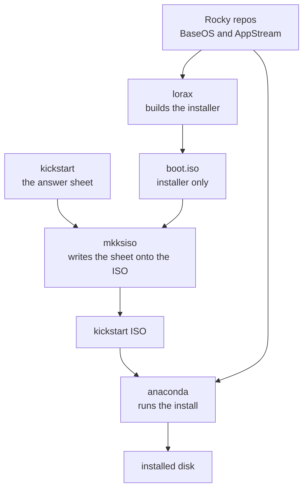
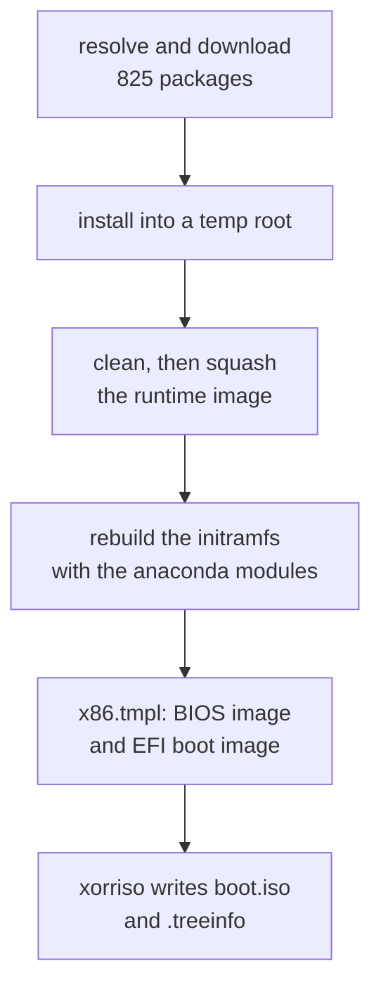

# 51 · Build your own install media

<ul class="module-meta">
  <li>⏱ ~3 hours</li>
  <li>5 labs</li>
  <li>Builds on: 23 · Automated Installs: Kickstart, PXE and Image Builder, 43 · Getting onto a disk: installer and media</li>
  <li>Environment: Tier C</li>
  <li>Verified: Rocky 10.2, 2026-11-06</li>
</ul>

You already built packages and a build system. Rocky makes install media at the Compose stage, in one long job that calls a tool named lorax. Here is yours, small: one boot ISO, built from Rocky's public repositories, wrapped with a kickstart, checked against the official ISO, and then installed unattended under software emulation.

On a four-vCPU x86_64 VM the build took 16 minutes 16 seconds. Wrapping it with a kickstart took 20 seconds. The unattended install under QEMU without KVM took about 51 minutes and the installed disk reached a login prompt in about 2 minutes. One honest limit up front: this ISO was built from the stock Rocky repositories. It is not a MyOrg-branded ISO, and nobody has tested one.

<div class="pipeline-strip" data-here="compose install" role="group" aria-label="Rocky build pipeline, six stages" markdown>

1. Source
2. Build
3. Sign
4. Compose
5. Publish
6. Install

</div>

*You are here: Compose (stage 4 of 6) and Install (stage 6 of 6). Before: Build, Sign. After: Publish, then your first boot.*

!!! abstract "What you'll learn"
    - Validate, flatten and compare kickstart files with `ksvalidator`, `ksflatten` and `ksverdiff`, and read the exit code.
    - Build a boot ISO with `lorax` and say what each phase of the build produced.
    - Add a kickstart to an ISO with `mkksiso` and prove what it changed.
    - Check an ISO's volume id, El Torito entries, root contents and checksum, and compare them with the official ISO.
    - Read a boot test from a machine without KVM: what it proves, and what it does not.
    - State exactly which image builders were tested here, on which architecture, and which were not tried.

## The big picture

You met the anatomy of an installer ISO in [module 43](43-installer-and-install-media.md) and the answer-sheet side of automated installs in [module 23](23-automated-installs.md). This module makes the object instead of describing it, and then uses the anatomy as an answer key: if your ISO differs from the official one, you should be able to say where and why.

There are two separate jobs. One builds the **installer**: a bootable environment that knows how to install packages. The other writes the **answer sheet** that tells the installer what to do. They meet when you put the answer sheet on the ISO.

### Install media in one sentence

> **Install media is an installer that can boot plus an answer sheet that says what to install: lorax builds the installer, a kickstart is the answer sheet, and mkksiso writes the sheet onto the ISO.**

Everything below uses these words the same way. The picture to keep is a courier van with a route sheet. The van knows how to drive and unload, the route sheet says where to go, and the goods wait in a warehouse (the repositories).

The analogy breaks in one place. A real van carries its goods. The boot ISO carries almost none: the installer pulls packages from the repositories named in the kickstart, so the ISO cannot tell you whether the warehouse is trustworthy.



The diagram shows the repositories feeding lorax, which makes `boot.iso`. The kickstart and `boot.iso` meet in mkksiso, which produces the kickstart ISO. Anaconda boots from that ISO, reads the answers, pulls packages from the same repositories and writes the installed disk.

### The few things that solve most problems

| Situation | What to do | Where this module teaches it |
|-----------|-----------|------------------------------|
| An install would fail on a typo, but you find out an hour in | Run `ksvalidator` first | Write the answer sheet first |
| You want to test the package part of a kickstart without a VM | `anaconda --dirinstall` into a directory | Try an install with no VM |
| You need a boot ISO of your own | `lorax` against your repositories | Build the installer with lorax |
| You want one ISO to install unattended | `mkksiso` with your kickstart | Put the answers on the ISO |
| You want to know if an ISO is built correctly | `xorriso` reports, `checkisomd5`, compare with the official ISO | The core skill, then Check the ISO |
| You want to know if it really installs | Boot it under QEMU, read the serial log | Boot it without KVM |
| You need a container, cloud or disk image | A different builder (KIWI), mostly not tried here | The other builders |

To pick one: if the question is about the answers, start with the kickstart tools. If it is about the installer, start with lorax. If it is about "does the thing boot", the boot test is the only honest answer.

### Words you'll see

| Word | Plain meaning |
|------|---------------|
| **kickstart** | A text file of answers (disk layout, packages, users) so an install runs without questions. |
| **Anaconda** | The Rocky installer program. It reads the kickstart and does the install. |
| **lorax** | The tool that builds the installer environment and the boot ISO. |
| **boot ISO** | A small ISO that contains the installer and boots it. It takes its packages from a network repository. |
| **install.img** | The compressed filesystem inside the ISO that holds the installer's userland. |
| **volume id (volid)** | The label of the ISO. Boot entries find the media by this label, so it must match everywhere. |
| **El Torito** | The standard that makes an ISO bootable. A boot catalog lists one image per platform (BIOS, UEFI). |
| **ESP** | The EFI System Partition, a small FAT partition that UEFI firmware boots from. |
| **`.treeinfo`** | A small file that describes an installer tree (which image is which). It sits next to the images, not inside `boot.iso`. |
| **mkksiso** | A tool that copies a kickstart onto an existing ISO and points every boot entry at it. |
| **TCG** | QEMU's software CPU emulation, used when the host has no KVM. Slow, but it runs anywhere. |
| **KIWI** | An image builder driven by an XML description. Rocky uses it for container, cloud and similar images. |
| **runroot** | A Koji task type that runs one command inside a build environment. |

## The core skill: read an ISO against an answer key

Before you build anything, learn to ask four questions of any ISO. They are the same four whether the ISO is Rocky's, yours or a vendor's, and none needs root.

1. What is the volume id and which tool wrote it?
2. What does the El Torito catalog list, and what paths do the entries point at?
3. What is at the root of the tree? Is there a `.treeinfo`, an `isolinux` directory, a kickstart?
4. Does `checkisomd5` pass?

The commands, run here on the official Rocky 10.2 x86_64 boot ISO:

```console
$ xorriso -indev Rocky-10.2-x86_64-boot.iso -pvd_info 2>&1 | grep -E 'Volume Id|Preparer'
Volume Id    : Rocky-10-2-x86_64-dvd
Preparer Id  : XORRISO-1.5.6 2023.06.07.180001, LIBISOBURN-1.5.6, LIBISOFS-1.5.6, LIBBURN-1.5.6
$ xorriso -indev Rocky-10.2-x86_64-boot.iso -report_el_torito plain 2>&1 | grep -E '^(Boot record|El Torito)'
Boot record  : El Torito , MBR protective-msdos-label grub2-mbr cyl-align-off GPT
El Torito catalog  : 136  1
El Torito images   :   N  Pltf  B   Emul  Ld_seg  Hdpt  Ldsiz         LBA
El Torito boot img :   1  BIOS  y   none  0x0000  0x00      4         137
El Torito boot img :   2  UEFI  y   none  0x0000  0x00  17660      507889
El Torito img path :   1  /images/eltorito.img
El Torito img opts :   1  boot-info-table grub2-boot-info
El Torito img blks :   2  4415
$ checkisomd5 Rocky-10.2-x86_64-boot.iso
The media check is complete, the result is: PASS.
```

Rocky 10.2 x86_64, 2026-11-06. Notice that image 2 (UEFI) has no `img path` line: it is a hidden image, and `xorriso` prints a note saying it found one. Notice also that the root holds only `.discinfo`, `EFI`, `boot` and `images`.

Now predict before you open the folds.

**Practice 1.** The `-find / -name '*treeinfo*'` command on this ISO prints only status lines and no path. Is there a `.treeinfo` inside `boot.iso`?

??? success "Answer: no"
    A find with no match prints no path, only xorriso's status lines. The official `boot.iso` has no `.treeinfo`. The one Rocky publishes sits next to the images in the repository tree, and lorax writes its own into the output directory (you will see it in Lab 2).

**Practice 2.** You build an ISO with lorax and its El Torito report shows `El Torito img path : 2 /images/efiboot.img`. The official ISO shows no path for image 2. Is yours broken?

??? success "Answer: no, it is a visible copy of the same kind of image"
    Both ISOs boot through a BIOS image and a UEFI image. Lorax leaves the UEFI image as a visible file, `/images/efiboot.img`. The official ISO carries only the hidden form. Both pass `checkisomd5`. The difference is real and worth knowing, but it is not a defect.

**Practice 3.** A kickstart ISO reports 335 ISO nodes and the plain lorax ISO 334. What is the extra node?

??? success "Answer: the kickstart file"
    mkksiso added `/lab-minimal.ks` at the root, under its own filename.

<div class="quiz" data-answer="2" markdown>

You list the root of an ISO and see `.discinfo`, `EFI`, `boot` and `images`, with no `Packages` directory. What does that tell you?

- It is a DVD ISO that carries its own packages
- It is a boot ISO: the installer is on the media and packages come from a repository
- The ISO is corrupt

Right: a boot ISO holds the installer only. That is why it is about 1 GB and why the kickstart must name repositories.

</div>

## Write the answer sheet first

A kickstart error found at minute 40 of an install costs 40 minutes. The `pykickstart` package ships three tools that find most problems in seconds. They are described in [module 23](23-automated-installs.md); here you measure them.

`ksvalidator` parses a kickstart the way the installer does and reports problems with line numbers. It checks syntax and version rules. It does not check that your disks or URLs exist.

```console
$ ksvalidator lab-minimal.ks
Checking kickstart file lab-minimal.ks
$ echo $?
0
$ printf 'bogus_cmd\n' > bad.ks
$ ksvalidator bad.ks
The following problem occurred on line 1 of the kickstart file:

Unknown command: bogus_cmd

…
$ echo $?
1
```

Rocky 10.2 x86_64, pykickstart 3.52.12, 2026-11-06. The good file returns 0 and the one-problem file returns 1. A second run on aarch64 used a file with two problems (an unknown command and a bad `rootpw`) and returned 2. That fits what module 23 says: the exit code counts problems.

<!-- ev: labs/final 04-media README part A; labs/V3 B1 | observed | Rocky 10.2 x86_64 VM, pykickstart 3.52.12, 2026-11-06 -->
!!! evidence "Observed: the bad-file exit code is 1, not 2"
    **Seen on:** Rocky 10.2 x86_64 (one-problem file) and Rocky 10.2 aarch64 (two-problem file), 2026-11-06.

    An earlier note recorded 2 for a bad file. That file had two problems. The one-line `bogus_cmd` file on x86_64 returned 1.

    **Check it yourself:** make a one-line bad file and a two-line bad file, run `ksvalidator` on each, then `echo $?`. The code should equal the number of problems reported.

The other two tools answer different questions.

`ksflatten -c lab-minimal.ks -o flat.ks` writes the kickstart back out in a canonical form. On the lab file the first two lines became `# Generated by pykickstart v3.52.12` and `#version=RHEL10`, the commands were re-ordered, `bootloader --location=mbr --timeout=1` gained its default location, and `%post --log=` was rewritten as `--logfile=`. We did not test it with a file that uses `%include`.

`ksverdiff -f RHEL9 -t RHEL10` lists what changed between two kickstart syntax versions. Rocky uses the RHEL version names. For 9 to 10 it reported these commands removed: `auth`, `authconfig`, `autostep`, `btrfs`, `method` and `nvdimm`. It reported `bootc` and `rdp` added and `vnc` deprecated. Run it before you reuse an old kickstart.

`ksvalidator -v RHEL10` pins the syntax version. The lab file passed both with and without it.

## Try an install with no VM

You do not need a VM to exercise most of a kickstart. `anaconda --dirinstall` runs the real installer against a directory: it resolves and installs packages, runs `%post`, and generates an initramfs, but it does not partition a disk or install a bootloader to one.

Two rules from the run. The kickstart must omit partitioning and `reboot` commands, and its path must be absolute because Anaconda changes directory. We did not keep the exact `dir.ks` from the run, so treat the rules as the record, not a file to copy.

```console
$ sudo dnf -y install anaconda anaconda-tui anaconda-install-env-deps
$ sudo mkdir -p /mnt/sysimage
$ time sudo anaconda --dirinstall /mnt/sysimage --kickstart /ABSOLUTE/PATH/dir.ks --text --nosave=all_ks
…
Generating initramfs
....
Running post-installation scripts
...
Complete!
Installation complete
…
Installation complete. Press ENTER to quit:
real	1m41.293s
```

Rocky 10.2 aarch64 (Lima VM, 4 CPU, 8 GiB), anaconda 40.22.3.46, 2026-11-06. This was not run on x86_64. It installed 341 packages, about 1076 MB, into `/mnt/sysimage` with a kernel, an initramfs and a `grub2` directory, plus logs under `/var/log/anaconda/`. It prints "Press ENTER to quit" and waits.

Our reading is that this proves the package list and `%post` work, not that the disk layout or bootloader will. Storage and bootloader steps are exactly what `--dirinstall` skips. The boot test later in this module covers them.

## Build the installer with lorax

**lorax** installs a chosen set of packages into a temporary directory, prunes it, squashes it into the runtime image, rebuilds the initramfs, adds a bootloader and writes the ISO. Its recipes are Mako templates in `/usr/share/lorax/templates.d/`, one directory per set. Rocky ships its set in the `lorax-templates-rocky` package.

<!-- ev: labs/final 04-media a-lorax.log; ERRATA C15; FACTBASE-B 3.10 | observed | Rocky 10.2 x86_64 VM, 2026-11-06 -->
!!! evidence "Observed: lorax picks the 70-rocky templates"
    **Seen on:** Rocky 10.2 x86_64, lorax 40.5.15-1.el10.rocky.0.4, 2026-11-06.

    ```console
    $ grep -a templatedir lorax.log
    … Using templatedir /usr/share/lorax/templates.d/70-rocky
    $ dnf repoquery --provides lorax-templates-rocky
    lorax-templates = …
    lorax-templates-rhel = …
    lorax-templates-rocky = …
    ```

    **Check it yourself:** run the `repoquery` on any Rocky 10 system (versions trimmed above). The package provides the name `lorax-templates-rhel` even though no package of that name exists. On x86_64 and on aarch64 the same package ships an `80-rhel` directory next to `70-rocky`. On x86_64 `diff -r` found the two directories identical (checked 2026-11-06), and lorax took the lowest-numbered one.

The command that built the ISO in Lab 2, with the flags that matter:

```bash
lorax --product "Rocky Linux" --version 10.2 --release 10.2 --variant BaseOS \
  --volid Lab-Rocky-10-2-x86_64 --isfinal \
  --source https://dl.rockylinux.org/pub/rocky/10/BaseOS/x86_64/os/ \
  --source https://dl.rockylinux.org/pub/rocky/10/AppStream/x86_64/os/ \
  --bugurl https://example.invalid/lab --nomacboot \
  --logfile /var/tmp/lab04/lorax.log --workdir /var/tmp/lab04/lorax-work \
  --cachedir /var/tmp/lab04/lorax-cache /var/tmp/lab04/lorax-out
```

The two `--source` repositories are where lorax gets its packages. `--volid` sets the ISO label, and boot entries find the media by that label, so it matters. `--isfinal` shows up as `IsFinal=True` in the `.buildstamp` of the official installer. `--bugurl` ends up in the `.buildstamp` too (Rocky's reads `https://bugs.rockylinux.org`; ours is a placeholder). `--nomacboot` is described in `lorax(1)` as "Do not create a Mac bootable iso". The official x86_64 ISO's El Torito catalog lists only a BIOS and a UEFI image, so it has no Mac boot entry. The output directory must not exist, and lorax writes its logs into the current directory, so run it from a scratch directory.

Here is where the 16 minutes went, from the log's own timestamps.

<div class="stepper" markdown>

<div class="step" data-title="Resolve and download" markdown>

Lorax reads both repositories, resolves dependencies and downloads the packages. The log says `825 packages selected`, about 1.0 GB, in about 25 seconds on this VM. The runtime package list comes from the template `runtime-install.tmpl`. `grub2-pc-modules` and `grub2-efi-x64-cdboot` are in it, which is why x86_64 gets both BIOS and UEFI boot.

</div>

<div class="step" data-title="Install into a temp root" markdown>

The 825 packages (2026-11-06 run) are installed into the work directory. This and the package scriptlets took about 5 minutes (00:03:36 to 00:08:31 in the log). The step ends by writing `.buildstamp`.

</div>

<div class="step" data-title="Clean and verify" markdown>

`runtime-postinstall.tmpl` and `runtime-cleanup.tmpl` run, kernel module metadata is generated, and lorax verifies the installroot. About 14 seconds.

</div>

<div class="step" data-title="Squash the runtime image" markdown>

The installroot is compressed into `images/install.img` with xz. This is the slowest phase: **8 minutes 10 seconds** (00:08:45 to 00:16:55), about half of the whole build, on 4 vCPU.

</div>

<div class="step" data-title="Rebuild the initramfs" markdown>

Lorax rebuilds the boot initramfs with `dracut`, adding the `anaconda`, `pollcdrom` and `qemu` modules among others. 2 minutes 15 seconds.

</div>

<div class="step" data-title="Write the tree and ISO" markdown>

`x86.tmpl` creates the BIOS image (`eltorito.img`) and the EFI boot image, copies the kernel and initramfs into `images/pxeboot/`, and writes `boot.iso` and `.treeinfo`. About 15 seconds.

</div>

</div>

The stepper follows the log from the first line to the `.treeinfo` write. Total wall time was 16 minutes 16 seconds on 4 vCPU, with 35 minutes of CPU time, so the build uses more than one core for part of its run.



The diagram shows the same six phases as the stepper in a chain: packages first, then the squashed runtime image, then the initramfs, then the boot images and the final ISO.

<!-- ev: labs/final 04-media README part B; a-lorax.log | observed | Rocky 10.2 x86_64 VM (AWS t3.xlarge, 4 vCPU), 2026-11-06 -->
!!! evidence "Observed: the output tree has .treeinfo and a visible efiboot.img"
    **Seen on:** Rocky 10.2 x86_64, 2026-11-06.

    ```text
    lorax-out/.discinfo   .treeinfo
    lorax-out/EFI/BOOT/{BOOTX64.EFI, grubx64.efi, mmx64.efi, grub.cfg, fonts/unicode.pf2}
    lorax-out/boot/grub2/grub.cfg
    lorax-out/images/{boot.iso, efiboot.img, eltorito.img, install.img, pxeboot/{initrd.img, vmlinuz}}
    ```

    **Check it yourself:** after Lab 2, `ls -a lorax-out lorax-out/images`. The `.treeinfo` is 415 bytes and describes only the installer images (family, name, variant, arch, `[stage2] mainimage = images/install.img`, and the boot image paths). The `.treeinfo` on Rocky's public tree is bigger and also lists the variants.

<!-- ev: labs/final 04-media README; a-lorax.log | observed | Rocky 10.2 x86_64 VM, 2026-11-06 -->
!!! freshness "As of 2026-11-06 on Rocky 10.2"
    Lorax is 40.5.15-1.el10.rocky.0.4 in AppStream, and this run installed 825 packages (816 on aarch64). The mechanism is stable. The package count, the build time (16 minutes 16 seconds here, 5 minutes 22 seconds on a 4-CPU aarch64 VM) and the ISO size (1,096,871,936 bytes) all drift with the repositories and the VM. This changes with every kernel and package update.

    **Re-check:** `rpm -q lorax pykickstart anaconda` and `time lorax ...` as in Lab 2.

The lab ISO is larger than Rocky's: 1,096,871,936 bytes against 1,049,538,560 (2026-11-06). They are not like for like. Lorax pulled the newest kernel (211.74.1 at the time), while the official ISO was built once for 10.2 with kernel 211.16.1.

## Put the answers on the ISO

**mkksiso** ships inside the `lorax` package. It takes an ISO and a kickstart and writes a new ISO. It does not rebuild the installer. It copies the kickstart onto the ISO under its own filename, appends an `inst.ks=` argument to every boot entry, keeps the volume id and re-implants the media checksum.

```console
$ time sudo mkksiso --ks lab-minimal.ks lab-boot.iso lab-boot-ks.iso
…
real	0m19.6s
```

Rocky 10.2 x86_64, 2026-11-06. It needs root, because it calls `mkefiboot`. The output was 1,096,941,568 bytes, 69,632 bytes bigger than its input. The extra node at the ISO root is `/lab-minimal.ks`, and every boot entry (including the rescue entry) gained `inst.ks=hd:LABEL=Lab-Rocky-10-2-x86_64:/lab-minimal.ks`. `checkisomd5` still passed on the new ISO.

Three more options changed the ISO for the boot test: `-c` adds kernel arguments, `-r` removes them, and `-R FROM TO` rewrites strings in `grub.cfg`.

!!! danger "A kickstart ISO wipes disks without asking"
    `lab-minimal.ks` contains `clearpart --all --initlabel`. An ISO built from it erases every disk it can see and starts installing, with no prompt. Boot it only in a VM with a disposable disk.

## Check the ISO against the answer key

You now have two ISOs to compare with the official one. This is the core skill applied. The columns are your lorax ISO, the mkksiso ISO and the official 10.2 boot ISO.

| Item | lorax ISO | mkksiso ISO | official boot.iso |
|------|-----------|-------------|-------------------|
| Volume id | `Lab-Rocky-10-2-x86_64` (our `--volid`) | same | `Rocky-10-2-x86_64-dvd` |
| Preparer | XORRISO-1.5.6 | same | same string |
| BIOS image | `/images/eltorito.img` | same | same |
| UEFI image | `/images/efiboot.img`, a visible file | same | hidden, no path |
| System area | MBR protective label, grub2-mbr, GPT | same | same |
| Appended GPT partition 2 | yes, EFI System type | yes | yes |
| `.treeinfo` in the ISO | none | none | none |
| `isolinux` | none | none | none |
| ISO nodes | 334 | 335 | 333 |
| `checkisomd5` | PASS | PASS | PASS |

<div class="layers" data-hint="Click a layer to see what lives there." markdown>

<div class="layer" data-label="ISO9660 tree" data-tag="files" markdown>

The ordinary files: `.discinfo`, `EFI/`, `boot/` and `images/`. A kickstart ISO adds the kickstart file here. Read it with `xorriso -indev X.iso -ls`.

</div>

<div class="layer" data-label="El Torito BIOS entry" data-tag="eltorito.img" markdown>

A boot catalog entry pointing at `/images/eltorito.img`, built from the grub2 `i386-pc` modules. The same on lorax and official ISOs.

</div>

<div class="layer" data-label="El Torito UEFI entry" data-tag="efiboot.img" markdown>

A second catalog entry for UEFI. Lorax points it at a visible `/images/efiboot.img`. The official ISO points it at the appended partition instead, with no file path.

</div>

<div class="layer" data-label="Appended ESP (GPT 2)" data-tag="FAT, EFI" markdown>

A FAT partition added after the ISO data and described in a GPT. UEFI firmware can boot from it directly. Both ISOs have it.

</div>

<div class="layer" data-label="System area" data-tag="MBR and GPT" markdown>

The first sectors of the file: a protective MBR with the grub2 boot code, plus a GPT, so firmware can treat the file as a disk as well as a CD.

</div>

</div>

The layers read top to bottom from the files you can list down to the bytes the firmware reads first. Module 43 teaches each layer; the table above is where yours matches Rocky's.

<!-- ev: labs/final 04-media README part C; b-inspect.log | observed | Rocky 10.2 x86_64 VM, 2026-11-06 -->
!!! evidence "Observed: lorax leaves a visible efiboot.img that the official ISO lacks"
    **Seen on:** Rocky 10.2 x86_64, 2026-11-06.

    ```console
    $ xorriso -indev lab-boot.iso -report_el_torito plain 2>&1 | grep 'img path'
    El Torito img path :   1  /images/eltorito.img
    El Torito img path :   2  /images/efiboot.img
    ```

    On the official ISO the same command prints only image 1, and the `as_mkisofs` report carries a libisofs note, `Found hidden El-Torito image for EFI`.

    **Check it yourself:** run the command on your ISO and on the official one (Lab 3). Only yours should list `/images/efiboot.img`.

Everything else matched, including the preparer string. The boot menu matched too: we compared the two `grub.cfg` files (extracted separately, not by a Lab 3 step) and found them identical apart from the label. On both, `set default="1"` selects the "Test this media" entry and `set timeout=60`. How Rocky ends up with the hidden form of the UEFI image is on the unknown list below.

??? version "Comparison lens: the sibling distributions"
    From saved captures of other distributions' boot ISOs, not re-run on 2026-11-06: AlmaLinux's boot ISO was written by xorriso 1.5.7 (Rocky's by 1.5.6) and AlmaLinux customises its installer configuration. CentOS Stream's `.buildstamp` named lorax 40.5.19-1 against Rocky's 40.5.15-1. Rocky needs no installer patch for branding because its profile ships in stock Anaconda. **Check it yourself:** unpack `images/install.img` from each ISO and read `.buildstamp`.

## Boot it without KVM

A structural check cannot prove an ISO installs. Only booting it can. The lab VM had no `/dev/kvm`, so QEMU ran its software CPU, TCG, which is slow but works anywhere. The test used a smaller kickstart, `lab-tcg.ks`, so it would finish.

!!! danger "Throwaway VM only"
    This kickstart erases every disk the installer can see (`clearpart --all`) and sets a throwaway root password, `labpass`, that is public on this page. Boot it only in a disposable VM, never on real hardware, and never reuse the password.

```bash
text
poweroff
lang en_US.UTF-8
keyboard us
timezone UTC --utc
rootpw --plaintext labpass
network --bootproto=dhcp --device=link --activate --hostname=lab-tcg
selinux --enforcing
firewall --disabled
services --disabled=firewalld
zerombr
clearpart --all --initlabel
autopart --type=plain --nohome
bootloader --timeout=1 --append="console=ttyS0,115200n8"
url --url=https://dl.rockylinux.org/pub/rocky/10/BaseOS/x86_64/os/
repo --name=AppStream --baseurl=https://dl.rockylinux.org/pub/rocky/10/AppStream/x86_64/os/

%packages --nocore --inst-langs=en --exclude-weakdeps
bash
coreutils
rocky-release
systemd
kernel
dnf
passwd
openssh-server
-iwl*-firmware
%end
```

The kickstart installs from the network, ends with `poweroff` and puts everything on the serial console. Anaconda pulled 249 packages (201.83 MiB) in the 2026-11-06 run. Before the run, `mkksiso` made the ISO serial-friendly (the worked story below shows that command). The install command, exactly as run:

```bash
qemu-img create -f qcow2 disk.qcow2 8G
cp /usr/share/edk2/ovmf/OVMF_VARS.fd .
nice -n 10 /usr/libexec/qemu-kvm -accel tcg,thread=multi -machine q35 -cpu max -smp 4 -m 4096 \
  -drive if=pflash,format=raw,readonly=on,file=/usr/share/edk2/ovmf/OVMF_CODE.fd \
  -drive if=pflash,format=raw,file=$PWD/OVMF_VARS.fd \
  -drive file=$PWD/disk.qcow2,if=virtio,format=qcow2 \
  -drive file=/var/tmp/lab04/lab-tcg.iso,media=cdrom,readonly=on \
  -nic user,model=virtio-net-pci -display none -serial stdio -monitor none
```

`-cpu max` matters: Rocky 10 needs an x86-64-v3 CPU, and the lab used `-cpu max` under TCG to meet it. We did not run it without that flag, so we cannot show you what fails. The binary is `/usr/libexec/qemu-kvm`, which is not on `PATH`.

<div class="stepper" markdown>

<div class="step" data-title="Firmware to Anaconda" markdown>

OVMF, grub, kernel and `dracut` run until Anaconda starts: about 5 minutes. Another 5 minutes pass before "Starting automated install".

</div>

<div class="step" data-title="Storage" markdown>

Four partitions are created and formatted (`Creating xfs on /dev/vda4`, `Creating efi on /dev/vda1`): about 4 minutes.

</div>

<div class="step" data-title="Download and install" markdown>

249 packages (2026-11-06 run) download in about 2 minutes. The RPM transaction takes about 7 minutes.

</div>

<div class="step" data-title="The slow step: kernel-core" markdown>

The `kernel-core` scriptlets run `dracut` under emulation: about **11 minutes** with nothing new on screen.

</div>

<div class="step" data-title="Configure and initramfs" markdown>

Configuring the installed system takes about 2 minutes. Then `Generating initramfs` takes about **11 minutes** again.

</div>

<div class="step" data-title="Power off, then boot the disk" markdown>

The guest powers off after under a minute. Booting the same disk with the ISO removed (`-m 2048`) reached `lab-tcg login:` in about 110 seconds.

</div>

</div>

The stepper totals about 51 minutes of install on a 4 vCPU host that gave QEMU about 190 to 200 percent of 400 percent. About 22 of the 51 minutes are the two `dracut` runs.

<!-- ev: labs/final 05-boot README; install.clean.log; boot.clean.log | observed | Rocky 10.2 x86_64 VM (AWS t3.xlarge, no KVM), 2026-11-06 -->
!!! evidence "Observed: the lorax ISO installed 249 packages unattended and the disk booted to a login prompt"
    **Seen on:** Rocky 10.2 x86_64, QEMU TCG (`qemu-kvm 10.1.0-16.el10_2.5`, `edk2-ovmf 20251114-5.el10_2.2`), 2026-11-06.

    Install log, then boot log, trimmed:

    ```text
    Command line: BOOT_IMAGE=/images/pxeboot/vmlinuz inst.stage2=hd:LABEL=Lab-Rocky-10-2-x86_64 console=ttyS0,115200n8 inst.text inst.ks=hd:LABEL=Lab-Rocky-10-2-x86_64:/lab-tcg.ks
    anaconda 40.22.3.46-1.el10.rocky.0.6 for Rocky Linux 10.2 started.
    Downloading 249 RPMs, 198.54 MiB / 201.83 MiB (98%) done.
    …
    Loaded X.509 cert 'Rocky Enterprise Software Foundation: Rocky Linux kernel signing key: …'
    …
    lab-tcg login:
    ```

    **Check it yourself:** you do not have to rerun it. Read Lab 4. The relationships to check are that the first line carries the same label in `inst.stage2` and `inst.ks`, that there is no `rd.live.check`, and that the last line is a login prompt.

What this does not prove is as important. A login was never typed: standard input was not wired. Whether `root` could log in with the kickstart password, what SELinux's state was, and whether the guest had working networking were not tested. A login prompt shows that systemd reached its multi-user state and started the serial getty, nothing more. And again, this is the stock-repository ISO, not a MyOrg-branded one.

## The other builders: KIWI and livemedia-creator

Boot ISOs are lorax's job. Other artifacts use other builders, and this is the part of the module where the honest answer is mostly "not tried".

**KIWI** builds images from an XML description. Rocky publishes its descriptions in the public repository `sig_core/rocky-kiwi-descriptions` on `git.resf.org`, with a branch per release (`r10` for Rocky 10; `main` is a stub). It produces container images, cloud images and similar. Module 44 covers what those images contain.

**Tested, on aarch64 only.** A KIWI `Container-Base` build ran on a Rocky 10.2 aarch64 VM (Lima, 4 CPU, 8 GiB) in 1 minute 2 seconds of build time and about 20 to 30 minutes with setup. It was not run on x86_64. The core command was:

```bash
kiwi-ng --type=oci --profile=Container-Base --kiwi-file=config.xml --color-output system build --description=. --target-dir OUT
```

The result was `Rocky.aarch64-10.oci.tar.xz`, 68 MB with 139 packages (2026-11-06), and `podman load` turned it into a `localhost/rockylinux:10` image of 210 MB. Four things went wrong on the way:

- KIWI's dependencies need the CRB repository, which is off by default (`python3-rich` needs `python3-pygments`).
- The default branch `main` is a stub. You need `-b r10`.
- With kiwi 11.1.1 from EPEL, the `r10` descriptions failed schema validation until the `vagrant/vagrant.xml` include was removed from `config.xml`. The descriptions' README targets an older kiwi.
- The descriptions point at the staging tree by default. The run rewrote that to the public `pub/rocky` path, and the descriptions' README asks for SELinux in permissive mode, which the run did on a throwaway VM.

<!-- ev: labs/V3 Tier D; FACTBASE-B L8 | observed | Rocky 10.2 aarch64 Lima VM, 2026-11-06 -->
!!! evidence "Observed: KIWI Container-Base builds on aarch64 (x86_64 not tried)"
    **Seen on:** Rocky 10.2 aarch64, kiwi 11.1.1 from EPEL, 2026-11-06.

    **Check it yourself:** the repository and branch are public: `git ls-remote --heads https://git.resf.org/sig_core/rocky-kiwi-descriptions`. The build itself needs root and a throwaway machine. We have not run it on x86_64.

**Not tried on x86_64.** The KIWI disk-image build (the `oem` type with a `Cloud-Base` profile) and `livemedia-creator --make-disk` were not tried on x86_64. A script for the KIWI container build on x86_64 was written and never run.

**Failed on aarch64, cause unknown.** `livemedia-creator --make-disk --no-virt` ran for about 90 seconds of package installation on aarch64 and then stopped.

!!! pitfall "`livemedia-creator --make-disk --no-virt` stopped with an unexplained error"
    **Symptom (aarch64 only):** `Non interactive installation failed: Failed to set new efi boot target. This is most likely a kernel or firmware bug.` It happened at the bootloader step, also with `efibootmgr` installed and with `--anaconda-arg=--leavebootorder`. A second mode, `--make-tar --no-virt`, failed with `umount of /run/credentials/serial-getty@hvc0.service failed (32)`.

    **Cause:** unknown. We do not know whether it reproduces on x86_64, because it was not tried there.

    **Fix:** none to offer. This module gives no recipe. A failed run leaves mounts, device-mapper devices and loop devices behind, so inspect them (`findmnt`, `losetup -a`, `dmsetup ls`) and remove only what the failed run created. Do not run it on a machine you care about.

## How Rocky does this in production

Rocky does not run `lorax` by hand. As of 2026-11, its release engineers run Pungi, a compose tool, which calls lorax for the installer images and has a KIWI phase for the rest. Everything in this section comes from public configuration, read on 2026-11-06 (Re-check: the `grep` in the freshness box below).

- Pungi's buildinstall phase uses lorax: `buildinstall_method = "lorax"`.
- The lorax options Rocky sets are visible: `noupgrade` false, `squashfs_only` true, and `bugurl` `https://bugs.rockylinux.org`. The configuration does not show the full lorax command line.
- Pungi is set to run its commands as Koji `runroot` tasks: `global_runroot_method = "koji"`, with the runroot tag `dist-rocky10.2-build`. The `createiso` step is set to run locally instead.
- The ISO label comes from a format string, `image_volid_formats = [ '{release_short}-{version}-{arch}-{disc_type}' ]`. That fits the official label `Rocky-10-2-x86_64-dvd` (our reading: dots in the version become dashes and the disc type is `dvd`; we did not read Pungi's code to confirm).
- KIWI images come from Pungi's `kiwibuild` phase against the Koji target `dist-rocky10.2-kiwi`, using the `r10` branch of the descriptions repository above.
- Installer images are not built for every variant. The shared config skips `AppStream`, `CRB`, `HighAvailability`, `SAP`, `SAPHANA`, `RT` and `NFV`.

<!-- ev: pungi-rocky r10.2 shared/buildinstall.conf, shared/runroot.conf, rocky/override.conf; FACTBASE-A hop 6 | official | git.rockylinux.org/rocky/pungi-rocky branch r10.2, read 2026-11-06 -->
!!! freshness "As of 2026-11-06 on Rocky 10.2"
    Rocky composes with Pungi today, and a public request to replace it with something that scales better is open (releng issue 49, state open on 2026-11-06). Treat the tool name as the part that may change. The idea of a compose, one long job that builds the trees and the installer images, is stable. This changes at the next tooling decision or the next release branch.

    **Re-check:** `git clone --depth 1 -b r10.2 https://git.rockylinux.org/rocky/pungi-rocky.git && grep -rnE "buildinstall_method|global_runroot_method|kiwibuild_target|squashfs_only|image_volid_formats" pungi-rocky` (run again on 2026-11-06: branch head `e5796d5`, committed 2026-10-07)

??? question "How does the lab command differ from what Rocky publishes?"
    Rocky's public Pungi configuration for 10.2 sets three lorax options (Re-check: the `grep` in the freshness box above; as of 2026-11): `noupgrade` false, `squashfs_only` true and `bugurl` `https://bugs.rockylinux.org` (`rocky/override.conf`; the shared file sets the first two). Our lab command passed `--isfinal`, `--bugurl` with a placeholder, `--nomacboot` and a `--volid` of our own, and did not pass `--squashfs-only` or anything for `noupgrade`.

    The omission turns out not to matter for the structure of `install.img`. On the lab VM, `lorax(1)` for lorax 40.5.15 says of `--squashfs-only`: "Ignored, provided for backward compatibility." Our `install.img` is a plain xz squashfs with no `LiveOS` directory, which is the same kind of file as the official one (checked with `file` and `unsquashfs -l` on 2026-11-06). The sizes differ (823,930,880 bytes against 786,558,976) and we did not diff the contents. `lorax(1)` gives `--rootfs-size` a default of 3 (GiB), and we did not set it.

    What we cannot say is what Pungi turns its settings into on the real command line, because we did not read Pungi's code for that. So we make no claim that our lab output equals Rocky's production output. The exact lorax command line used in production today: I found no public description.

<div class="quiz" data-answer="3" markdown>

Where do you read which lorax options Rocky's production compose sets?

- In the `lorax` man page
- In the `.buildstamp` inside the official ISO
- In the public Pungi configuration for the release branch

Right: the options are in `pungi-rocky` (as of 2026-11; Re-check: the `grep` in the freshness box above). The `.buildstamp` records the product, version, bug URL, final flag and lorax version, not the full set of options. The full production command line is not public.

</div>

## Worked story: the ISO that spent an hour checking itself

**Symptom (anticipated, then avoided in the lab).** You wrap the lorax ISO with a kickstart and boot it in QEMU. The risk is a long wait with nothing on the console, then a media check. We did not let it run, because the log of the setup showed the cause in advance.

**Evidence.** The ISO's `grub.cfg` has `set default="1"` and `set timeout=60`. Entry 1 is "Test this media", which adds `rd.live.check` to the kernel command line. Checksumming a 1 GB ISO under TCG would be slow, and the 60-second countdown adds a wait before it even starts. The lorax ISO has the same `grub.cfg` as the official one apart from the label.

**Reasoning.** The default entry is a feature for real media and a trap in emulation. You want entry 0, a short timeout, no media check and no `quiet`, so the serial console shows the whole boot. `mkksiso` can change all of that on the existing ISO.

**Fix.** The command from the lab:

```bash
mkksiso --ks lab-tcg.ks \
  -c "console=ttyS0,115200n8 inst.text" \
  -r "rd.live.check quiet" \
  -R 'set timeout=60' 'set timeout=3' \
  -R 'set default="1"' 'set default="0"' \
  lab-boot.iso lab-tcg.iso
```

**Check.** The kernel command line in the install log is the proof: it carries `console=ttyS0,115200n8 inst.text` and `inst.ks=hd:LABEL=Lab-Rocky-10-2-x86_64:/lab-tcg.ks`, with no `rd.live.check` and no `quiet`. The install started on its own after a 3-second countdown.

<div class="decision" markdown>

<div class="node" data-id="start" markdown>

**Your ISO boots but does not install by itself. Which is it?**

<button data-goto="asks">The installer asks questions</button> <button data-goto="check">It sits at a media check</button> <button data-goto="slow">It installs but seems frozen</button>

</div>

<div class="node" data-id="asks" markdown>

The installer did not find or read the kickstart. Look at the kernel command line for `inst.ks=hd:LABEL=<volid>:/<file>`. The label must equal the volume id exactly (`xorriso -indev X.iso -pvd_info`), and the file must be at the ISO root (`xorriso -indev X.iso -ls`). Check that the kickstart passes `ksvalidator`.

</div>

<div class="node" data-id="check" markdown>

The default entry is "Test this media" (`rd.live.check`). Remove it with `mkksiso -r rd.live.check`, or choose the first entry in `grub.cfg` with `-R`.

</div>

<div class="node" data-id="slow" markdown>

Under TCG, `kernel-core` scriptlets and `Generating initramfs` take about 11 minutes each with no new output. Check that QEMU is using CPU before you stop it. Use `pkill -x qemu-kvm` to stop it, not `pkill -f`.

</div>

</div>

<div class="terminal-sim" data-title="Validate before you build" markdown>

<div class="task" data-expect="ksvalidator lab-minimal.ks" data-hint="Run ksvalidator on the kickstart file." markdown>

**Step 1.** Validate the good kickstart.

```text
Checking kickstart file lab-minimal.ks
```

</div>

<div class="task" data-expect="ksvalidator bad.ks" data-hint="Same tool, the file bad.ks, which contains one unknown command." markdown>

**Step 2.** Validate the bad one-line file.

```text
The following problem occurred on line 1 of the kickstart file:

Unknown command: bogus_cmd

…
```

</div>

<div class="task" data-expect="echo $?" data-hint="Print the exit status of the last command." markdown>

**Step 3.** Read the exit code.

```text
1
```

</div>

<div class="task" data-expect="checkisomd5 lab-boot.iso" data-hint="The checkisomd5 command takes the ISO file name." markdown>

**Step 4.** Check the media checksum of the lorax ISO.

```text
The media check is complete, the result is: PASS.

It is OK to use this media.
```

</div>

</div>

<div class="quiz" data-answer="2" markdown>

The TCG install seems to be doing nothing at `Generating initramfs`. What do you do first?

- Kill QEMU and rebuild the ISO
- Check that QEMU is still using CPU, then wait: this step took about 11 minutes
- Add `-cpu max`, which was missing

Right: the log showed two long steps, the `kernel-core` scriptlets and the initramfs generation, about 11 minutes each. `-cpu max` was already in the command.

</div>

<div class="quiz" data-answer="2" markdown>

Which statement does the boot test support?

- A MyOrg-branded ISO installs and boots
- An ISO built by lorax from stock Rocky repositories installed unattended and its disk reached a login prompt under TCG
- `livemedia-creator` builds bootable disks on x86_64

Right. A MyOrg ISO was never built or booted, and livemedia-creator was not tried on x86_64.

</div>

!!! unknown "What nobody outside the project can tell you"
    - The exact lorax command line Rocky's production compose runs today. The public Pungi configuration (as of 2026-11; Re-check: the `grep` in the freshness box above) shows the options it sets, not the full command line. I found no public description.
    - How Rocky's official ISO ends up with a hidden EFI image where a plain lorax run leaves a visible `efiboot.img`. Our reading is that something after lorax (or different options) changes it. Not public.
    - Whether Koji's KIWI results are signed in the RPM path, and who signs the ISO `CHECKSUM` file. Not public.
    - Whether KIWI disk images and `livemedia-creator --make-disk` work on x86_64, and why the aarch64 `Failed to set new efi boot target` error happens. Not tested here.
    - Whether an ISO built from your own repositories, with your own release package, installs and boots. Not tested here; module 52 covers the repository side.

## Labs

!!! tip "Lab kit"
    The kickstarts, the lorax and mkksiso script, the ISO inspection script and the QEMU boot scripts are in kits 04 and 05 on the [lab kits](lab-kits.md) page.

!!! lab "Lab 1: Validate, flatten and compare a kickstart"

    - **Tier** A: Rocky shell
    - **Status** Tested
    - **Time** about 5 minutes (each command finishes in seconds)
    - **Hardware** any Rocky 10 shell
    - **Tested on** Rocky 10.2 x86_64 VM (AWS t3.xlarge), pykickstart 3.52.12, 2026-11-06

    **Goal:** Check a kickstart for problems before it costs you an install.

    **You'll need:** a Rocky 10 shell and sudo.

    1. Install the tools.

        ```bash
        sudo dnf -y install pykickstart
        ```

    2. Write the kickstart. It is only ever validated in this lab, never booted. If you boot an ISO built from it, it wipes the disks.

        ```bash
        cat > lab-minimal.ks <<'EOF'
        # lab-minimal.ks - tiny unattended Rocky 10 install (x86_64 lab, UEFI or BIOS)
        # WARNING: wipes every disk it can see. Use in a VM only.
        text
        reboot --eject
        lang en_US.UTF-8
        keyboard us
        timezone UTC --utc
        rootpw --plaintext labpass
        network --bootproto=dhcp --device=link --activate --hostname=lab-ks
        selinux --enforcing
        firewall --enabled --ssh
        zerombr
        clearpart --all --initlabel
        autopart --type=plain --nohome
        bootloader --timeout=1
        url --url=https://dl.rockylinux.org/pub/rocky/10/BaseOS/x86_64/os/
        repo --name=AppStream --baseurl=https://dl.rockylinux.org/pub/rocky/10/AppStream/x86_64/os/

        %packages --inst-langs=en
        @^minimal-environment
        -iwl*-firmware
        %end

        %post --log=/root/ks-post.log
        echo "installed by lab-minimal.ks on $(date -u)" > /etc/motd
        %end
        EOF
        ```

    3. Validate it twice, then flatten it and compare syntax versions.

        ```bash
        ksvalidator lab-minimal.ks; echo "rc=$?"
        ksvalidator -v RHEL10 lab-minimal.ks; echo "rc=$?"
        ksflatten -c lab-minimal.ks -o flat.ks; head -2 flat.ks
        ksverdiff -f RHEL9 -t RHEL10
        ```

    4. Break a file on purpose and read the code.

        ```bash
        printf 'bogus_cmd\n' > bad.ks
        ksvalidator bad.ks; echo "rc=$?"
        ```

    **Check your work:** the good file returns `rc=0` both times, the first two lines of `flat.ks` are `# Generated by pykickstart v3.52.12` and `#version=RHEL10`, and `bad.ks` prints `Unknown command: bogus_cmd` with `rc=1`. If `bad.ks` gives a different code, count the problems it printed: the code should match. If the versions differ, your pykickstart is newer or older than 3.52.12 and the generated header will show it.

    ??? success "What just happened?"
        The tools parsed the file with the same rules the installer uses. `ksflatten` wrote it back in canonical order and filled in defaults. `ksverdiff` compared two syntax versions and listed commands removed, added and deprecated, which is the quickest way to find what an old Rocky 8 or 9 kickstart will trip over on Rocky 10.

    **Clean up:** `rm -f lab-minimal.ks flat.ks bad.ks`

!!! lab "Lab 2: Build a boot ISO with lorax and wrap it with a kickstart"

    - **Tier** C: root VM
    - **Status** Tested
    - **Time** about 25 minutes (lorax 16m16s and mkksiso 19.6 s measured; package install and downloads on top)
    - **Hardware** 4 vCPU and 8 GiB RAM as a floor; 4.2 GB of disk for the output, work directory and two ISOs (measured)
    - **Tested on** Rocky 10.2 x86_64 VM (AWS t3.xlarge, 4 vCPU, 15 GiB, no KVM), lorax 40.5.15-1.el10.rocky.0.4, 2026-11-06

    **Goal:** Build `boot.iso` from the public repositories and add `lab-minimal.ks` to a copy.

    **You'll need:** a throwaway Rocky 10 VM with root, network access to `dl.rockylinux.org`, and `lab-minimal.ks` from Lab 1 in your home directory.

    1. Install the tools and put the kickstart at an absolute path root can read.

        ```bash
        sudo dnf -y install xorriso squashfs-tools isomd5sum lorax lorax-templates-rocky pykickstart
        sudo cp ~/lab-minimal.ks /var/tmp/lab-minimal.ks
        ```

    2. Build the ISO as root from a scratch directory. The output directory must not exist.

        ```bash
        sudo -i
        W=/var/tmp/lab04; rm -rf $W; mkdir -p $W/scratch; cd $W/scratch
        R=https://dl.rockylinux.org/pub/rocky/10
        time lorax --product "Rocky Linux" --version 10.2 --release 10.2 --variant BaseOS \
          --volid Lab-Rocky-10-2-x86_64 --isfinal \
          --source $R/BaseOS/x86_64/os/ --source $R/AppStream/x86_64/os/ \
          --bugurl https://example.invalid/lab --nomacboot \
          --logfile $W/lorax.log --workdir $W/lorax-work --cachedir $W/lorax-cache $W/lorax-out
        ls -la $W/lorax-out $W/lorax-out/images
        ```

    3. Copy the ISO and wrap it. Use an absolute path to the kickstart: the first scripted run built that path from the wrong directory and mkksiso reported the file missing.

        ```bash
        cp $W/lorax-out/images/boot.iso $W/lab-boot.iso
        cd $W
        time mkksiso --ks /var/tmp/lab-minimal.ks lab-boot.iso lab-boot-ks.iso
        ls -l lab-boot.iso lab-boot-ks.iso
        ```

    **Check your work:** run `ls -a $W/lorax-out`. You should see `.discinfo` and a `.treeinfo` of a few hundred bytes next to `boot`, `EFI` and `images`. The `time` output for lorax should be about 16 minutes on 4 vCPU (the squashing of `install.img` is half of it), and `lab-boot-ks.iso` should be a few tens of kilobytes bigger than `lab-boot.iso`. If mkksiso prints `ERROR:... is missing`, the kickstart path was wrong.

    ??? success "What just happened?"
        Lorax resolved 825 packages (2026-11-06) from the two repositories, installed them into a work directory, squashed that into `install.img`, rebuilt the initramfs and wrote the ISO, the boot images and the `.treeinfo`. `mkksiso` then copied the kickstart onto a new ISO and pointed each boot entry at it. Neither touched your host's own installation.

    **Clean up:** `sudo rm -rf /var/tmp/lab04 /var/tmp/lab-minimal.ks` (about 4.2 GB). Lab 3 reuses the two ISOs, so run this after it.

!!! lab "Lab 3: Check your ISO against the official ISO"

    - **Tier** D: network services
    - **Status** Tested
    - **Time** about 10 minutes plus the download
    - **Hardware** a Rocky 10 shell with about 2.2 GB free for two ISOs
    - **Tested on** Rocky 10.2 x86_64 VM, 2026-11-06 (volume id, El Torito, root listing, node count and `checkisomd5` on three ISOs)

    **Goal:** Ask the four questions of three ISOs and see where yours matches Rocky's.

    **You'll need:** `lab-boot.iso` and `lab-boot-ks.iso` from Lab 2, and the tools from Lab 2 step 1.

    1. Download the official ISO. It is 1,049,538,560 bytes (2026-11-06).

        ```bash
        mkdir -p ~/iso && cd ~/iso
        curl -O https://dl.rockylinux.org/pub/rocky/10/isos/x86_64/Rocky-10.2-x86_64-boot.iso
        ```

    2. Run the four questions on each ISO.

        ```bash
        for iso in /var/tmp/lab04/lab-boot.iso /var/tmp/lab04/lab-boot-ks.iso ~/iso/Rocky-10.2-x86_64-boot.iso; do
          echo "=== $iso"
          xorriso -indev "$iso" -pvd_info 2>&1 | grep -E 'Volume Id|Preparer'
          xorriso -indev "$iso" -report_el_torito plain 2>&1 | grep -E 'img path|boot img'
          xorriso -indev "$iso" -ls 2>&1 | grep 'Valid ISO nodes'
          xorriso -indev "$iso" -find / -name '*treeinfo*' 2>&1 | grep -v '^xorriso'
          checkisomd5 "$iso"
          xorriso -indev "$iso" -find / 2>/dev/null | wc -l
        done
        ```

    **Check your work:** all three print `PASS`. The volume ids differ (your `--volid` against `Rocky-10-2-x86_64-dvd`). Only your two ISOs show `/images/efiboot.img` as the UEFI path. Node counts are about 334, 335 and 333, with the kickstart ISO exactly one more than the lorax ISO. If your numbers are off by small amounts, the repositories moved: the node count tracks the package versions lorax pulled.

    ??? success "What just happened?"
        You checked that your ISO has the same boot structure as Rocky's: a BIOS image, a UEFI image, a GPT with an appended ESP, no `isolinux` and no `.treeinfo`. The one real difference was the visible `efiboot.img`.

    **Clean up:** `rm -rf ~/iso`

!!! lab "Lab 4: Read a boot test (read-along)"

    - **Tier** C: root VM
    - **Status** Read-along
    - **Time** about 10 minutes to read; the original run took about 51 minutes to install and about 2 minutes to boot
    - **Hardware** the run used 4 vCPU, a 4 GiB guest and an 8 GiB qcow2 on a host with no KVM
    - **Tested on** captured output from Rocky 10.2 x86_64 (AWS t3.xlarge), 2026-11-06

    **Goal:** Follow a real unattended install under TCG and learn what each log line proves.

    This is a read-along. The commands are the ones that were run, shown for study. Run them only on a throwaway VM, and only after Lab 2, because `lab-tcg.iso` is made from `lab-boot.iso`.

    The setup was `sudo dnf -y install qemu-kvm qemu-img edk2-ovmf` (1 minute 14 seconds). The ISO was wrapped with the `mkksiso` command in the worked story. Then the install command in the section above ran with `lab-tcg.iso`. The boot used the same command without the cdrom drive and with `-m 2048`.

    Log lines worth reading, in order: the grub menu `Install Rocky Linux 10.2` counting down from 3 seconds; `anaconda 40.22.3.46-1.el10.rocky.0.6 for Rocky Linux 10.2 started.`; `Starting automated install`; `Creating xfs on /dev/vda4`; `Downloading 249 RPMs, … MiB / 201.83 MiB`; `Installing libgcc.x86_64 (1/249)`; `Generating initramfs`; `reboot: Power down`. On the boot log: `Booting 'Rocky Linux (6.12.0-211.74.1.el10_2.x86_64) 10.2 (Red Quartz)'`; the kernel banner; `Loaded X.509 cert 'Rocky Enterprise Software Foundation: Rocky Linux kernel signing key: …'`; `Started serial-getty@ttyS0.service`; `lab-tcg login:`. The installed disk ended at 755 MiB on disk (8 GiB virtual).

    **Check your work:** in the install log you should notice the same volume label on `inst.stage2` and `inst.ks`, no `rd.live.check`, and `Installing … (1/249)` through to the power-down. In the boot log the signing-key lines show the kernel trusting Rocky's keys. The install log also carried 12 SELinux denial lines from the installer's own policy during the run, harmless, since the install completed. What the log does not show is a typed login.

    **Clean up:** nothing to clean up when reading. If you ran it: `pkill -x qemu-kvm; rm -rf ~/lab/05 /var/tmp/lab04`.

!!! lab "Lab 5: Install into a directory with no VM (read-along)"

    - **Tier** C: root VM
    - **Status** Read-along
    - **Time** about 5 minutes to read; the original run took 1 minute 41 seconds
    - **Hardware** the run used 4 CPU, 8 GiB RAM and about 1.1 GB of disk for the target
    - **Tested on** captured output from Rocky 10.2 aarch64 (Lima VM), 2026-11-06; not re-run on x86_64

    **Goal:** Learn what `anaconda --dirinstall` installs and what it skips.

    This is a read-along because the kickstart used was not kept. The recorded rules were: no partitioning commands, no `reboot`, an absolute path, and `--text --nosave=all_ks`. The run (2026-11-06) installed 341 packages, about 1076 MB, into `/mnt/sysimage`, finishing with `Generating initramfs`, `Running post-installation scripts` and `Installation complete. Press ENTER to quit:`. Anaconda's logs landed under `/var/log/anaconda/` (`anaconda`, `packaging`, `program`, `storage`, `journal`), and `--nosave` meant no `/root/anaconda-ks.cfg`.

    **Check your work:** from the captured output, you should be able to say which installer stages ran (packages, post-install setup, initramfs, `%post`) and which did not (disk partitioning, bootloader to a disk, reboot).

    **Clean up:** nothing to clean up when reading.

## Common pitfalls

!!! pitfall "lorax fails or litters the wrong directory"
    **Symptom:** lorax errors about the output directory, or `debugdata/`, `pylorax.log` and friends appear in your home. **Cause:** the output directory already exists, and lorax writes its logs into the current directory. **Fix:** run as root from an empty scratch directory and point `--logfile`, `--workdir`, `--cachedir` and the output directory at fresh paths.

!!! pitfall "mkksiso says the kickstart is missing"
    **Symptom:** `ERROR:/var/tmp/lab04/scratch/lab-minimal.ks is missing` and `Problems running /bin/mkksiso`. **Cause:** a path built from the wrong directory (the first scripted run had exactly this bug). **Fix:** pass an absolute path to `--ks` and run mkksiso as root.

!!! pitfall "The install sits at a media check under emulation"
    **Symptom:** a long delay at the start, then a checksum run. **Cause:** the default grub entry is "Test this media". **Fix:** `mkksiso -r rd.live.check` and `-R` to change the default entry, as in the worked story.

!!! pitfall "A kickstart ISO erased the wrong disk"
    **Symptom:** a disk is empty after a boot. **Cause:** `clearpart --all` and no prompt. **Fix:** use a VM with only a disposable disk attached, and never boot a kickstart ISO on hardware you care about.

!!! pitfall "KIWI stops before it builds anything"
    **Symptom:** missing Python modules, a stub branch, or a schema error mentioning `vagrantconfig`. **Cause:** CRB is not enabled, you cloned `main`, or kiwi 11.1.1 rejects the `r10` descriptions' vagrant include. **Fix:** enable CRB, use branch `r10`, and remove the vagrant include from `config.xml` as the aarch64 run did. This was tested on aarch64 only.

!!! pitfall "A login prompt is not a verified system"
    **Symptom:** you tell a colleague the ISO "works". **Cause:** the boot log ended at `login:` and nobody typed a login. **Fix:** say what you saw: the installer completed and systemd reached the serial getty. Log in and check SELinux and networking before claiming more.

## Cheat sheet

| Command | What it does |
|---------|--------------|
| `ksvalidator FILE.ks` | Check a kickstart. The exit code counts problems. |
| `ksvalidator -v RHEL10 FILE.ks` | Check against a named syntax version. |
| `ksflatten -c FILE.ks -o OUT.ks` | Write the kickstart back in canonical form. |
| `ksverdiff -f RHEL9 -t RHEL10` | List commands removed, added and deprecated between versions. |
| `anaconda --dirinstall DIR --kickstart /ABS/FILE.ks --text` | Run the installer into a directory, no VM. |
| `lorax --product … --source REPO … OUTDIR` | Build the installer tree and boot ISO. |
| `mkksiso --ks FILE.ks IN.iso OUT.iso` | Copy a kickstart onto an ISO and point boot entries at it. |
| `xorriso -indev X.iso -pvd_info` | Show the volume id and preparer. |
| `xorriso -indev X.iso -report_el_torito plain` | Show the boot catalog. |
| `xorriso -indev X.iso -ls` | List the ISO root. |
| `checkisomd5 X.iso` | Verify the embedded media checksum. |
| `/usr/libexec/qemu-kvm -accel tcg -cpu max …` | Boot under software emulation. |

## Facts and freshness

Every dated fact in this module, in one place.

| Fact | Value (dated) | Re-check | Stale when |
|------|---------------|----------|------------|
| lorax, pykickstart, anaconda | 40.5.15-1.el10.rocky.0.4, 3.52.12, 40.22.3.46 (2026-11-06) | `rpm -q lorax pykickstart anaconda` | a package update |
| Build time | 16m16s on 4 vCPU x86_64; 5m22s on 4 CPU aarch64 (2026-11-06) | `time lorax …` | a different VM or repository |
| Packages in the installer | 825 on x86_64, 816 on aarch64 (2026-11-06) | the `packages selected` line in the lorax log | any package update |
| Official boot ISO size | 1,049,538,560 bytes (2026-11-06) | `curl -sI` on the boot ISO URL | 10.3 GA |
| Lab ISO size | 1,096,871,936 bytes (2026-11-06) | `ls -l lab-boot.iso` | any new kernel |
| mkksiso time | 19.6 s (2026-11-06) | `time mkksiso …` | different hardware |
| TCG install and boot | about 51 min and about 2 min (2026-11-06) | Lab 4 commands on your host | different host or package set |
| Pungi lorax settings | `buildinstall_method`, `squashfs_only`, runroot tag (as of 2026-11) | Re-check: the `grep` in the freshness box | a release branch or a Pungi replacement |
| KIWI container build | 1m02s, aarch64 only, kiwi 11.1.1 (2026-11-06) | `rpm -q kiwi-cli` | kiwi or descriptions change |

## Flashcards

<div class="flashcards" markdown>

<div class="card" markdown>

What are the two jobs behind install media?

The installer (built by lorax) and the answer sheet (a kickstart). mkksiso puts the sheet on the ISO.

</div>

<div class="card" markdown>

What does `ksvalidator` return for a file with one problem?

Exit code 1. The code counts the problems.

</div>

<div class="card" markdown>

Does `anaconda --dirinstall` test the bootloader?

No. It runs package install, `%post` and the initramfs into a directory. It skips partitioning, the bootloader and reboot.

</div>

<div class="card" markdown>

Where is the `.treeinfo` for a lorax build?

In the lorax output directory next to `images/`, not inside `boot.iso`.

</div>

<div class="card" markdown>

What is the one structural difference between a lorax ISO and Rocky's official ISO?

Lorax leaves a visible `/images/efiboot.img` for UEFI. The official ISO has only the hidden form.

</div>

<div class="card" markdown>

Why does the TCG test use `-cpu max`?

Rocky 10 needs an x86-64-v3 CPU, and `-cpu max` provided it under emulation. We did not run without it.

</div>

<div class="card" markdown>

Which two steps dominate a TCG install?

The `kernel-core` scriptlets and `Generating initramfs`, about 11 minutes each in the measured run.

</div>

<div class="card" markdown>

What was tested on aarch64 only, and what was not tried?

The KIWI Container-Base build was tested on aarch64 only. KIWI disk images and `livemedia-creator --make-disk` were not tried on x86_64. The aarch64 `livemedia-creator` failure is unexplained.

</div>

</div>

## Recap

!!! recap "Key takeaways"
    - Install media is an installer plus an answer sheet: lorax builds the installer, a kickstart is the sheet, mkksiso joins them.
    - `ksvalidator` finds most kickstart mistakes in seconds, and its exit code counts the problems it found.
    - On x86_64, lorax took 16m16s, and the squashfs step was half of that; mkksiso took about 20 seconds.
    - Structurally the lorax ISO matched the official one apart from the volume id and a visible `efiboot.img`.
    - A boot test is the only proof of an install: the stock-repository ISO installed 249 packages unattended and the disk reached a login prompt, under software emulation.
    - Rocky builds installer images with Pungi calling lorax through Koji runroot, and other images with a KIWI phase (as of 2026-11; Re-check: the `grep` in the freshness box).
    - Not tried here: KIWI disk images and `livemedia-creator --make-disk` on x86_64, and any MyOrg-branded media.

## Add to your dossier

!!! example "Dossier entry"
    Add a section headed `## 51 · Media` to `~/dossier/which.md`. Paste the output of each command under it.

    1. `curl -s https://dl.rockylinux.org/pub/rocky/10/BaseOS/x86_64/os/.treeinfo | grep -n 'boot.iso'`: the tree's own description of the installer ISO.
    2. `curl -sI https://dl.rockylinux.org/pub/rocky/10/isos/x86_64/Rocky-10.2-x86_64-boot.iso | grep -i content-length`: the size of the official boot ISO.
    3. If you built an ISO in Lab 2, `xorriso -indev /var/tmp/lab04/lab-boot.iso -ls`: the root of your ISO. Then one sentence in your own words: where does `which` come from on a machine installed from this media?

    **A good entry proves:** the boot ISO carries an installer, not packages, so `which` reaches a machine from the repositories the kickstart names.

## Go deeper

- [[man:mkksiso(1)]] [[man:ksvalidator(1)]] [[man:qemu-kvm(1)]]
- [Lorax documentation](https://weldr.io/lorax/)
- [KIWI documentation](https://osinside.github.io/kiwi/)
- [pykickstart documentation](https://pykickstart.readthedocs.io/en/latest/)
- [Rocky's public Pungi configuration](https://git.rockylinux.org/rocky/pungi-rocky) (as of 2026-11; Re-check: `git ls-remote --heads https://git.rockylinux.org/rocky/pungi-rocky`)
- [Rocky's KIWI descriptions](https://git.resf.org/sig_core/rocky-kiwi-descriptions)
- Where this shows up in Rocky's pipeline: the compose (hop 6) runs lorax and the KIWI phase for the whole release. Module 46 follows it.

**Next:** [52 · Capstone: MyOrg Lab](52-capstone-myorg-lab.md)

*Verified on Rocky 10.2 (kernel 6.12.0-211.74.1.el10_2), 2026-11-06. Re-verify trigger: 10.3 GA. The lab VM's clock (UTC) read 2026-11-07 for its runs; this page uses the series date for them.*
