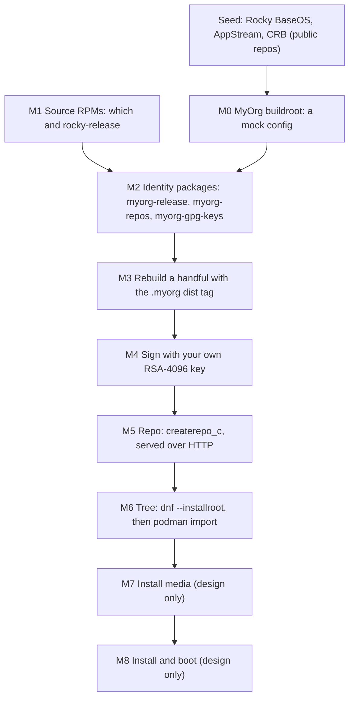
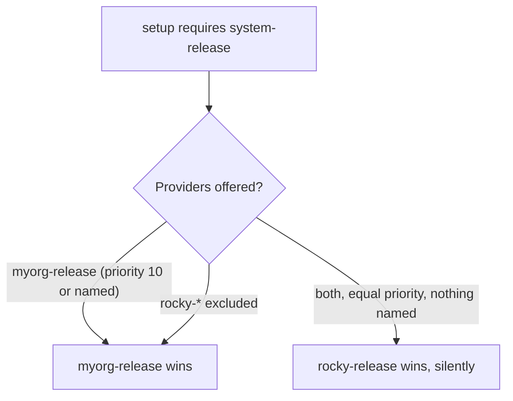

# 52 · Capstone: MyOrg lab

<ul class="module-meta">
  <li>⏱ ~7 hours</li>
  <li>5 labs</li>
  <li>Builds on: 22 · Building RPMs, 47 · Trust I, 49 · Build your own packages and repository, 50 · Build your own build system, 51 · Build your own install media</li>
  <li>Environment: Tier C</li>
  <li>Verified: Rocky 10.2, 2026-11-07</li>
</ul>

Two machines can both say "Rocky Linux 10.2" and still differ in build host, signing key and bytes. Now you turn that around: you make a machine that says "MyOrg Lab Linux", keep almost every package from Rocky, replace the few that carry the name, sign your own work, and prove with a script what changed and what did not.

You have already built the small versions of this in modules 49 to 51: a signed repo, a build system, install media. The capstone runs them as one line. The only new idea is the front of the machine: the three packages that decide what it calls itself, and what happens when your name meets the seed's.

<div class="pipeline-strip" data-here="none" role="group" aria-label="Rocky build pipeline, six stages" markdown>

1. Source
2. Build
3. Sign
4. Compose
5. Publish
6. Install

</div>

*You are here: the whole pipeline in miniature (no single stage lit). Before: module 51, install media. After: module 53, the field exam.*

!!! abstract "What you'll learn"
    - Scope a distribution project honestly: rebuild a handful of packages, keep the rest from a seed repository.
    - Write three small packages (`myorg-release`, `myorg-repos`, `myorg-gpg-keys`) that carry a distribution's identity, and say what each one owns.
    - Predict and measure what happens when your release package meets `rocky-release`: file conflicts, a silent wrong choice, and the fix.
    - Rebuild packages with your own dist tag, sign them with your own key and serve them as a repo that a consumer checks with `gpgcheck=1`.
    - Build a tree with `dnf --installroot`, import it as a container image and prove its identity.
    - Run `capstone-check.sh`, read its 28 checks, and explain the final diff between Rocky's `which` and yours.
    - Say what you did not build or test (media, install, boot, Secure Boot, logos) and why.

## The big picture

A distribution is mostly other people's work. Rocky is built from upstream sources, and almost every package in a rebuild of Rocky is the same package you would get from Rocky. What makes it a different distribution is small: a few packages that name it, a key that signs your own work, and a repository that serves both.

So the capstone has a scoping rule, stated up front. **You rebuild a handful of packages and keep the other roughly 2,200 source packages (2026-11) from the seed repository.** Rebuilding all of them is a project, not a lab. The lab rebuilds `which` and a tiny library plus consumer pair, and takes the remaining packages as the seed built them.

!!! note "Remember from 21"
    A Rocky system's identity sits in three small packages: `rocky-release` (`/etc/os-release` and the release files), `rocky-repos` (the `.repo` files) and `rocky-gpg-keys` (the public keys). See [module 21](21-inside-rocky-linux.md). MyOrg writes its own three and keeps the seed's packages for everything else.

### The capstone in one sentence

> **MyOrg is Rocky's packages (the seed) plus three packages of your own that say who you are, a key that signs what you rebuilt, and a repository that serves both.**

The seed is an input, not part of your identity. Everything below hangs off that sentence: the three packages are the "who you are", the signing key is the "who vouches", and the repo is how a machine finds both.



The diagram shows nine milestones in order. The seed feeds your buildroot. Your buildroot builds the identity packages, then the rebuilds. You sign, publish and consume them, and the tree and image come last. M7 and M8 are drawn because they are the next steps, not because this module tested them.

### The milestones

Milestones M0 to M6 are required and all were built and tested together on a clean machine. M7 and M8 are stretch milestones. The Secure Boot item is written, not built.

| Milestone | What you deliver | Required or stretch | Tested |
|---|---|---|---|
| M0 Seed | A mock config that uses Rocky BaseOS, AppStream and CRB as seed repos and a buildroot whose identity is MyOrg | Required | Yes, x86_64, 2026-11-07 |
| M1 Source | `which` and `rocky-release` as SRPMs fetched from Rocky, hashes recorded | Required (Rocky path only) | Yes |
| M2 Rebrand | `myorg-release`, `myorg-repos`, `myorg-gpg-keys` from one spec | Required | Yes |
| M3 Rebuild | `which`, a library and a consumer built through mock with the `.myorg` dist tag | Required | Yes |
| M4 Sign | Your own RSA-4096 key, `rpmsign`, five OK lines from `rpm -Kv` | Required | Yes |
| M5 Repo | `createrepo_c`, served by Python, consumed with `gpgcheck=1` | Required (comps groups optional) | Yes, comps groups not tested |
| M6 Image | `dnf --installroot` tree, `podman import`, `podman run` | Required | Yes |
| M7 Media | Install media that carries the MyOrg repo | Stretch | Design, not a tested lab |
| M8 Install and boot | A MyOrg-branded image installed and booted in a VM | Stretch | Design, not a tested lab |
| Secure Boot | Two written sentences on why it is off, or how a key is enrolled | Required, written | Not applicable |

The evidence each tested milestone leaves is in the next table. The check ids are the ones `capstone-check.sh` prints.

| Milestone | Check ids | What the evidence line shows |
|---|---|---|
| M0 | M0.1, M0.2 | Three seed `baseurl` lines; `mock --shell` prints `ID=myorg` and `dist=.myorg` |
| M1 | M1.which, M1.rocky-release | SRPM signed by the seed key, hash equals the one you recorded |
| M2 | M2.1 to M2.8 | `system-release` provided, `ID="myorg"`, truthful `ID_LIKE`, `%distcore .myorg`, no seed brand in names |
| M3 | M3.which, M3.myorg-libgreet, M3.myorg-greeter, M3.devel | NVRs end in `.myorg`, binary and source |
| M4 | M4.0, M4.1, M4.2 | RSA-4096 key, five OK lines for every file, NOKEY with an empty keyring |
| M5 | M5.1, M5.2, M5.3 | dnf reads the repo with `gpgcheck=1` and `repo_gpgcheck=1`, signed `repomd.xml`, an unsigned package is refused |
| M6 | M6.1 to M6.6 | Tree identity, one `system-release` provider, no `rocky-*` package, `podman run` shows `ID="myorg"` |

### Choose a name that is yours

Neutral naming is part of the exercise. If you publish a rebuild under your own name, choose your own name and do not use Rocky, Red Hat or CentOS marks, logos or names. This is not legal advice.

The lab follows that rule in its mechanics. No package name, file path or `Provides` carries a seed brand, and check M2.6 fails the build if one does. The seed is named only where it is a fact: the `ID_LIKE` lineage, a "rebuilt from" line, the seed's repository URLs and the seed's public key file.

### The few things that solve most problems

| Situation | What to do | Where this module teaches it |
|---|---|---|
| A new tree or image says Rocky | `--exclude='rocky-*'` and name `myorg-release`; verify with `rpm -q --whatprovides system-release` | Worked story: the tree that said Rocky |
| An existing Rocky tree must become MyOrg | `dnf swap rocky-release myorg-release` (a plain `dnf install` fails with six file conflicts) | Worked story: replacing rocky-release |
| `Unable to detect release version` in a fresh installroot | Pass `--releasever=10` on the first transaction | M6 |
| Your rebuild must beat the seed's copy | `priority=10` on your repo, 99 on the seed, and do not rely on version order | M3 |
| dnf will not import your key unattended | Put `gpgkey=file://...` in the repo file and run with `-y` | M4 and M5 |
| You want to know whether you passed | Run `capstone-check.sh`: 28 checks, exit 0 | The verification script |

To pick one for a release package problem, first ask whether you are building something new (a tree, an image, a buildroot) or changing something that exists. New things get the exclude and the explicit name. Existing things get the swap.

### Words you'll see

| Word | Plain meaning |
|---|---|
| **seed** | The upstream repositories you take every package from that you did not rebuild (here Rocky BaseOS, AppStream and CRB) |
| **identity package** | A package that says what the system is called: release files, repo files, public keys |
| **`system-release`** | A capability that `setup` requires. Any package that provides it satisfies the dependency |
| **dist tag** | The suffix in a release number (`.el10_0`, `.myorg`) that comes from the `%dist` macro |
| **buildroot** | The clean chroot mock builds in. Its identity decides the dist tag |
| **installroot** | A directory that `dnf --installroot` fills like a fresh system, without touching the host |
| **repo priority** | A number on a repo. The lower number wins, even over a higher version |
| **`ID_LIKE`** | In `os-release`, an ordered list of the distributions yours is built like |
| **evidence bundle** | The PASS and FAIL lines of the checker, with a hash over them |

## The core skill: ask who provides system-release

The most useful question in this module is short: which package provides `system-release` in this tree, and what does its `os-release` say? A tree can look right and say Rocky, because nothing warns you which identity package dnf chose. Three commands answer it.

1. `sudo rpm --root TREE -q --whatprovides system-release` names the provider. There should be exactly one.
2. `grep -E '^(ID|ID_LIKE|PRETTY_NAME)=' TREE/etc/os-release` shows what the tree says about itself.
3. `sudo rpm --root TREE -qa --qf '%{NAME}\n' | grep -c '^rocky-'` counts seed identity packages by name. Count by name, not by a loose `grep rocky`, for a reason the third example shows.

Try to predict each answer before you open it. The outputs are real, from the lab.

**Example 1.** A fresh tree was built with two repos at equal priority, installing `bash setup`. Nothing else was named. This is what the tree reports:

```console
$ sudo rpm --root /var/tmp/m2-exp/D -q --whatprovides system-release
rocky-release-10.2-1.2.el10.noarch
$ head -2 /var/tmp/m2-exp/D/etc/os-release
NAME="Rocky Linux"
VERSION="10.2 (Red Quartz)"
```

Rocky 10.2 x86_64, 2026-11-07. The MyOrg repo was enabled and offered a provider too. What happened?

??? success "Answer: dnf chose the seed's identity package and told nobody"
    `setup` requires `system-release`. Both repos offered a provider and both had the same priority, so dnf picked one. It picked `rocky-release` and pulled in `rocky-repos` and `rocky-gpg-keys` with it. There was no warning, and the tree now says Rocky. The fix is in the worked story below.

**Example 2.** Same repos, but the tree was built with `--exclude='rocky-*'` and `myorg-release` named on the command line:

```console
$ sudo rpm --root /var/tmp/m2-exp/F -qa | grep -E 'rocky|myorg'
myorg-gpg-keys-10.2-1.myorg.noarch
myorg-release-10.2-1.myorg.noarch
myorg-repos-10.2-1.myorg.noarch
$ sudo rpm --root /var/tmp/m2-exp/F -q --whatprovides system-release
myorg-release-10.2-1.myorg.noarch
```

Rocky 10.2 x86_64, 2026-11-07. Is this tree clean?

??? success "Answer: yes, one provider and no seed identity package"
    Only the three MyOrg identity packages match, and `myorg-release` is the single provider of `system-release`. The explicit name satisfied `setup`, and the exclude kept every `rocky-*` package out of the transaction.

**Example 3.** A finished MyOrg tree, counted loosely and then by name:

```console
$ sudo rpm --root /var/tmp/m2-root -qa | grep -c rocky
11
$ sudo rpm --root /var/tmp/m2-root -qa --qf '%{NAME}\n' | grep -c '^rocky-'
0
```

Rocky 10.2 x86_64, 2026-11-07. Eleven matches, then zero. Is the tree wrong?

??? success "Answer: no, the eleven are seed packages that Rocky patched"
    The loose match finds packages such as `dnf-4.20.0-22.el10_2.rocky.0.1`. Their release field carries `.rocky.0.N` because the seed patched them. Those are the seed's own builds, not identity packages. The name-anchored count is the one that tests identity.

<div class="quiz" data-answer="2" markdown>

A tree built with two equal-priority repos has `rocky-release` as the only `system-release` provider. Which statement explains it?

- dnf prefers the package with the older version
- dnf had two valid providers, and with equal priority it picked the seed's without a warning
- `myorg-release` was missing a `Provides: system-release` line

Right: both release packages provide `system-release`, nothing broke the tie, and dnf prints no warning. A `Provides` line was present, which is why the explicit name or the exclude fixes it.

</div>

## M0 and M1: the seed and the source

Before you can build anything you need a buildroot, and before you need that you need the source of the packages you will change. Two small steps, both read from Rocky's public repositories.

### The seed buildroot

Your mock config is a standalone file, so every line is visible. Three things differ from the seed's own config, and each one matters:

```python title="mock/myorg-10-x86_64.cfg.in (excerpt)"
config_opts['use_bootstrap'] = False
config_opts['dist'] = 'myorg'   # only used in --resultdir substitution, NOT the %dist macro
config_opts['chroot_setup_cmd'] = 'install bash bzip2 coreutils cpio diffutils findutils gawk glibc-minimal-langpack grep gzip info patch redhat-rpm-config myorg-release rpm-build sed tar unzip util-linux which xz'
```

```ini title="dnf.conf section inside the mock config (excerpt)"
[main]
gpgcheck=1
module_platform_id=platform:el10
exclude=rocky-*

[myorg]
baseurl=http://localhost:@PORT@/myorg/10/x86_64/
priority=10

[seed-baseos]
baseurl=https://dl.rockylinux.org/pub/rocky/10/BaseOS/x86_64/os/
priority=99
```

1. `chroot_setup_cmd` installs `myorg-release` instead of the seed's release package. That one change is what puts your `macros.dist` into every buildroot.
2. `exclude=rocky-*` keeps the seed's identity packages out of the buildroot. Without it, dnf can pick `rocky-release` as the `system-release` provider (the worked story shows how).
3. `use_bootstrap = False` because mock's bootstrap image is a Rocky container with a Rocky identity, and nothing here needs it.

The full config also has `seed-appstream` and `seed-crb` sections, the same shape as `seed-baseos`, each with `gpgcheck=1` and a key file. `config_opts['dist']` is not the `%dist` macro. It only changes result directory names.

### The source

The source repos are disabled in the stock repo files, so you enable them for one command. You fetch `which` (the through-line package) and `rocky-release` (the model for your own release package):

<!-- ev: labs/final/06-capstone-m2 README 4.1; logs/06 | observed | Rocky 10.2 x86_64 VM, 2026-11-07 -->
!!! evidence "Observed: the seed publishes the SRPMs you need, signed"
    **Seen on:** Rocky 10.2 x86_64, 2026-11-07.

    ```console
    $ dnf -q download --source --enablerepo=baseos-source --enablerepo=appstream-source rocky-release which
    $ sha256sum *.src.rpm
    6dda257e2a19b090...a199  rocky-release-10.2-1.2.el10.src.rpm
    ae2be2e274d739f6...5078  which-2.21-44.el10_0.src.rpm
    ```

    The checker reads each SRPM's signature: both carry key id `5b106c736fedfc85`, and the hash must equal the one you recorded.

    **Check it yourself:** run the first command on any Rocky 10 system. Expect two `.src.rpm` files, and expect `rpm -qp --nosignature --qf '%{RSAHEADER:pgpsig}\n'` on each to name the Rocky 10 release key.

One snag is worth knowing. The source repo carried `rocky-release-10.2-1.2` while the images and the lab VM carried `-1.1`. The newer package ships a key file with two certificates, and GnuPG 2.4 rejects it with `packet(6) with unknown version 6`. The lab keeps only the first PGP block of the installed key file as the seed key (`sed -n '1,/END PGP PUBLIC KEY BLOCK/p'`) and prints its fingerprint, `FC22 6859 C086 0BF0 DDB9 5B08 5B10 6C73 6FED FC85`. RPMs themselves are RSA-signed, so the first block is all that verification needs. [Module 47](47-trust-signatures-and-keys.md) covers the two key files.

<!-- ev: labs/final/06-capstone-m2 README 4.1; ERRATA key file rulings | observed | Rocky 10.2 x86_64 VM, 2026-11-07 -->
!!! freshness "As of 2026-11-07 on Rocky 10.2"
    The repo carried `rocky-release-10.2-1.2` with a key file holding two certificates, while the VM image carried `-1.1` with one. The mechanism (a newer key file in the repo than in the image) is stable until a new image catches up. This changes at the next 10.2 image or the 10.3 release.

    **Re-check:** `rpm -q rocky-gpg-keys; wc -c /etc/pki/rpm-gpg/RPM-GPG-KEY-Rocky-10`

### The bootstrap order

The first identity package has to be built by somebody else's buildroot, because your own buildroot needs `myorg-release` and it does not exist yet. That order is a small loop, and the same loop sits under every distribution.

<div class="stepper" markdown>

<div class="step" data-title="Seed buildroot" markdown>

You build `myorg-release` with `mock -r rocky-10-x86_64 --rebuild`. This is the seed's stock buildroot, so it still carries the seed's `macros.dist`. The spec sets its own `%define dist .myorg`, and a define in the spec wins for this one build.

</div>

<div class="step" data-title="Sign and publish" markdown>

You sign the three packages with your key and publish them with `createrepo_c`. Now a repo exists that holds `myorg-release`, and a buildroot can install it.

</div>

<div class="step" data-title="MyOrg buildroot" markdown>

Your mock config installs `myorg-release` in `chroot_setup_cmd`. `mock --shell` in that root prints `ID="myorg"` and `dist=.myorg`. From here the buildroot is MyOrg, and nobody has to remember a `--define`.

</div>

<div class="step" data-title="Rebuild" markdown>

`which` and the library and consumer pair are built in the MyOrg buildroot. Their release fields end in `.myorg` because the dist tag comes from the buildroot.

</div>

<div class="step" data-title="Tree and image" markdown>

`dnf --installroot` installs the MyOrg packages and the seed packages into a directory, and `podman import` turns it into an image that says `ID="myorg"`.

</div>

</div>

The stepper shows five stages in order: seed buildroot, signed repo, MyOrg buildroot, rebuilds, tree and image. The identity package is the only thing built in a foreign buildroot, which is why Rocky's own first buildroot is an interesting question (see the unknown box).

## M2: three packages that say who you are

One SRPM builds three binary packages, the same shape as the real release SRPM. Keeping them in one spec keeps the `Requires:` between them trivial and teaches the subpackage pattern.

| Package | What it owns |
|---|---|
| `myorg-release` | `/usr/lib/os-release` (with `/etc/os-release` as a relative symlink), `/etc/myorg-release`, `/etc/system-release`, `/etc/redhat-release`, `/usr/lib/rpm/macros.d/macros.dist`, `/etc/issue.d`, `Provides: system-release` |
| `myorg-repos` | `/etc/yum.repos.d/myorg.repo`, `myorg-seed.repo`, and the dnf variables `myorg_baseurl` and `seed_baseurl` |
| `myorg-gpg-keys` | `/etc/pki/rpm-gpg/RPM-GPG-KEY-myorg` and `RPM-GPG-KEY-upstream-seed` |

The core of the spec is the list of capabilities. Other packages ask for these by name, so providing them is the whole point:

```bash title="specs/myorg-release.spec (excerpt)"
Name:           myorg-release
Version:        %{full_version}
Release:        1%{dist}
BuildArch:      noarch
Provides:       system-release = %{version}-%{release}
Provides:       system-release(releasever) = %{major}
Provides:       system-release(releasever_major) = %{major}
Provides:       system-release(releasever_minor) = %{minor}
Provides:       base-module(platform:el%{major})
Provides:       redhat-release = %{version}-%{release}
```

You can read the built result without installing anything:

<!-- ev: labs/final/06-capstone-m2 README 4.2; logs/07 | observed | Rocky 10.2 x86_64 VM, 2026-11-07 -->
!!! evidence "Observed: the release package provides the identity capabilities"
    **Seen on:** Rocky 10.2 x86_64, 2026-11-07.

    ```console
    $ rpm -qp --provides myorg-release-10.2-1.myorg.noarch.rpm
    base-module(platform:el10)
    …
    myorg-release = 10.2-1.myorg
    redhat-release = 10.2-1.myorg
    rpm_macro(dist)
    rpm_macro(distcore)
    rpm_macro(rhel)
    rpm_macro(myorg)
    …
    system-release = 10.2-1.myorg
    system-release(releasever) = 10
    ```

    **Check it yourself:** run the command on the built `myorg-release` RPM. The `rpm_macro(...)` lines come from rpm automatically, one per file in `macros.d`. They are why `rpm -q --whatprovides 'rpm_macro(dist)'` names the package that sets your dist tag.

The identity lives in two files. `os-release` says what the machine is, and `macros.dist` says what the dist tag is for every build:

```text
ID="myorg"
ID_LIKE="rocky rhel centos fedora"
PLATFORM_ID="platform:el10"
PRETTY_NAME="MyOrg Lab Linux 10.2 (Prototype)"
```

```text
%distcore .myorg
%rhel 10
%el10 1
%myorg 10
```

`ID` is yours. `ID_LIKE` is a search path, most specific first, that tools use to choose behaviour when they do not know your `ID`. Rocky's own `ID_LIKE` is `rhel centos fedora` (read on the Rocky 10.2 VM, 2026-11-07; see [module 21](21-inside-rocky-linux.md)), and the lab's `ID_LIKE` adds `rocky` at the front. `PLATFORM_ID` stays `platform:el10` because dnf's `module_platform_id` and several scripts use it. `%rhel 10` stays in the macros so `%if 0%{?rhel}` conditionals in other specs still behave.

!!! note "A choice of the lab author, not a rule: `ID_LIKE` and `redhat-release`"
    Two identity decisions in this kit are the lab author's, flagged for the course owner to confirm. First, `ID_LIKE="rocky rhel centos fedora"` names Rocky as a parent. It is a statement of fact (the packages are Rocky's), and it lets tools that know Rocky treat MyOrg as Rocky-like. The cost is that every tool which special-cases `rocky` will now do so for MyOrg, and an earlier fact-base suggestion was the shorter `rhel centos fedora`, which names no seed. Second, `Provides: redhat-release` and the `/etc/redhat-release` symlink (next fold) keep third-party packages installable, at the cost of putting a Red Hat name in your own package. Neither was tested against the alternative. Decide both on purpose for your own distribution.

<div class="layers" data-hint="Click a package to see what it owns and why." markdown>

<div class="layer" data-label="myorg-release" data-tag="identity" markdown>

**What it owns:** the release strings, `os-release`, the `redhat-release` and `system-release` compatibility names, `macros.dist` and the `/etc/issue.d` directory.

`console-login-helper-messages-issuegen` requires the path `/etc/issue.d`, so `myorg-release` owns that directory, copied from the real package's behaviour. `Provides: system-release` is what lets `setup` install.

</div>

<div class="layer" data-label="myorg-repos" data-tag="where" markdown>

**What it owns:** two repo files and two dnf variables. `myorg.repo` points at your repo with `priority=10`, and `myorg-seed.repo` points at the seed with `priority=99`.

The base URLs use `$myorg_baseurl` and `$seed_baseurl` from `/etc/dnf/vars`, so moving the repo changes one word, not the repo file. CRB is shipped disabled. Every repo has `gpgcheck=1`.

</div>

<div class="layer" data-label="myorg-gpg-keys" data-tag="who vouches" markdown>

**What it owns:** your public key and the seed's public key, under different file names.

The seed key must be in the tree, or `gpgcheck` for the roughly 120 seed packages cannot work once `rocky-gpg-keys` is excluded. A public key is not branding, but reusing the seed's key as your own signing key would be the mistake to avoid, so you generate your own.

</div>

<div class="layer" data-label="Left out on purpose" data-tag="not built" markdown>

**What the real package has that yours does not:** systemd presets, the `50-redhat.conf` sysctl defaults, the EULA, a man page, Secure Boot and IMA certificates, and logos.

A tree used as a container does not need presets. Logos and Secure Boot certificates get their own section below.

</div>

</div>

The layers show the three packages and a fourth bar for what you skipped. `myorg-release` is identity, `myorg-repos` says where packages come from, and `myorg-gpg-keys` says whose signatures to accept.

??? question "Why `Provides: redhat-release`, and how to remove it"
    EPEL-style release packages in other repositories require `redhat-release` by name, and many admin scripts read `/etc/redhat-release`. The lab keeps both so those packages install. It is a capability and a path, not branding. It was measured: nothing in BaseOS or AppStream requires `redhat-release`, only third-party repos do. `centos-release` is not provided, because only CentOS SIG repos use it.

    This is a product decision, so it is flagged as the lab author's choice. The trade-off: keeping it means EPEL-type packages install (the measured requirers were `epel-release`, `epel-rpm-macros` and `rpmfusion-free-release`), but your package carries a Red Hat name in a `Provides` and a path, which sits uneasily next to the neutral-naming rule above. Rocky's own release package also provides `redhat-release`, and `centos-release`, for the same compatibility reason. If you want a stricter reading, delete the `Provides: redhat-release` line and the `/etc/redhat-release` symlink, and accept that EPEL-type packages will not install. We did not test that variant.

??? question "Why `/etc/issue.d` and the other small choices"
    `/etc/issue.d` is owned because a package in the seed requires the path. `Release` is `1.myorg` and `Version` is `10.2`, the seed minor you track, and `VERSION_ID` uses the same string. The repo files use `baseurl` to the seed (no mirrorlist) to keep the lab deterministic. `repo_gpgcheck` is left off in the shipped repo files, although the repo does publish a signed `repomd.xml` and the checker tests it.

## Worked story: replacing rocky-release

**Symptom.** You have a tree with Rocky's identity in it, and you want it to become MyOrg. The obvious command fails.

**Evidence.** All of these runs used throwaway `--installroot` directories, so the shared VM's own identity was never touched. First the Rocky tree, then a plain install:

<!-- ev: labs/final/06-capstone-m2 README 4.3; logs/09 | observed | Rocky 10.2 x86_64 VM, 2026-11-07 -->
!!! evidence "Observed: a plain install of myorg-release hits six file conflicts"
    **Seen on:** Rocky 10.2 x86_64 throwaway installroot, 2026-11-07.

    ```console
    $ sudo dnf -y --installroot=$X/A --releasever=10 install myorg-release
    …
    Error: Transaction test error:
      file /etc/issue.net from install of myorg-release-10.2-1.myorg.noarch conflicts with file from package rocky-release-10.2-1.2.el10.noarch
      file /etc/redhat-release from install of myorg-release-… conflicts with file from package rocky-release-…
      file /etc/system-release from install of myorg-release-… conflicts with file from package rocky-release-…
      file /etc/system-release-cpe from install of myorg-release-… conflicts with file from package rocky-release-…
      file /usr/lib/os-release from install of myorg-release-… conflicts with file from package rocky-release-…
      file /usr/lib/rpm/macros.d/macros.dist from install of myorg-release-… conflicts with file from package rocky-release-…
    ```

    **Check it yourself:** Lab 2 reproduces it. Count the lines with `grep -c 'conflicts with file from package rocky-release'` on the saved output: expect 6.

**Reasoning.** Two packages own the same files, and rpm refuses to let one overwrite the other. The conflict is useful: it makes the two release packages mutually exclusive without any `Conflicts:` line. The question is how to move from one to the other on purpose.

**Fix.** `dnf swap` does it in one transaction. rpm allows the file overlap because the old owner is erased in the same transaction:

```console
$ sudo dnf -y --installroot=$X/A --releasever=10 swap rocky-release myorg-release
…
  Installing       : myorg-gpg-keys-10.2-1.myorg.noarch                     1/6
  Installing       : myorg-release-10.2-1.myorg.noarch                      2/6
  Installing       : myorg-repos-10.2-1.myorg.noarch                        3/6
  Erasing          : rocky-release-10.2-1.2.el10.noarch                     4/6
  Erasing          : rocky-repos-10.2-1.2.el10.noarch                       5/6
  Erasing          : rocky-gpg-keys-10.2-1.2.el10.noarch                    6/6
…
$ head -3 $X/A/etc/os-release | tail -1
ID="myorg"
```

**Check.** `rpm --root $X/A -qa | grep -E 'rocky|myorg'` lists only the three `myorg-*` packages, and `/etc/os-release` says `ID="myorg"`. The `rocky-repos` and `rocky-gpg-keys` packages left as "unused dependencies" once `rocky-release` went.

The runs on the same tree gave a whole table. Six variants and one dry run, all measured:

| # | Experiment | Real behaviour |
|---|---|---|
| A | Rocky tree, then `dnf install myorg-release` | Six file conflicts, nothing installed |
| B | Same tree, `dnf swap rocky-release myorg-release` | Works with no flags: installs three, erases three |
| E | Fresh tree, `install bash setup myorg-release` | Works, no Rocky identity package pulled in |
| F | Fresh tree, `--exclude='rocky-*'`, `install bash coreutils setup myorg-release` | Works, the only `system-release` provider is `myorg-release` |
| J-obs | Spec variant with `Obsoletes: rocky-release rocky-repos rocky-gpg-keys` and `redhat-release`, plain install | Works: dnf prints `Obsoleting` for the three seed packages |
| J-conf | Spec variant with `Conflicts: rocky-release`, plain install | Fails with `conflicts with rocky-release`; with `--allowerasing` it removes `rocky-release` and `rocky-repos` but leaves `rocky-gpg-keys` installed |
| host | `dnf --assumeno swap rocky-release myorg-release` on a live VM | Plan only: install 3, remove 3, no protected-package refusal |

<div class="decision" markdown>

<div class="node" data-id="start" markdown>

**Are you building a new tree, image or buildroot, or changing a system that already has Rocky's identity?**

<button data-goto="new">A new tree</button> <button data-goto="existing">An existing one</button>

</div>

<div class="node" data-id="new" markdown>

Keep Rocky's identity out from the start: pass `--exclude='rocky-*'`, name `myorg-release` in the install, and pass `--releasever=10` on the first transaction. Then check `rpm --root TREE -q --whatprovides system-release` for exactly one provider.

</div>

<div class="node" data-id="existing" markdown>

**Do you want every host that enables the MyOrg repo to migrate itself with a plain `dnf install`?**

<button data-goto="obs">Yes, one command for everyone</button> <button data-goto="swap">No, I will migrate on purpose</button>

</div>

<div class="node" data-id="obs" markdown>

Add `Obsoletes:` lines to the spec for `rocky-release`, `rocky-repos` and `rocky-gpg-keys` (all three, or the keys package is left behind). It works, but it makes `myorg-release` a seed-identity remover on any system that has your repo enabled. Add it only if migration is a product goal.

</div>

<div class="node" data-id="swap" markdown>

Use `dnf swap rocky-release myorg-release`. It was run for real in throwaway installroots and as a dry run on a live host. This is the lab's default answer, and the minimal spec carries no `Obsoletes` and no `Conflicts`.

</div>

</div>

The decision tree compresses the table into two questions: new or existing, and migrate on purpose or by obsoleting. If you skip it, remember the first branch, because it is the one that catches most people.

<!-- ev: labs/final/06-capstone-m2 README 4.3 and logs/11 | observed | Rocky 10.2 x86_64 VM, 2026-11-07 -->
!!! freshness "As of 2026-11-07 on Rocky 10.2"
    On this host dnf protects `grub2-efi-x64 grub2-pc grub2-tools-minimal selinux-policy-targeted setup shim-aa64 shim-arm shim-ia32 shim-x64 sudo systemd systemd-udev yum`. `rocky-release` is not on the list, so a swap is not refused by protection. The list is set by packages and changes when they do, usually at a minor release.

    **Re-check:** `cat /etc/dnf/protected.d/*.conf | sort -u | tr '\n' ' '`

??? question "Obsoletes versus Conflicts, and why the lab ships neither"
    The overlap in file ownership already makes the two release packages exclusive (experiment A). `dnf swap` handles a host that migrates, and `--exclude` handles a new tree. An `Obsoletes` adds silent one-command migration with a sharp edge: it turns `myorg-release` into a removal tool for the seed's identity on any machine with the MyOrg repo enabled.

    A `Conflicts: rocky-release` variant is worse than it looks. It fails on a plain install, and with `--allowerasing` it removes two of the three seed packages and leaves `rocky-gpg-keys`, because nothing conflicts with the keys package. If you add either, include all three seed packages. Neither variant was tested on a real booted host.

### What depends on the seed's identity packages

You can measure how much the identity packages are depended on, and the answer is small. This is why a tree with no `rocky-*` package in it works at all. The results come from `dnf repoquery --whatrequires` on BaseOS and AppStream, 2026-11-07:

| Capability or path | Who requires it | What it means for MyOrg |
|---|---|---|
| `system-release` | `setup` only | Any provider works, so `myorg-release` must provide it |
| `rocky-release` by name | `rocky-repos` only (`setup` and `console-login-helper-messages-issuegen` appear through a capability or the path `/etc/issue.d`) | A tree with no `rocky-repos` has no need of it |
| `redhat-release` | Nothing in BaseOS or AppStream | Kept for third-party repos, see the fold above |
| `system-logos` | `gdm`, `gnome-session`, `plymouth-graphics-libs`, `anaconda-gui`, `lorax-lmc-novirt` and others | Our minimal tree has none of them, so no logos are shipped |

<div class="quiz" data-answer="3" markdown>

You run a plain `dnf install myorg-release` on a Rocky tree and get six file conflicts. What is the cleanest fix for an existing tree?

- Add `--nogpgcheck` to the install
- Delete `/etc/os-release` by hand and try again
- `dnf swap rocky-release myorg-release`, which erases the old owner in the same transaction

Right: rpm allows overlapping files when the old owner goes in the same transaction. Deleting files by hand leaves the database wrong, and the conflict has nothing to do with signatures.

</div>

## Worked story: the tree that said Rocky

**Symptom.** You build a fresh tree, install `bash` and `setup`, and the result says "Rocky Linux" even though your MyOrg repo is enabled and healthy.

**Evidence.** Experiment D (equal priority, nothing named) and D2 (your repo at priority 10, the seed at 99) differ only in repo priority:

<!-- ev: labs/final/06-capstone-m2 README 4.3; logs/09 and logs/10 | observed | Rocky 10.2 x86_64 VM, 2026-11-07 -->
!!! evidence "Observed: equal priority silently picks the Rocky identity package"
    **Seen on:** Rocky 10.2 x86_64 throwaway installroot, 2026-11-07.

    ```console
    $ sudo dnf -y --installroot=$X/D --releasever=10 install bash setup
    …
     rocky-gpg-keys           noarch   10.2-1.2.el10            seed-baseos    25 k
     rocky-release            noarch   10.2-1.2.el10            seed-baseos    26 k
     rocky-repos              noarch   10.2-1.2.el10            seed-baseos    13 k
    …
    $ sudo rpm --root $X/D -q --whatprovides system-release
    rocky-release-10.2-1.2.el10.noarch
    ```

    With `myorg-local` at priority 10 and the seed at 99 (experiment D2) the answer flips to `myorg-release-10.2-1.myorg.noarch`.

    **Check it yourself:** Lab 2 builds both trees. Compare the `whatprovides` line for D and D2.

**Reasoning.** `setup` requires `system-release`. Two repos offer a provider. With equal priority dnf has no rule to prefer yours, so it picks the seed's, and it tells you nothing. Priority alone decides, and a priority-only fix has a cost: you now depend on a number in a repo file for your own identity.

**Fix.** Name the package you want and exclude the one you do not. An explicit `myorg-release` satisfies `setup`'s requirement (experiment E), and `--exclude='rocky-*'` stops every seed identity package from entering the transaction (experiment F). The exclude also catches `rocky-logos`, `rocky-sb-certs` and the rest of the seed's `rocky-*` names, which is what you want in a tree with its own identity.

**Check.** `rpm --root TREE -q --whatprovides system-release` prints a single line that starts `myorg-release`, and `grep ^ID= TREE/etc/os-release` prints `ID="myorg"`.



The diagram shows one dependency and three outcomes. Naming your package, or excluding the seed's, or giving your repo a lower priority number each lead to MyOrg. Doing none of them lets the seed's package win without a message.

??? version "Comparison lens: a repo with only one release package"
    A stock Rocky tree never meets this problem, because only one repo offers `system-release`. The problem exists the moment you add a second source of the same capability, which is every derivative's situation. Nothing in dnf tells you the choice was ambiguous. **Check it yourself:** build a tree from two repos that both provide `system-release` and read `rpm -q --whatprovides system-release`.

## M3: a dist tag and a handful of rebuilds

With a MyOrg buildroot, every package you rebuild picks up `.myorg` automatically. There are two tested ways to get the tag, and they build the same bytes.

| Way | How | Result |
|---|---|---|
| A | The seed's stock buildroot with `mock -r rocky-10-x86_64 --define 'dist .myorg' --rebuild ...` | `which-2.21-44.myorg.x86_64.rpm` |
| B | Your MyOrg buildroot, where `macros.dist` from `myorg-release` sets the tag | The same file name and the same `PAYLOADDIGEST` |

Use B. The buildroot then is MyOrg, nobody has to remember a flag, and the same file sets `%rhel 10`, so `%if 0%{?rhel}` conditionals in other specs behave. A third way, `config_opts['macros']['%dist']` in the mock config, appears in a comment in the config and was not tested.

```console
$ mock -r $M/mock/myorg-10-x86_64.cfg --shell 'cat /etc/os-release | head -4; rpm -qa | grep -E "myorg|rocky" | sort; rpm -E "dist=%{dist} rhel=%{rhel} myorg=%{?myorg} el10=%{?el10}"; rpm -q --whatprovides system-release'
NAME="MyOrg Lab Linux"
VERSION="10.2 (Prototype)"
ID="myorg"
ID_LIKE="rocky rhel centos fedora"
…
myorg-gpg-keys-10.2-1.myorg.noarch
myorg-release-10.2-1.myorg.noarch
myorg-repos-10.2-1.myorg.noarch
…
dist=.myorg rhel=10 myorg=10 el10=1
myorg-release-10.2-1.myorg.noarch
```

Rocky 10.2 x86_64, 2026-11-07. The library and consumer pair shows why order matters. Built alone, the consumer fails, because its `BuildRequires` lives in a library that is not in any repo yet. `mock --chain --localrepo` builds them in order:

```console
$ mock -r $M/mock/myorg-10-x86_64.cfg --rebuild …/myorg-greeter-1.0-1.myorg.src.rpm
No matching package to install: 'myorg-libgreet-devel'
$ mock -r $M/mock/myorg-10-x86_64.cfg --chain --localrepo=$M/repo-local …/myorg-libgreet-….src.rpm …/myorg-greeter-….src.rpm
INFO: Success building myorg-libgreet-1.0-1.myorg.src.rpm
INFO: Success building myorg-greeter-1.0-1.myorg.src.rpm
INFO: Packages built: 2
```

### The dist tag is a sort order, so use priority

A repo with a priority of 10 beats a repo with a priority of 99 even if the 99 repo has the higher version. And the dist tag is only a string. Rocky's `which` is `2.21-44.el10_0` and yours is `2.21-44.myorg`:

<!-- ev: labs/final/06-capstone-m2 README 5 item 5; logs/16 | observed | Rocky 10.2 x86_64 VM, 2026-11-07 -->
!!! evidence "Observed: .myorg sorts newer than .el10_0 only by alphabet"
    **Seen on:** Rocky 10.2 x86_64, 2026-11-07. The two expressions below were re-run verbatim on the Rocky VM by an independent reviewer on 2026-11-07 and printed the same values.

    ```console
    $ rpm --eval '%{lua:print(rpm.vercmp("2.21-44.myorg","2.21-44.el10_0"))}'
    1
    $ rpm --eval '%{lua:print(rpm.vercmp("2.21-44.aaa","2.21-44.el10_0"))}'
    -1
    ```

    A return of 1 means the first argument is newer. A tag that sorts below `el10_0` loses to the seed's copy.

    **Check it yourself:** run both lines on any Rocky 10 system. The first prints 1 and the second prints -1, because `m` sorts after `e` and `a` sorts before it.

So your rebuild "wins" over the seed's copy by luck of the letter `m`. A tag such as `.aaa` would lose. The design answer is `priority=10` for the MyOrg repo and 99 for the seed, so the rebuild wins on purpose. Priority also beats version in the other direction: in a variant test with two MyOrg repos, dnf installed `myorg-release-10.2-1` from the priority-10 repo and ignored the newer `-2` elsewhere. When you publish a fix, bump the release in the repo with the priority, and disable other repos when testing variants.

<div class="quiz" data-answer="1" markdown>

Why does `2.21-44.myorg` compare newer than `2.21-44.el10_0` in rpm's version comparison?

- By alphabet: `m` sorts after `e`, so the comparison happens to favour your tag
- Because rpm knows that MyOrg rebuilds replace Rocky's
- Because the build time of your package is later

Right: rpm compares the strings, nothing more. That is why the lab sets repo priorities instead of trusting the tag.

</div>

## M4 and M5: sign and publish

Rebuilt packages need a signature that a consumer can check, and a repo that serves them. You generate an RSA-4096 key, sign every file, make the repo metadata and sign that too. The key has no passphrase because this is a lab. A real key lives on an HSM or an offline host, which is the part of Rocky's pipeline you cannot copy (see the unknown box).

```bash
gpg --batch --pinentry-mode loopback --passphrase "" --quick-generate-key "$KEYNAME" rsa4096 sign never
rpmsign --define "_gpg_name $KEYNAME" --addsign *.rpm
createrepo_c .
gpg --batch --yes --armor --detach-sign -u "$KEYNAME" repodata/repomd.xml
```

Pass the key name with `--define`, not through `~/.rpmmacros`. The lab's early sign script wrote `%_gpg_name` into the user-global file and overwrote another person's setting on a shared host.

<!-- ev: labs/final/06-capstone-m2 README 4.5; logs/16; capstone-check M4.1 M4.2 | observed | Rocky 10.2 x86_64 VM, 2026-11-07 -->
!!! evidence "Observed: five OK lines with the key, NOKEY without it"
    **Seen on:** Rocky 10.2 x86_64, 2026-11-07. Key id and file names differ on every run.

    ```console
    $ rpm -Kv myorg-release-10.2-1.myorg.noarch.rpm
        Header V4 RSA/SHA256 Signature, key ID 7334ac47: OK
        Header SHA256 digest: OK
        Header SHA1 digest: OK
        Payload SHA256 digest: OK
        MD5 digest: OK
    $ rpm --dbpath /tmp/emptydb -Kv myorg-release-10.2-1.myorg.noarch.rpm
        Header V4 RSA/SHA256 Signature, key ID 7334ac47: NOKEY
    ```

    **Check it yourself:** run `rpm -Kv` with the key imported into a throwaway `--dbpath` and again with an empty one. With no key the first line is `NOKEY` and the other four stay OK, because digests do not need a key. NOKEY is not BAD.

The checker uses a throwaway rpm database so your host keyring is never touched. [Module 47](47-trust-signatures-and-keys.md) explains what the five lines prove and what they do not.

A consumer that checks signatures is the point of the exercise. The repo is served by `python3 -m http.server 8080 --bind 127.0.0.1` and read with `gpgcheck=1` and `repo_gpgcheck=1`. A negative control proves the consumer refuses an unsigned package:

```console
$ sudo dnf -y … --installroot=$TMPD/uroot install myorg-gpg-keys
Package myorg-gpg-keys-unsigned.rpm is not signed
```

Two consumer behaviours surprise people:

- With `gpgkey=file://...` in the repo file and `-y`, dnf imports your key by itself and prints `Importing GPG key ... Key imported successfully`. That is an unattended opt-in, and it is why a repo with an unknown key "just works" the first time.
- Without `-y` and with nobody to answer the key prompt (cron, CI), dnf stops with `Error: Refusing to automatically import keys when running unattended.` The lab's demo pipes a `y` into dnf's first prompt, so it reaches the key step on x86_64. With standard input at end of file, dnf stops one step earlier at `Is this ok [y/N]: Operation aborted.` instead ([module 49](49-build-your-own-packages-and-repo.md) shows that run).

A tampered package shows the other half. Flip one payload byte and keep the signature: the header signature line stays OK while the payload digest lines go BAD. The signature covers the header, and a digest in the header protects the payload.

<div class="quiz" data-answer="2" markdown>

`rpm -Kv` on your package prints `NOKEY` on the signature line and OK on the four digest lines. What does that mean?

- The package was tampered with
- The package is intact, but the key that signed it is not in the keyring you used
- The package is unsigned

Right: NOKEY says rpm cannot verify the signature because the key is missing. An unsigned package would show no signature line at all, and tampering shows BAD on the digests.

</div>

## M6: a tree, an image, a container

The last required milestone uses everything. You install the MyOrg packages and the seed's packages into a directory, import it as an image and run it. The command uses the tested flags exactly:

```bash
sudo dnf -y --installroot=$TREE --releasever=10 --setopt=reposdir=$M/repos.d --exclude='rocky-*' \
  --setopt=install_weak_deps=False --setopt=tsflags=nodocs \
  install bash coreutils dnf rpm rootfiles which myorg-release myorg-repos myorg-gpg-keys myorg-greeter
```

`--releasever=10` is required on the first install, because an installroot with no release package inside has no `$releasever` and dnf stops with `Unable to detect release version (use '--releasever' to specify release version)`. After `myorg-release` is inside, `dnf --installroot=$TREE repolist` finds `$releasever` on its own. The `reposdir` here is the bootstrap repo file the host's dnf needs before `myorg-repos` exists: the tree gets its own repo files from `myorg-repos`, but dnf needs some repo definition to download that package first.

<!-- ev: labs/final/06-capstone-m2 README 4.6; logs/13 and logs/20 | observed | Rocky 10.2 x86_64 VM, 2026-11-07 -->
!!! evidence "Observed: the tree and the image say MyOrg"
    **Seen on:** Rocky 10.2 x86_64, 2026-11-07. The transaction installed 121 packages (52 MB download, 186 MB installed).

    ```console
    $ sudo rpm --root $TREE -q --whatprovides system-release
    myorg-release-10.2-1.myorg.noarch
    $ sudo dnf -q --installroot=$TREE repolist
    myorg   MyOrg 10 - x86_64
    seed-appstream   Seed (upstream) AppStream 10 - x86_64
    seed-baseos      Seed (upstream) BaseOS 10 - x86_64
    $ sudo podman run --rm localhost/myorg-base:10 cat /etc/os-release | grep -E '^ID'
    ID="myorg"
    ID_LIKE="rocky rhel centos fedora"
    $ sudo podman run --rm localhost/myorg-base:10 bash -c 'rpm -q myorg-release which myorg-greeter; greeter'
    myorg-release-10.2-1.myorg.noarch
    which-2.21-44.myorg.x86_64
    myorg-greeter-1.0-1.myorg.x86_64
    hello from libgreet 1.0
    ```

    **Check it yourself:** Lab 4 builds it. Expect the identity on the tree, in the tree's own repo files and inside the container.

Both signing keys were imported by dnf itself, yours and the seed's, because each repo file has `gpgkey=file://...` and the run used `-y`. The image comes from `tar --numeric-owner --xattrs -C $TREE -cf myorg-root.tar .` and `podman import`: a 227 MB tar became a 237 MB image. The tree's own repo files work inside the container with `--network=host`.

Count what is yours (2026-11-07 run). Of the 121 packages, 115 are the seed's own builds, and six are ours: `myorg-release`, `myorg-repos`, `myorg-gpg-keys`, `which`, `myorg-libgreet` and `myorg-greeter`. The identity packages are ours. The rest is Rocky's bits under a different name, which is exactly why the `myorg-release-upstream` file says "Rebuilt from Rocky Linux 10.2 sources".

The checker prints a slightly larger number, `0 of 123 packages` on check M6.3, because it counts with `rpm --root $TREE -qa`. dnf reported 121 installed packages, and the other two entries are the public keys that dnf imported into the tree's rpm database (yours and Rocky's), which rpm lists as `gpg-pubkey` entries. 121 plus 2 is 123. The lab's own listing of the tree's keyring shows exactly those two keys, and the same effect shows on any host (the Rocky VM listed 768 entries from `rpm -qa` and 766 once its two `gpg-pubkey` entries were removed from the count). We did not re-count the finished tree itself.

<!-- ev: labs/final/06-capstone-m2 README 4.6 pitfall 15 | observed | Rocky 10.2 x86_64 VM, 2026-11-07 -->
!!! freshness "As of 2026-11-07 on Rocky 10.2"
    Eleven packages in the tree carry `.rocky.0.N` in their release (for example `dnf-4.20.0-22.el10_2.rocky.0.1`, `libdnf`, `elfutils`, `systemd-libs`). They are the seed's own patched builds, not identity packages. The count changes whenever the seed patches or stops patching a package, so expect it to drift.

    **Re-check:** `sudo rpm --root $TREE -qa | grep -c rocky`

??? question "SELinux and the tree"
    The host was enforcing. `tar --xattrs` of the tree, `podman import` and `podman run` all worked with no denial and no relabel step. The tree has no `selinux-policy`, so inside the container nothing is enforced. A bootable tree would need a policy and a relabel. That was not tested.

## What you will not build

Three things are deliberately missing, and two milestones are design only. The honest way to handle them is to say so.

### Logos

There is no `myorg-logos`. The desktop and installer stack needs a `system-logos` provider (the table above names `gdm`, `anaconda-gui` and others), and nothing in M0 to M6 does. A logo is where trademark mistakes happen. If you later add a graphical installer, ship a text-only logos package with your own artwork.

### Secure Boot: a written item

The capstone explains Secure Boot and does not build it. The real `rocky-sb-certs` package is a list of vendor certificates that the seed's signed shim, grub and kernel chain to. A rebuild that keeps the seed's binaries cannot sign anything with a MyOrg certificate, and one that re-signs them needs a shim submission, which is a project of its own. The checker prints a note and does not score it.

The written rubric item is two sentences. Here is a model answer to compare yours with:

??? success "Model answer: why Secure Boot is off, or how a key gets enrolled"
    Secure Boot stays off for MyOrg, because the shim, grub and kernel that boot under Secure Boot chain to certificates held by the seed's builders, and a MyOrg rebuild has no certificate the firmware trusts. The honest options are to disable Secure Boot in the VM, or to enroll a MyOrg key through the machine owner key (MOK) path of a signed shim, which is a per-machine choice and not a distribution-wide answer.

    Our reading: the MOK route is general knowledge about shim and was not tested here. [Module 29](29-secure-boot-and-drivers.md) and [module 48](48-trust-secure-boot-and-reproducibility.md) cover the chain and the dated facts.

### M7 and M8: design, not a tested lab

!!! warning "Design, not a tested lab"
    M7 (media that carries the MyOrg repo) and M8 (install and boot a MyOrg-branded image) were not built or tested. Everything in this subsection is a design note. The tree from M6 is a container-style tree: it has no kernel, no bootloader, no `/etc/fstab`, no initramfs, no machine-id or root password, and none of the presets the release package would add. It is not bootable by construction.

The nearest evidence is the stock-ISO boot test, which used Rocky's own packages and no MyOrg identity at all. In that test (2026-11), a lorax plus mkksiso ISO installed 249 packages unattended over serial into a qcow2 under QEMU TCG in about 51 minutes, and the qcow2 booted to a login prompt in about 2 minutes. Rocky 10 needs `-cpu max` under TCG for x86-64-v3. A login was not typed. See [module 43](43-installer-and-install-media.md) for the anatomy of the media and [module 51](51-build-your-own-install-media.md) for the tested build and boot.

What a MyOrg ISO would add, from the measurements above:

1. The installer picks its configuration from `os-release` `ID` through `/etc/anaconda/profile.d/<id>.conf`. `ID=myorg` has no matching profile, so a `myorg.conf` profile would be needed.
2. The `anaconda-gui` and `lorax` packages are built around the seed's `system-release` name, and `lorax-lmc-novirt` requires `system-logos`.
3. The mini repo has to hold the installer, kernel, bootloader and `@core` closure, which is hundreds of megabytes.
4. A bootable tree needs a kernel, a bootloader, an initramfs, a policy and a relabel.

None of these steps was tried. If you try them, your transcript is your evidence, and the rubric asks you to label it as such.

## The verification script and the dossier diff

`capstone-check.sh` checks milestones M0 to M6 and prints the dossier diff. It never rebuilds, signs or publishes. It uses a throwaway rpm database and dnf cache, and `sudo` only to inspect the tree and run podman. It prints one line per check, `PASS` or `FAIL` with an id and the evidence, and ends with a hash over those lines and an exit code of 0 only if every check passed.

<!-- ev: labs/final/06-capstone-m2 STATUS.md; logs/21-evidence-final.txt | observed | Rocky 10.2 x86_64 VM, 2026-11-07 -->
!!! evidence "Observed: the gate passes, 28 of 28"
    **Seen on:** Rocky 10.2 x86_64 clean VM, scrubbed MyOrg mock root, new key, 2026-11-07. The scripted run from an empty directory took 387 s with the optional experiments.

    ```console
    $ M=$HOME/m2 bash capstone-check.sh
    PASS M0.2 buildroot is a MyOrg buildroot (mock --shell prints identity and dist): myorg-release-10.2-1.myorg.noarch dist=.myorg ID=myorg
    PASS M2.6 no seed-branded package names, file paths, logos or Provides: checked names, file lists and Provides of 3 packages
    PASS M4.1 rpm -Kv prints five OK lines for every package (11 files): …
    PASS M5.3 negative control: gpgcheck=1 refuses an unsigned package: Package myorg-gpg-keys-unsigned.rpm is not signed
    PASS M6.2 only myorg-release provides system-release in the tree: myorg-release-10.2-1.myorg.noarch
    NOTE  SB  Secure Boot is a written rubric item, not checked here: …
    …
    RESULT: 28 passed, 0 failed.  evidence-bundle sha256 (pass/fail lines) = <hash>
    ```

    **Check it yourself:** Lab 5 runs it. Expect exit 0 and `RESULT: 28 passed, 0 failed.` The key id and the hash differ on every run, because each clean run generates a new key.

A checker is only worth trusting if it can fail. This one was tested for false passes by pointing it at a missing tree and a missing image. It then failed five or six checks and exited 1. That test found one false PASS, M6.3 passing on an empty tree, which was fixed and re-run. Two of the checks are negative controls on purpose (M4.2 expects NOKEY with an empty keyring, M5.3 expects an unsigned package to be refused), because a check that cannot fail proves nothing.

<!-- ev: labs/final/06-capstone-m2 README 2 and logs/20 | observed | Rocky 10.2 x86_64 VM, 2026-11-07 -->
!!! freshness "As of 2026-11-07 on Rocky 10.2"
    The run used mock 6.9, dnf 4.20.0 and rpm 4.19.1.1. The check ids and the pass count are stable for this kit, but any of these tools or the seed repos can change an outcome. This changes at a minor release.

    **Re-check:** `rpm -q mock rpm; dnf --version | head -1`

### The dossier diff

The checker ends with the capstone moment: Rocky's `which` beside yours. The build host and key id are yours and differ every run. The last line here is condensed (the checker prints one `file` row per path), and the other columns are the lesson:

```text
field          | Rocky (seed)                                   | MyOrg (our rebuild)
NVRA           | which-2.21-44.el10_0.x86_64                    | which-2.21-44.myorg.x86_64
SOURCERPM      | which-2.21-44.el10_0.src.rpm                   | which-2.21-44.myorg.src.rpm
BUILDHOST      | ord1-prod-x86build007.svc.aws.rockylinux.org   | <your build host>
BUILDTIME      | Wed 06 Aug 2025 06:54:42 AM UTC                | Sat 07 Nov 2026 12:41:59 AM UTC
signature      | 5b106c736fedfc85                               | <your key id>
PAYLOADDIGEST  | 0895052a64e967f4...                            | a378d7efd7ffb172...
VENDOR         | Rocky Enterprise Software Foundation           | (none)
file /usr/bin/which   DIFFERENT 6a8821502b51 vs d6819a7e761a      (the other 9 regular files identical)
```

Read the table as a list of what a distribution's identity is made of. The NVRA and source RPM name differ only in the dist tag. The build host, build time and signing key differ because a different machine built the package at a different time and a different key signed it. The vendor is empty because yours sets none.

One regular file differs: `/usr/bin/which`. The nine other regular files (the profile scripts, docs, info page, licence and man page) are byte-identical. The binary differs because your buildroot is today's seed toolchain, while Rocky's `which` was built in August 2025 with an older one. Earlier labs pinned a vault buildroot and `--define 'dist .el10_0'` and got an identical `/usr/bin/which`. That pinned path was not re-run in this capstone, and the checker makes no reproducibility claim: it shows what differs. [Module 48](48-trust-secure-boot-and-reproducibility.md) and [module 49](49-build-your-own-packages-and-repo.md) cover the pinned rebuild.

## Scoring: the rubric

There is no server, so the criteria are local and honest. A pass is M0 to M6 passing in `capstone-check.sh` on a clean machine, and a rubric score of at least 16 of 20.

| Criterion | 4 points | 2 points | 0 points |
|---|---|---|---|
| Correctness (M0 to M6) | All checks pass on a clean VM | One fails after a retry | More than one fails |
| Rebrand quality (M2) | `os-release`, release, repos and keys are all neutral; `ID_LIKE` is truthful | One Rocky string is left in an identity file | The tree claims to be Rocky |
| Trust (M4, M5) | Signed, `gpgcheck=1`, key delivered out of band, you can explain what the signature proves | Signed but checked with `--nogpgcheck` | Unsigned |
| Evidence and dossier | Complete final diff, annotated | Partial | Missing |
| Honest scoping | States what was not built or tested, labels the Secure Boot choice, the naming sentence is present | Partial | Overclaims |

The fifth row is where most of the learning is. A capstone that says "M7 and M8 are design, not tested" and shows the Secure Boot sentence outscores one that claims a bootable distribution and cannot show it.

<div class="quiz" data-answer="3" markdown>

Which milestones did the course team test on a clean machine before publishing this module?

- M0 to M8
- M0 to M5, plus M7
- M0 to M6; M7 and M8 are design only

Right: the gate covers M0 to M6. The nearest evidence for M7 and M8 is the stock-ISO install and boot test in modules 43 and 51, which used no MyOrg identity.

</div>

<div class="terminal-sim" data-title="Read the identity of the finished tree" data-prompt="[alex@lab m2]$ " markdown>

<div class="task" data-expect="sudo rpm --root /var/tmp/m2-root -q --whatprovides system-release||rpm --root /var/tmp/m2-root -q --whatprovides system-release" data-match="^(sudo )?rpm --root [^ ]+ -q --whatprovides system-release$" data-hint="rpm --root points rpm at the tree, -q --whatprovides asks who provides a capability." markdown>

**Step 1.** Ask which package provides `system-release` in the tree at `/var/tmp/m2-root`.

```text
myorg-release-10.2-1.myorg.noarch
```

</div>

<div class="task" data-expect="sudo grep ^ID= /var/tmp/m2-root/etc/os-release||grep ^ID= /var/tmp/m2-root/etc/os-release" data-match="^(sudo )?grep '?\^ID='? /var/tmp/m2-root/etc/os-release$" data-hint="Grep the line that starts with ID= in the tree's os-release." markdown>

**Step 2.** Show the `ID=` line of the tree's `os-release`.

```text
ID="myorg"
```

</div>

<div class="task" data-expect="sudo podman run --rm localhost/myorg-base:10 cat /etc/os-release||podman run --rm localhost/myorg-base:10 cat /etc/os-release" data-hint="Run the image once, remove it afterwards, and cat the file." markdown>

**Step 3.** Print `/etc/os-release` from inside the imported image `localhost/myorg-base:10`.

```text
NAME="MyOrg Lab Linux"
VERSION="10.2 (Prototype)"
ID="myorg"
ID_LIKE="rocky rhel centos fedora"
…
```

</div>

<div class="task" data-expect="sudo rpm --root /var/tmp/m2-root -qa --qf '%{NAME}\n' | grep -c '^rocky-'||rpm --root /var/tmp/m2-root -qa --qf '%{NAME}\n' | grep -c '^rocky-'" data-match="grep -c '\^rocky-'" data-hint="List package names with --qf, then count the ones that start with rocky-." markdown>

**Step 4.** Count the seed identity packages (names starting `rocky-`) in the tree.

```text
0
```

</div>

</div>

!!! unknown "What nobody outside the project can tell you"
    - How the very first Rocky 10 buildroot for x86_64 and aarch64 was seeded. I found no public description. Your capstone answers it for MyOrg (the first identity package is built in somebody else's buildroot), but that is not Rocky's answer. Not public.
    - How Rocky's release packages are signed, and where its signing keys live. The public record shows the result (key ids, signing times), not the mechanism or custody. The capstone key sits in a directory on your disk, which is the part you cannot copy from Rocky. Not public.
    - Whether an Anaconda profile for `ID=myorg`, a `myorg.conf`, is enough for an installer to run, whether a MyOrg image boots, and whether `Obsoletes` behaves on a live booted host. Not tested, in the same sense as M7 and M8.
    - Not tested either: comps groups in the repo, `config_opts['macros']['%dist']`, the pinned-buildroot reproduction of `which` inside this capstone, and aarch64. Only x86_64 was run.

## Labs

The labs run the tested kit in order. Get the capstone kit from the [lab kits](lab-kits.md) page (kit 06, with a `README.txt`) and put it in one directory so that `specs/`, `src/`, `scripts/`, `mock/` and `capstone-check.sh` sit together, then work from `~/m2`.

```bash
mkdir ~/m2 && cp -r specs src scripts mock capstone-check.sh ~/m2/ && cd ~/m2
export M=$HOME/m2
```

You need a user in group `mock`, passwordless `sudo`, and the packages `mock rpm-build rpm-sign createrepo_c podman gnupg2 python3` (mock comes from EPEL, see [module 22](22-building-rpms.md)). The lab needs internet access to `dl.rockylinux.org`.

!!! tip "The one-command version"
    `M=$HOME/m2 bash scripts/run-all.sh --experiments` runs every step from an empty directory and ends with the checker. On the clean VM it took 387 s: the experiments (04 to 06) took about 171 s of that and the checker about 9 s. Do the labs one at a time first, so each result means something.

!!! lab "Lab 1: Build and publish the identity packages (M0 to M2)"

    - **Tier** C: root VM
    - **Status** Tested
    - **Time** about 20 s of scripted work (6 s for step 1, 10 s for step 2, 1 s for step 3, measured with a cached seed buildroot)
    - **Hardware** 4 vCPU, 8 GiB RAM or more, 10 GB free in `/var/tmp` and `/var/lib/mock` (tested on 4 vCPU, 15 GiB)
    - **Tested on** Rocky 10.2 x86_64 VM, 2026-11-07

    **Goal:** Fetch the seed's source RPMs, make your own signing key, build `myorg-release`, `myorg-repos` and `myorg-gpg-keys` from one spec, sign them and serve them.

    **You'll need:** The kit in `~/m2`, `export M=$HOME/m2`, internet to the seed repos.

    1. Fetch the two SRPMs, generate the RSA-4096 key and render the mock config:

        ```bash
        bash scripts/01-fetch-and-keys.sh
        ```

    2. Build the three identity packages in the seed's stock buildroot (the bootstrap step):

        ```bash
        bash scripts/02-build-release.sh
        ```

    3. Sign them, create the repo and start the Python server:

        ```bash
        bash scripts/03-sign-publish.sh $M/result/release/*.rpm
        ```

    **Check your work:** Run `rpm -qp --provides $M/result/release/myorg-release-10.2-1.myorg.noarch.rpm | grep -E '^system-release'`. Expect `system-release = 10.2-1.myorg` and `system-release(releasever) = 10`. Run `curl -fsS -o /dev/null -w "http %{http_code}\n" http://localhost:8080/myorg/10/x86_64/repodata/repomd.xml` and expect `http 200`. If the provides line is missing, the spec build failed: read the mock log in the result directory. If the curl fails, the server is not running: run step 3 again.

    ??? success "What just happened?"
        The first identity package was built by the seed's buildroot, because yours needs `myorg-release` and it did not exist. The spec's own `%define dist .myorg` won over the seed's `macros.dist` for that build. You then signed three files and published them, so the next lab has a repo that carries your release package.

    **Clean up:** Stop the server with `pkill -f '[h]ttp.server 8080'`. Remove your work, including the signing key, with `rm -rf $M`. Remove only your own mock root with `mock -r $M/mock/myorg-10-x86_64.cfg --scrub=all` (run it before deleting `$M`). The seed's stock root stays in place; reclaim its disk with `mock -r rocky-10-x86_64 --scrub=all`.

!!! lab "Lab 2: Replace rocky-release and watch what happens (M2 deep dive)"

    - **Tier** C: root VM
    - **Status** Tested
    - **Time** about 171 s of scripted work (79 s, 90 s and 2 s, measured on the clean run)
    - **Hardware** 4 vCPU, 8 GiB RAM or more, 10 GB free in `/var/tmp`
    - **Tested on** Rocky 10.2 x86_64 VM, 2026-11-07

    **Goal:** Reproduce the file conflicts, the working swap, the silent wrong provider and the fix, in throwaway installroots. This lab is optional for the checker but is the heart of the module.

    **You'll need:** Lab 1 finished and the server still running. The host's own identity is never touched.

    1. Run the conflict experiments (they use `sudo` for the installroots) and keep the output:

        ```bash
        sudo -E env M=$M HOME=$HOME bash scripts/04-conflict-experiments.sh 2>&1 | tee $M/exp04.log
        ```

    2. Run the second set (priorities, `releasever`, the `Obsoletes` and `Conflicts` variants):

        ```bash
        sudo -E env M=$M HOME=$HOME bash scripts/05-more-experiments.sh 2>&1 | tee $M/exp05.log
        ```

    3. See what a swap would do on this live host without doing it (`--assumeno`):

        ```bash
        bash scripts/06-host-dryrun.sh
        ```

    **Check your work:** Run `grep -c 'conflicts with file from package rocky-release' $M/exp04.log` and expect `6`. Run `sudo rpm --root /var/tmp/m2-exp/D -q --whatprovides system-release` and expect a `rocky-release` package. Run the same on `/var/tmp/m2-exp/F` and expect `myorg-release`. In `exp05.log` expect `Obsoleting` for three seed packages in the `obs` variant and a `conflicts with rocky-release` error in the `conf` variant. If D prints `myorg-release`, your repos are not at equal priority.

    ??? success "What just happened?"
        Experiment A failed on six files because two packages own them. B succeeded because rpm lets the old owner leave in the same transaction. D chose the seed's identity because nothing broke the tie. F fixed it with an exclude and an explicit name. The host dry run printed a plan of install 3 and remove 3 and aborted. Nothing on the host changed.

    **Clean up:** `sudo rm -rf /var/tmp/m2-exp $M/variants`. The experiment scripts leave your Lab 1 repo alone.

!!! lab "Lab 3: Rebuild with the .myorg dist tag (M0 buildroot and M3)"

    - **Tier** C: root VM
    - **Status** Tested
    - **Time** about 140 s (cold MyOrg buildroot 38 s, `which` two ways 29 s and 27 s, the chain 36 s, measured on the clean run)
    - **Hardware** 4 vCPU, 8 GiB RAM or more, 10 GB free in `/var/lib/mock`
    - **Tested on** Rocky 10.2 x86_64 VM, 2026-11-07

    **Goal:** Create the MyOrg buildroot, rebuild `which` two ways, and build a library and its consumer through a chain.

    **You'll need:** Lab 1 finished and the server running, because the MyOrg buildroot installs `myorg-release` from your repo.

    1. Run the rebuild script:

        ```bash
        bash scripts/07-rebuild.sh
        ```

    **Check your work:** The script's `mock --shell` section must print `ID="myorg"` and `dist=.myorg rhel=10 myorg=10 el10=1`. Run `ls $M/result/which/*.rpm` and expect `which-2.21-44.myorg.x86_64.rpm`. The two `payload=` lines the script prints for the define way and the buildroot way must be identical. The consumer built alone must fail with `No matching package to install: 'myorg-libgreet-devel'`, and the chain must print `Packages built: 2`. If the two payload digests differ, one of the builds used a different buildroot: check that the MyOrg config, not the seed's, built the second one.

    ??? success "What just happened?"
        Your buildroot installed `myorg-release`, so rpm read your `macros.dist` and every rebuild got `.myorg`. Setting the tag with `--define` in the seed's buildroot gave the same bytes, but only the MyOrg buildroot removes the need to remember the flag. The chain built the library first and fed its `-devel` package to the consumer's build through a local repo.

    **Clean up:** `rm -rf $M/result/which $M/result/which-defineA $M/result/pair $M/result/greeter-fail $M/repo-local $M/rpmbuild-pair`, then `mock -r $M/mock/myorg-10-x86_64.cfg --scrub=all`.

!!! lab "Lab 4: Publish, build the tree and import the image (M4 to M6)"

    - **Tier** C: root VM
    - **Status** Tested
    - **Time** about 49 s (signing and repo under 3 s, the 121-package install, the tar, and a 6 s to 7 s `podman import`, measured on the clean run)
    - **Hardware** 4 vCPU, 8 GiB RAM or more, 10 GB free in `/var/tmp`
    - **Tested on** Rocky 10.2 x86_64 VM, 2026-11-07

    **Goal:** Sign everything you built, publish one repo, install a tree from it with `gpgcheck=1`, import the tree as an image and run it. Then watch the trust failures.

    **You'll need:** Labs 1 and 3 finished. The script uses `sudo` for the installroot, tar and podman.

    1. Publish, build the tree, import and run the image:

        ```bash
        bash scripts/08-publish-and-image.sh
        ```

    2. Run the failure demos: NOKEY, a missing `gpgkey=`, an unattended key import, a tampered byte, and the version comparison:

        ```bash
        bash scripts/09-failure-demos.sh
        ```

    **Check your work:** Run `sudo podman run --rm localhost/myorg-base:10 cat /etc/os-release | grep -E '^ID'` and expect `ID="myorg"`. Run `sudo rpm --root /var/tmp/m2-root -q --whatprovides system-release` and expect one line, `myorg-release-10.2-1.myorg.noarch`. In the demo output expect a `NOKEY` signature line with four OK digests, then `Refusing to automatically import keys when running unattended.`, then `BAD` digest lines for the tampered file. If the tree says Rocky, check that the install used `--exclude='rocky-*'`.

    ??? success "What just happened?"
        The tree got its identity, repo files and keys from your own packages, and the seed's packages for everything else. dnf imported both keys because the repo files point at them and the run used `-y`. The image is the tree turned into a container filesystem. The demos showed the other side of trust: NOKEY means no key, BAD means the bytes changed, and an unattended import is an opt-in.

    **Clean up:** `sudo rm -rf /var/tmp/m2-root /var/tmp/m2-fail`, `sudo podman rmi -f localhost/myorg-base:10`, and `rm -f $M/myorg-root.tar`.

!!! lab "Lab 5: Run the checker and read the dossier diff"

    - **Tier** C: root VM
    - **Status** Tested
    - **Time** about 9 s (measured on the clean run)
    - **Hardware** 4 vCPU, 8 GiB RAM or more
    - **Tested on** Rocky 10.2 x86_64 VM, 2026-11-07

    **Goal:** Score your own capstone with the script, and read the diff between Rocky's `which` and yours.

    **You'll need:** Labs 1, 3 and 4 finished, the server running, and the tree and image still in place.

    1. Run the checker:

        ```bash
        M=$HOME/m2 bash capstone-check.sh
        echo "exit=$?"
        ```

    **Check your work:** The last lines should read `RESULT: 28 passed, 0 failed.` and `exit=0`. Find the `file` row for `/usr/bin/which` in the diff and expect `DIFFERENT`, with the other regular files `identical`. A `FAIL` line names the milestone and the evidence, so fix that milestone and re-run. The script copies its output to `$M/capstone-evidence.txt`.

    ??? success "What just happened?"
        The checker re-read your artifacts and never rebuilt anything. It tested your packages, signatures, repo, tree and image with positive checks, and two negative controls proved that a missing key gives NOKEY and that an unsigned package is refused. Check M2.6 scans names, file paths and `Provides` for a seed brand and would fail the build. The diff then showed that your `which` and Rocky's differ in every identity field and in one binary.

    **Clean up:** Nothing new is created apart from `$M/capstone-evidence.txt`. Keep it for the dossier, then clean up the earlier labs.

## Common pitfalls

| Symptom | Cause | Fix |
|---|---|---|
| `dnf install myorg-release` on a Rocky tree fails with six file conflicts | Both release packages own `/usr/lib/os-release`, `macros.dist`, `/etc/system-release` and more | `dnf swap`, or build the tree with `--exclude='rocky-*'` and name `myorg-release` |
| A tree built without the exclude has a Rocky `os-release` | Equal-priority repos, `setup` needs `system-release`, dnf chose `rocky-release` and said nothing | `--exclude='rocky-*'` or `priority=`; verify with `rpm -q --whatprovides system-release` |
| `Unable to detect release version` in a fresh installroot | No release package inside the root yet | `--releasever=10` on the first transaction |
| `Error: Refusing to automatically import keys when running unattended.` | `gpgkey=` is set, there is no `-y` and no terminal | Use `-y`, or import first with `rpm --import` |
| `You have enabled checking of packages via GPG keys...` and a failure | `gpgcheck=1` and no `gpgkey=` line, nothing imported | Add `gpgkey=file:///etc/pki/rpm-gpg/RPM-GPG-KEY-...` |
| `rpm -Kv` first line `NOKEY`, other four OK | The key is not in the keyring you used | `rpm --import KEY`; the checker uses a throwaway `--dbpath` on purpose |
| `gpg --show-keys` fails with `packet(6) with unknown version 6` | The seed's newer key file has a version 6 block, and GnuPG 2.4 rejects it | Take the first PGP block only: `sed -n '1,/END PGP/p'`. RPMs are RSA-signed |
| `Macro expanded in comment` four times during `rpmbuild` | rpm expands macros inside spec comments | Write `%%define` in comments, or reword |
| `config_opts['dist']` does not change `%dist` | It is only used in result directory names | Put `myorg-release` in `chroot_setup_cmd`, or pass `--define` |
| `rpm -qa \| grep -c rocky` prints 11 in the MyOrg tree | Seed packages patched by Rocky carry `.rocky.0.N` | Count by name: `grep -c '^rocky-'` |
| `Permission denied` writing `repos.d/lab.repo` on a re-run | Experiments under `sudo` made the directory root-owned | The scripts `chown` it back; do the same by hand |
| `ssh host 'cmd &'` never returns | A background `http.server` keeps the session open | `setsid -f ... </dev/null >log 2>&1` |

!!! pitfall "The tree says Rocky and nothing warned you"
    Symptom: `/etc/os-release` in a fresh tree says Rocky Linux while your repo is enabled. Cause: two repos offered `system-release` at equal priority. Fix: `--exclude='rocky-*'`, name `myorg-release`, then confirm with `rpm --root TREE -q --whatprovides system-release`. The check is cheap and it is the first thing to run on any derived tree.

!!! pitfall "Priority beats version, in both directions"
    A priority-10 repo wins over a priority-99 repo even when the other has a higher version. In a variant test, dnf installed `myorg-release-10.2-1` from the priority-10 repo instead of the newer `-2`. When you publish a fix, bump the release in the repo that has the priority, and use `--disablerepo` when testing variants.

!!! pitfall "Do not write your signing name into ~/.rpmmacros on a shared host"
    `%_gpg_name` there is global to the user. An early version of the sign script overwrote another lab's value on a shared machine. Pass `--define "_gpg_name ..."` to `rpmsign` instead. The scripts never touch `~/.rpmmacros`.

## Cheat sheet

| Command | What it does |
|---|---|
| `rpm --root TREE -q --whatprovides system-release` | Names the identity package of a tree. There should be one |
| `grep -E '^(ID\|ID_LIKE\|PRETTY_NAME)=' TREE/etc/os-release` | Shows what the tree says about itself |
| `dnf swap rocky-release myorg-release` | Replaces the seed's release package with yours in one transaction |
| `dnf --installroot=TREE --releasever=10 --exclude='rocky-*' install ... myorg-release` | Builds a tree that never meets the seed's identity |
| `dnf download --source --enablerepo=baseos-source --enablerepo=appstream-source PKG` | Fetches the SRPM from Rocky's source repos |
| `mock -r $M/mock/myorg-10-x86_64.cfg --rebuild X.src.rpm` | Rebuilds in the MyOrg buildroot, so the tag is `.myorg` |
| `mock -r CFG --chain --localrepo=DIR A.src.rpm B.src.rpm` | Builds dependent packages in order through a local repo |
| `rpmsign --define "_gpg_name NAME" --addsign *.rpm` | Signs packages without touching `~/.rpmmacros` |
| `createrepo_c .` then `gpg --armor --detach-sign repodata/repomd.xml` | Builds repo metadata and signs it |
| `rpm --dbpath DB -Kv FILE` | Checks a file against a throwaway keyring |
| `rpm -qp --provides FILE` | Shows what a built package provides, including `rpm_macro(...)` |
| `tar --numeric-owner --xattrs -C TREE -cf root.tar .` then `podman import` | Turns a tree into a container image |
| `M=$HOME/m2 bash capstone-check.sh` | Runs the 28 checks and prints the dossier diff |

## Facts and freshness

Every dated fact in this module, in one place.

| Fact | Value (dated) | Re-check | Stale when |
|---|---|---|---|
| M2 gate result | 28 of 28 checks, 387 s scripted run, 2026-11-07 | `M=$HOME/m2 bash capstone-check.sh` | Seed repo or tool change |
| Seed release package | `rocky-release-10.2-1.2` in the repo, `-1.1` in the image, 2026-11-07 | `rpm -q rocky-gpg-keys` | New image or 10.3 |
| Tree size | 121 packages, 52 MB download, 186 MB installed, 2026-11-07 | `sudo rpm --root $TREE -qa --qf '%{NAME}\n' \| grep -vc '^gpg-pubkey$'` | Seed repo updates |
| Seed packages with `.rocky.0.N` | 11 in the tree, 2026-11-07 | `sudo rpm --root $TREE -qa \| grep -c rocky` | The seed patches a package |
| Protected packages | The list in the evidence above, 2026-11-07 | `cat /etc/dnf/protected.d/*.conf` | A minor release |
| Tool versions | mock 6.9, dnf 4.20.0, rpm 4.19.1.1, 2026-11-07 | `rpm -q mock rpm` | A minor release |
| Boot test of the stock ISO | 249 packages, about 51 min install, about 2 min boot, 2026-11 | See module 51 | Any change in the lab |
| Seed source packages | about 2,200: 2,199 distinct source names across BaseOS, AppStream and CRB on x86_64, re-counted 2026-11-07 | `dnf -q repoquery --disablerepo='*' --enablerepo=baseos --enablerepo=appstream --enablerepo=crb --qf '%{sourcerpm}\n' \| sed -E 's/-[^-]+-[^-]+\.src\.rpm$//' \| sort -u \| wc -l` | The seed repos change |
| Packages counted in the tree | dnf: 121 installed; `rpm -qa`: 123 (121 plus two `gpg-pubkey` key entries), 2026-11-07 | `sudo rpm --root $TREE -qa \| wc -l` | Seed repo updates |

## Flashcards

<div class="flashcards" markdown>

<div class="card" markdown>

What is the scoping rule of the capstone?

Rebuild a handful of packages and keep the other roughly 2,200 source packages (2026-11) from the seed repo. Rebuilding everything is a project.

</div>

<div class="card" markdown>

Which three packages carry MyOrg's identity?

`myorg-release` (os-release, release files, `macros.dist`, `Provides: system-release`), `myorg-repos` (repo files, dnf vars) and `myorg-gpg-keys` (your key and the seed's key).

</div>

<div class="card" markdown>

Why does a plain `dnf install myorg-release` fail on a Rocky tree?

Six file conflicts with `rocky-release`: both own `/etc/issue.net`, `/etc/redhat-release`, `/etc/system-release`, `/etc/system-release-cpe`, `/usr/lib/os-release` and `macros.dist`.

</div>

<div class="card" markdown>

What is the clean way to build a tree with only your identity?

`--exclude='rocky-*'` and name `myorg-release` in the install, then check `rpm --root TREE -q --whatprovides system-release`.

</div>

<div class="card" markdown>

What does dnf do when two repos at equal priority both provide `system-release`?

It picks one without a warning. In the lab it picked `rocky-release`, and the tree said Rocky.

</div>

<div class="card" markdown>

Why does `.myorg` beat `.el10_0` in version comparison?

Only by alphabet: `m` sorts after `e`. A tag like `.aaa` would lose, so set repo priorities.

</div>

<div class="card" markdown>

Why is the first identity package built in somebody else's buildroot?

Your own buildroot needs `myorg-release` installed, and it does not exist until you build it.

</div>

<div class="card" markdown>

Which milestones are tested, and which are design only?

M0 to M6 are tested (28 of 28 checks). M7, install media with the MyOrg repo, and M8, install and boot of a MyOrg image, are design, not a tested lab.

</div>

</div>

## Recap

!!! recap "Key takeaways"
    - A distribution is mostly its seed. The capstone rebuilds a handful of packages and keeps the rest from the seed repo.
    - Three packages carry identity: `myorg-release`, `myorg-repos` and `myorg-gpg-keys`. `setup` is the only seed package that requires `system-release`.
    - Plain `dnf install myorg-release` on a Rocky tree fails with six file conflicts. `dnf swap` works, and `--exclude='rocky-*'` plus the explicit name is the clean way for a new tree.
    - Equal-priority repos silently pick `rocky-release` as the `system-release` provider. Verify every derived tree with `rpm --root TREE -q --whatprovides system-release`.
    - The `.myorg` tag sorts newer than `.el10_0` only by alphabet. Use repo priorities, and remember that priority beats version.
    - You sign with your own key and serve a repo that a consumer checks with `gpgcheck=1`. NOKEY means no key, BAD means changed bytes.
    - M0 to M6 are tested and the checker passes 28 of 28. M7, M8, logos and Secure Boot are design or written items, and saying so is part of the score.

## Add to your dossier

!!! example "Dossier entry"
    Add a section headed `## 52 · Final diff` to `~/dossier/which.md`. Paste the dossier diff block that `capstone-check.sh` prints, starting at the line that begins `field` (it is also saved in `$M/capstone-evidence.txt`). It sets Rocky's `which` beside the `which` you rebuilt.

    1. The block: NVRA, source RPM, build host, build time, signature key id, payload digest, vendor and the per-file hashes.
    2. One sentence in your own words: which fields prove that two packages with the same version are different builds, and which single file differs?
    3. One sentence on what the diff does not prove: it makes no reproducibility claim, and the binary differs because your buildroot is today's toolchain.

    **A good entry proves:** the identity of a package is its build facts and its signing key, not its version, and a rebuild from the same source is a different artifact with its own provenance.

## Go deeper

- [[man:os-release(5)]] [[man:rpm(8)]] [[man:dnf(8)]] [[man:mock(1)]] [[man:rpmsign(8)]]
- [os-release specification](https://www.freedesktop.org/software/systemd/man/latest/os-release.html) for `ID`, `ID_LIKE` and `PLATFORM_ID`.
- [Mock documentation](https://rpm-software-management.github.io/mock/) for config options and `--chain`.
- [DNF command reference](https://dnf.readthedocs.io/en/latest/command_ref.html) for `swap`, `--installroot`, `--exclude` and repo priority.
- The earlier modules you combined here: [40](40-how-an-os-gets-built.md), [41](41-anatomy-of-a-package.md), [42](42-what-is-inside-an-os.md), [43](43-installer-and-install-media.md), [47](47-trust-signatures-and-keys.md), [49](49-build-your-own-packages-and-repo.md), [50](50-build-your-own-koji.md) and [51](51-build-your-own-install-media.md).

**Next:** [53 · Field exam](53-field-exam.md)

*Verified on Rocky 10.2 (kernel 6.12.x on the lab VM), 2026-11-07. Re-verify trigger: Rocky 10.3 GA or a new `rocky-release` build in the seed.*
